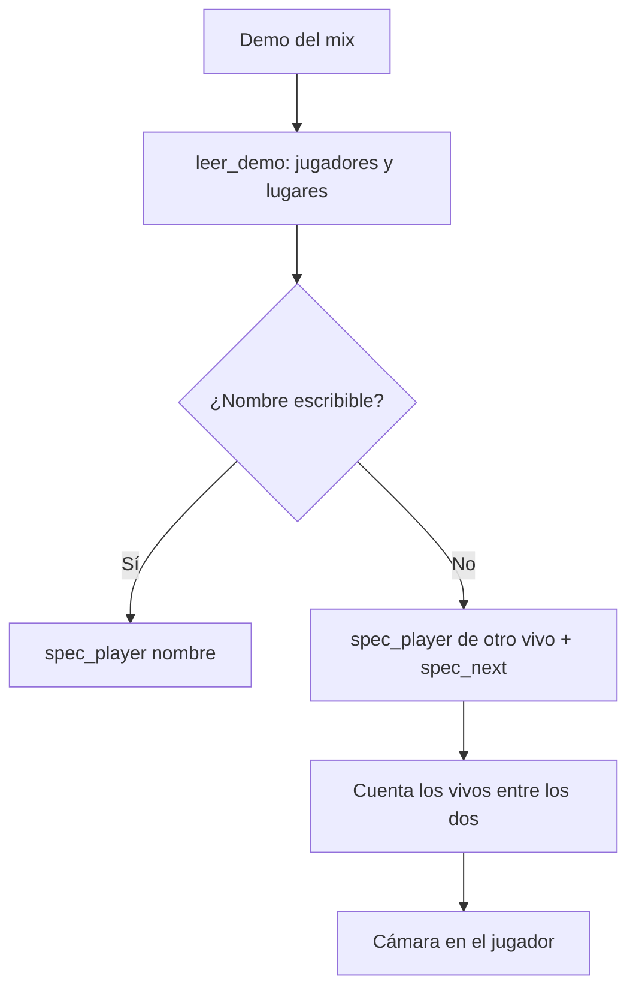

# Plan: clips con la cámara en otro jugador y el menú al final

> Planeación original. Estado: **pedido directo de Daniel (2026-10-29)**: revisar, corregir y pasar el script de reproceso. Es un arreglo de un error, así que este plan se escribió junto con el diagnóstico, antes de tocar el código.

## Decisiones tomadas

| Tema | Decisión | Por qué |
|---|---|---|
| Cámara en otro jugador | Corregir el lector de demos (`leer_demo.py`), no la forma de mover la cámara | `spec_target` está bien: llega con `spec_next` si el nombre no se puede escribir. Falla porque el lector no ve a los que se conectan durante el mix y cuenta mal los pasos |
| Largo de `svc_UpdateStringTable` | 16 bits | Con 16, la actualización de la tabla `userinfo` de la demo se lee entera y cierra justo en su largo (1079 bits). Con 20, el largo sale 525367 y se pierde el resto del paquete |
| Tick de los signon | 0 | Los signon traen un tick que no es de la grabación (234850 en una demo de 232332): el estado inicial quedaba "después" de todo lo demás |
| Menú al final | Cortar el tramo 0,1 s antes del último tick de la demo | La grabación termina con la última ronda: los 2 s de después no existen y se grababa el menú |
| Reproceso | `clip_reprocess` desde el SQL Editor, después de actualizar el portátil | La web nueva no salió todavía. Si se reprocesa antes, se graba otra vez con el error |

## 1. El flujo

El error está en B: si falta un jugador vivo, F cuenta un paso de menos y G cae en otro.

## 2. Cambios

- `render/leer_demo.py`: largo de 16 bits en `svc_UpdateStringTable`, tick 0 en los signon y sin las fichas `STEAM_ID_PENDING`.
- `render/render_clip.py`: `segments(..., last_tick)` corta en el final de la demo menos `END_MARGIN_SECONDS`.
- `render/procesar.py`: le pasa `playback_ticks` a `segments`.

## 3. Pruebas

- La demo del mix, con la versión vieja y la nueva: mismas rondas y kills, y en la nueva los nombres y lugares de los que se reconectaron.
- Los comandos de cámara de las dos jugadas.

## 4. Orden

1. Corregir y probar con la demo.
2. Actualizar `render/` en el portátil.
3. Reprocesar los dos clips y revisarlos.
