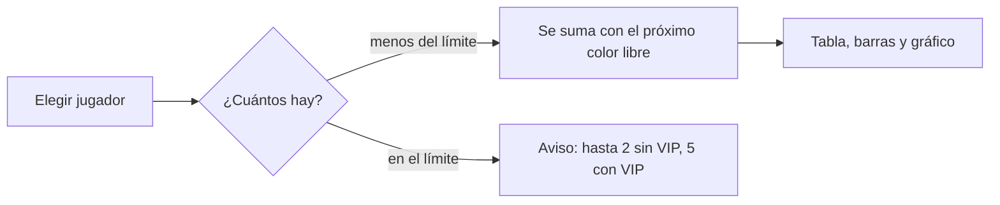

# Plan: Comparador de hasta 5 jugadores (VIP)

> Planeación original. Estado: **propuesta**, prototipo para pasarle a Daniel (backend) y a Esteban (frontend).

## Decisiones tomadas

| Tema | Decisión | Por qué |
|---|---|---|
| Dónde se ve | `/demo/comparador` del frontend nuevo, solo en `pnpm dev` | Patrón de los demás demos |
| Cuántos | Gratis 2, como el comparador actual de `/players/compare`; con VIP, hasta 5 | Kyan lo pidió de 5 en lugar de 3 |
| Métricas | Las del comparador actual (ELO, Rating, K/D, HS %, ADR, % de victorias y mixes) más ELO máximo | Son los mismos datos que la API ya devuelve para 2 |
| Vista | Tabla con un jugador por columna y el mejor de cada fila marcado, barras por métrica y gráfico de ELO con una línea por jugador | La tabla es la vista accesible del gráfico |
| Colores | Los 5 primeros colores categóricos validados (azul, naranja, aqua, amarillo y magenta), fijos por jugador | El color sigue al jugador aunque se saque a otro |
| URL | `?p=nick1,nick2,…` | Se comparte con un link |

## 1. El flujo

## 2. Lo que tendría que hacer cada uno

- **Daniel:** que `GET /api/v1/players/compare` acepte hasta 5 nicks (hoy recibe `a` y `b`) y chequee el VIP del lado del servidor.
- **Esteban:** llevarlo a `/players/compare`.

## 3. Orden de implementación

1. `features/compare5/demo.ts` y `features/compare5/MultiCompare.tsx`.
2. `routes/demo.comparador.tsx`.
