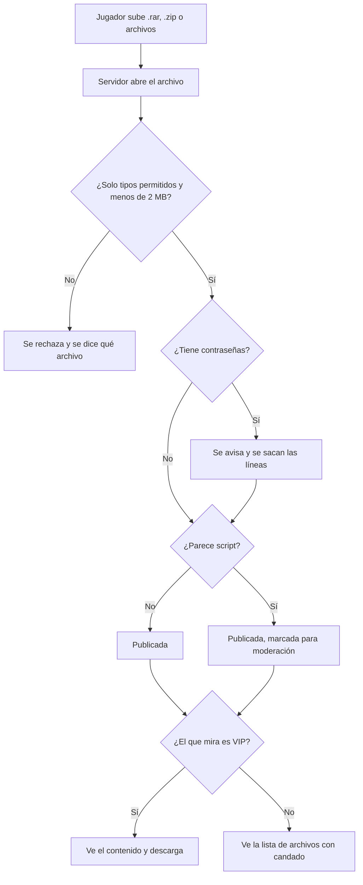

# Plan: Configs de los jugadores (subir para todos, descargar con VIP)

> Planeación original. Estado: **propuesta**, prototipo de Kyan para pasarle a Daniel (backend) y a Esteban (frontend, perfil).

## Decisiones tomadas

| Tema | Decisión | Por qué |
|---|---|---|
| Qué es | Una pestaña **Config** en el perfil de cada jugador: cualquiera sube la suya, solo los VIP descargan las de los demás | Lo pidió Kyan |
| Dónde se ve | `/demo/configs` del frontend nuevo, solo en `pnpm dev`. La pestaña es del perfil, así que la versión real la lleva Esteban | El perfil es de Esteban |
| Qué se sube | Un `.rar` o un `.zip` con la carpeta `cstrike/cfg`, o los archivos sueltos | Es como se comparten hoy |
| Qué se acepta adentro | Solo `.cfg`, `.vdf`, `.scr`, `.rc` y `.txt`; hasta 2 MB en total y 100 archivos | Un `.rar` puede esconder un `.exe` o un cheat |
| Contraseñas | Si un archivo tiene `rcon_password`, `password` o `sv_password` con un valor, se avisa antes de publicar y se sacan esas líneas | Muchos `config.cfg` y `autoexec.cfg` las guardan sin que el jugador lo sepa |
| Scripts | Si hay archivos o comandos típicos de scripts (`norecoil`, `aim`, alias con `+attack` en bucle, `wait`), la config queda marcada para moderación | Pueden estar prohibidos por el reglamento; lo decide un admin |
| Vista previa | Todos ven la lista de archivos, el tamaño y la fecha; los VIP además ven el contenido de cada archivo y descargan | Que se sepa qué hay antes de bajarlo |
| Una por jugador | Cada jugador tiene una config publicada; subir otra la reemplaza | Simple; el historial queda para después |
| Revisión real | En el prototipo, el `.zip` y los archivos sueltos se revisan en el navegador. El `.rar` lo tiene que abrir el servidor | El navegador no abre `.rar` sin una librería |

## Lo que tendría que hacer cada uno

- **Daniel:** el storage, la revisión del archivo en el servidor (abrir `.rar` y `.zip`, tipos, tamaño, contraseñas y scripts), las rutas para subir, ver y descargar con chequeo de VIP, y la cola de moderación.
- **Esteban:** la pestaña Config en el perfil.
- **Kyan o un admin:** qué scripts están prohibidos.
