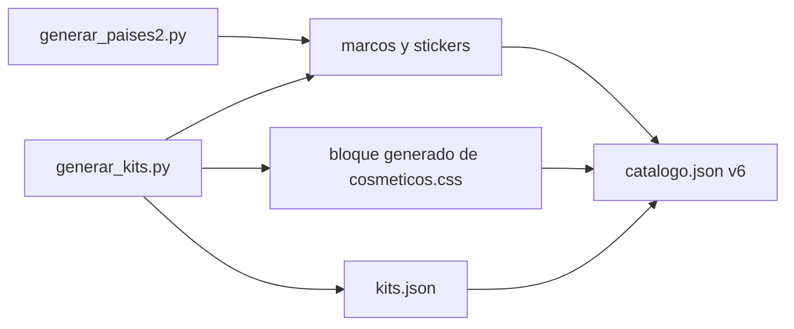

# Más de 300 cosméticos: documentación

## Qué hace

Suma 160 artículos en cuatro colecciones nuevas. El catálogo (`assets/perfil/catalogo.json`, versión 6) pasa de 148 a **308 artículos**, con la misma cantidad para todos que VIP en cada tipo.

| Tipo | Para todos | VIP |
|---|---|---|
| Marcos | 40 | 40 |
| Stickers | 38 | 38 |
| Temas | 38 | 38 |
| Nombres | 38 | 38 |

## Las siete colecciones

| `collection` | En la tienda | Para | Artículos | Dónde está |
|---|---|---|---|---|
| `cs` | Counter-Strike | Mitad y mitad | 68 | [`2026-10-28-cosmeticos-perfil`](../2026-10-28-cosmeticos-perfil/DOCUMENTACION.md) |
| `paises` | Sudamérica | Todos | 40 | [`2026-10-29-cosmeticos-colecciones`](../2026-10-29-cosmeticos-colecciones/DOCUMENTACION.md) |
| `series` | Series míticas (VIP) | VIP | 40 | [`2026-10-29-cosmeticos-colecciones`](../2026-10-29-cosmeticos-colecciones/DOCUMENTACION.md) |
| `paises2` | Latinoamérica y España | Todos | 40 | Acá |
| `mapas` | Mapas de CS:S | Todos | 40 | Acá |
| `arsenal` | Arsenal (VIP) | VIP | 40 | Acá |
| `series2` | Series míticas 2 (VIP) | VIP | 40 | Acá |

## Latinoamérica y España (`paises2`, para todos)

México, Costa Rica, Cuba, República Dominicana, Puerto Rico, Panamá, Guatemala, Honduras, El Salvador y España. Usan la misma plantilla que Sudamérica, con la bandera dentro del emblema. Los stickers dicen CHIDO, PURA VIDA, ASERE, KLK, WEPA, XOPA, CHILERO, CATRACHO, CHIVO y MOLA.

## Mapas de CS:S (`mapas`, para todos)

de_dust2, de_inferno, de_nuke, de_train, cs_office, de_aztec, de_cbble, cs_italy, de_piranesi y de_prodigy.

- **Marco:** la textura del mapa (arena, ladrillo, franjas de peligro, nieve, piedra, selva, tejas, vías o rejilla), el sitio A o B arriba y una placa con el nombre del mapa.
- **Sticker:** el cartel del sitio.
- **Tema:** el color de acento del mapa.
- **Nombre:** el acento arriba y el color base abajo.
- Son estáticos.

## Arsenal (`arsenal`, VIP)

| Arma | Acabado | Efecto extra |
|---|---|---|
| AK-47 | Lava | Pulso |
| M4A1 | Ártico | — |
| AWP | Relámpago | Destellos que corren |
| Deagle | Oro macizo | — |
| Scout | Selva | — |
| USP | Medianoche | Pulso |
| Glock | Caramelo | Destellos que corren |
| MP5 | Neón | Degradado que gira |
| Cuchillo | Fantasma | Pulso |
| HE | Arcoíris | Degradado que gira |

**Los acabados son nombres y diseños propios, sin nombres de skins de Valve.** Todos tienen un brillo que cruza el marco. El marco lleva el arma abajo y el acabado arriba. El sticker muestra el arma sobre una placa con brillo.

## Series míticas 2 (`series2`, VIP)

Homenajes originales, como la primera tanda: sin logos, personajes, nombres registrados ni frases textuales. Cada uno tiene un ícono dibujado de cero que flota en el marco y en el sticker. La serie de inspiración figura solo en esta tabla, no en el catálogo.

| `id` base | En la tienda | Inspirado en | Ícono | Sticker | Nombre |
|---|---|---|---|---|---|
| `dona` | Dona glaseada | Los Simpson | Dona con glaseado rosa | DONA | Glaseado |
| `zombi` | Apocalipsis zombi | The Walking Dead | Mano que sale de la tierra | ZOMBI | Podrido |
| `barril` | La vecindad | El Chavo del 8 | Barril de madera | VECINDAD | Barril |
| `fuga` | La fuga | Prison Break | Barrotes con uno doblado | FUGA | Tatuaje |
| `radiacion` | Reactor 4 | Chernobyl | Símbolo de radiación | REACTOR | Radiactivo |
| `vikingo` | Vikingo | Vikingos | Casco con cuernos | VALHALLA | Rúnico |
| `elementos` | Cuatro elementos | Avatar: la leyenda de Aang | Cuatro círculos de colores | ELEMENTOS | Elemental |
| `robot` | Robot del futuro | Futurama | Cabeza de robot | BIP BUP | Binario |
| `fondo-mar` | Fondo de mar | Bob Esponja | Casa con forma de ananá | GLU GLU | Burbujas |
| `isla` | La isla | Lost | Isla con palmera | LA ISLA | Tropical |

## Generadores

Todo sale de dos scripts en [`pruebas/`](pruebas/). Para cambiar una colección entera se edita el script y se vuelve a correr desde la raíz del repo.

- [`generar_paises2.py`](pruebas/generar_paises2.py) reusa la plantilla de [`generar_paises.py`](../2026-10-29-cosmeticos-colecciones/pruebas/generar_paises.py), que regenera los 10 países de antes sin cambios, y suma las banderas nuevas.
- [`generar_kits.py`](pruebas/generar_kits.py) escribe los SVG de mapas, arsenal y series 2, y reemplaza en `cosmeticos.css` el bloque entre `/* --- inicio: generado por generar_kits.py --- */` y `/* --- fin … --- */` (no hay que editarlo a mano). También deja la lista de artículos en `kits.json`, que se sumó al catálogo.
