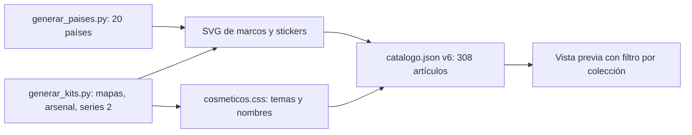

# Plan: más de 300 cosméticos

> Planeación original. Estado: **aprobado por Kyan** (2026-10-29: "HACE MÁS QUE SEAN MÁS DE 300 CHABON YA FUE").

## Decisiones tomadas

| Tema | Decisión | Por qué |
|---|---|---|
| Cantidad | +160 artículos en cuatro colecciones nuevas de 40 (10 temas × marco, sticker, tema y nombre). El catálogo pasa de 148 a **308** | Kyan pidió más de 300 |
| Equilibrio | Dos colecciones para todos y dos VIP | Que cada tipo siga con la misma cantidad para todos que VIP |
| Colecciones para todos | **Latinoamérica y España** (México, Costa Rica, Cuba, República Dominicana, Puerto Rico, Panamá, Guatemala, Honduras, El Salvador y España) y **Mapas de CS:S** (de_dust2, de_inferno, de_nuke, de_train, cs_office, de_aztec, de_cbble, cs_italy, de_piranesi y de_prodigy) | Completan los países y suman algo muy propio del server |
| Colecciones VIP | **Arsenal** (10 armas de CS:S con acabados inventados) y **Series míticas 2** (Los Simpson, The Walking Dead, El Chavo del 8, Prison Break, Chernobyl, Vikingos, Avatar, Futurama, Bob Esponja y Lost) | Lo animado y llamativo sigue siendo VIP |
| Acabados de armas | Nombres y diseños propios, sin nombres de skins de Valve | Los nombres de skins de CS:GO y CS2 son de Valve |
| Series | Homenajes originales, igual que en [`2026-10-29-cosmeticos-colecciones`](../2026-10-29-cosmeticos-colecciones/PLAN.md): sin logos, personajes, nombres registrados ni frases textuales | La web es pública |
| Cómo se hacen | Todo con generadores (plantilla por colección y un ícono por artículo) | 160 artículos a mano no entran en una sesión; con plantilla se ven parejos y se corrigen juntos |

## 1. El flujo completo

## 2. Colecciones nuevas

| `collection` | Nombre en la tienda | Para | Marco | Sticker |
|---|---|---|---|---|
| `paises2` | Latinoamérica y España | Todos | La plantilla de países | Bandera y palabra típica |
| `mapas` | Mapas de CS:S | Todos | Anillo con la textura del mapa y una placa con el nombre | Cartel del sitio A o B con el nombre del mapa |
| `arsenal` | Arsenal (VIP) | VIP | Anillo con el acabado animado y el arma abajo | El arma sobre una placa con brillo |
| `series2` | Series míticas 2 (VIP) | VIP | Anillo animado con el ícono de la serie | Ícono grande con texto |

## 3. Requisitos antes de empezar

Ninguno: todo es estático.

## 4. Orden de implementación

1. Sumar los 10 países al generador de países.
2. Escribir `pruebas/generar_kits.py` (mapas, arsenal y series 2), que también genera su CSS.
3. Catálogo v6 y datos falsos.
4. Revisión en el navegador.
5. Documentación, guía y changelog.
