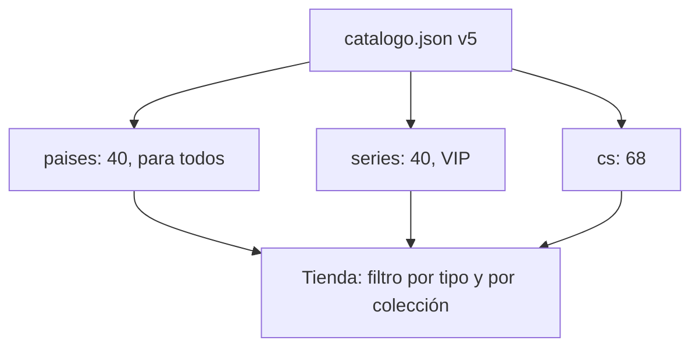

# Colecciones de cosméticos (países y series): documentación

## Qué hace

Suma 80 artículos a los cosméticos del perfil ([`2026-10-28-cosmeticos-perfil`](../2026-10-28-cosmeticos-perfil/DOCUMENTACION.md)) y los ordena en tres colecciones. El catálogo pasa de 68 a **148 artículos**, con la misma cantidad para todos que VIP en cada tipo.

| Colección (`collection`) | Nombre en la tienda | Quién la usa | Artículos |
|---|---|---|---|
| `cs` | Counter-Strike | Mitad para todos, mitad VIP | Los 68 de antes |
| `paises` | Sudamérica | Para todos | 10 países × marco, sticker, tema y nombre = 40 |
| `series` | Series míticas (VIP) | Solo VIP, todo animado | 10 series × marco, sticker, tema y nombre = 40 |

## Totales por tipo

| Tipo | Para todos | VIP |
|---|---|---|
| Marcos | 20 | 20 |
| Stickers | 18 | 18 |
| Temas | 18 | 18 |
| Nombres | 18 | 18 |

## Países (para todos)

Argentina, Brasil, Uruguay, Chile, Perú, Colombia, Venezuela, Ecuador, Bolivia y Paraguay. Los `id` usan el código ISO en minúsculas (`marco-pais-ar`, `sticker-pais-ar`, `tema-pais-ar`, `nombre-pais-ar`).

- **Marco:** tres anillos con los colores de la bandera, un emblema arriba (sol, estrella, cóndor, volcán, wiphala…), una cinta con el nombre y un brillo que cruza cada 4 segundos.
- **Sticker:** la bandera con una palabra típica: CHE, BORA!, GARRA, ¿CACHAI?, CAUSA, PARCE, CHAMO, PANA, JALLALLA y JAHA.
- **Tema:** el color principal de la bandera en `--primary`.
- **Nombre:** el texto con las franjas de la bandera.

Los marcos y stickers salen de [`pruebas/generar_paises.py`](pruebas/generar_paises.py). Para cambiar los diez de una vez se edita el script y se vuelve a correr.

## Series (VIP)

**Son homenajes originales.** Ninguno usa logos, personajes, nombres registrados ni frases textuales de las series. Toman un motivo reconocible y lo dibujan de cero. Los nombres de la tienda son propios. La serie de inspiración figura solo en esta tabla interna, no en el catálogo público.

| `id` base | En la tienda | Inspirado en | Marco | Sticker | Nombre |
|---|---|---|---|---|---|
| `ninja` | Shinobi | Naruto | Cinta naranja, espiral y shurikens que giran | JUTSU! | Chakra |
| `guerrero` | Súper guerrero | Dragon Ball | Aura dorada que arde y rayos | +9000 | Ki |
| `alien` | Reloj alien | Ben 10 | Panel hexagonal verde con un dial que gira | ALIEN | Mutante |
| `portal` | Portal | Rick y Morty | Portal verde girando | PORTAL | Portal |
| `navaja` | Gorra y navaja | Peaky Blinders | Art déco de 1919, gorra con navaja, humo | NAVAJA | Whisky 1919 |
| `laboratorio` | Laboratorio | Breaking Bad | Tabla periódica con **Cs** y **Ss** (Counter-Strike: Source), cristales azules | COCINANDO | Cristal azul |
| `reves` | Mundo del revés | Stranger Things | Luces de colores que titilan, esporas | CORRE | Ochentoso |
| `reinos` | Reinos | Game of Thrones | Acero con remaches, espadas, corona, nieve | EL TRONO | Acero antiguo |
| `atraco` | Atraco | La casa de papel | Mono rojo, lingote y billetes volando | ATRACO | Billete |
| `juego` | Juego mortal | El juego del calamar | Círculo, triángulo y cuadrado; placa "N°034" | ELIMINADO | Luz roja, luz verde |

Los temas de series (`tema-serie-*`) suman un borde que brilla y respira (`cos-glow`, con la variable `--glow`); el de Mundo del revés titila. Todo se apaga con `prefers-reduced-motion`.

## Catálogo v5

- Cada artículo tiene `collection`.
- La raíz suma `collections` con el nombre de cada colección para la tienda.
- Lo demás no cambia: `price` sigue en `null` y `vip_only` se compara con el `vip` de la API.

## Vista previa

`vista-previa.html` suma una fila de botones para filtrar por colección (Todas, Counter-Strike, Sudamérica, Series míticas) con la cantidad de cada una. Los datos falsos ahora usan artículos nuevos: v34|Pepon y Kyan (VIP) llevan series, y chiquitoAWP, Tóxico99 y flashero llevan Uruguay, Brasil y Chile.
