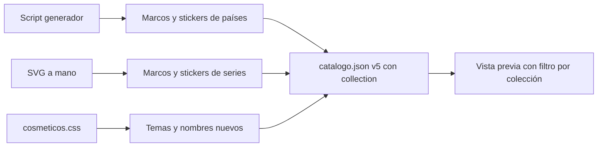

# Plan: colecciones de cosméticos (países y series)

> Planeación original. Estado: **aprobado por Kyan** (2026-10-29: "hace más, tiene que ser una tienda muy llena y grande… inspirate y versiona cosas de series… y países sudamericanos"; después: "hace lo que sea necesario").

## Decisiones tomadas

| Tema | Decisión | Por qué |
|---|---|---|
| Cantidad | +80 artículos: 10 países y 10 series, con un marco, un sticker, un tema y un nombre cada uno. El catálogo pasa de 68 a 148 | Kyan pidió una tienda "muy llena y grande" |
| Países | Para todos | Es identidad: que cualquiera pueda llevar su bandera. Las banderas son de dominio público |
| Series | Solo VIP y animados | Son lo más llamativo y empujan el VIP. Así cada tipo sigue con la misma cantidad para todos que VIP |
| Series sin marcas | Homenajes originales: motivos reconocibles (espiral ninja, aura dorada, portal verde, gorra con navaja, cristal azul…), sin logos, personajes, nombres registrados ni frases textuales de las series | La web es pública: copiar logos o personajes con derechos de autor nos expone a reclamos. Los nombres de los artículos son propios |
| Colección | Campo nuevo `collection` en el catálogo: `cs`, `paises`, `series` | Para que la tienda filtre por colección |
| Países elegidos | Argentina, Brasil, Uruguay, Chile, Perú, Colombia, Venezuela, Ecuador, Bolivia y Paraguay | Los diez de Sudamérica de habla hispana o portuguesa |
| Marcos de países | Generados con un script a partir de una plantilla (anillo con los colores de la bandera, emblema y cinta con el nombre) | Diez marcos coherentes entre sí, fáciles de corregir todos juntos |
| Series elegidas | Ninja (Naruto), Súper guerrero (Dragon Ball), Reloj alien (Ben 10), Portal (Rick y Morty), Navaja y gorra (Peaky Blinders), Laboratorio (Breaking Bad), Mundo del revés (Stranger Things), Reinos (Game of Thrones), Atraco (La casa de papel) y Juego mortal (El juego del calamar) | Las cuatro que nombró Kyan y seis "series míticas" más |

## 1. El flujo completo

## 2. Artículos

- **Países (para todos, 40):** `marco-pais-XX`, `sticker-pais-XX` (con una palabra típica del país), `tema-pais-XX` y `nombre-pais-XX` (degradado con los colores de la bandera). `XX` es el código ISO en minúsculas.
- **Series (VIP, 40):** marco animado, sticker animado, tema con brillo y nombre animado por serie.

## 3. Catálogo y vista previa

- `catalogo.json` sube a la versión 5 y suma `collection` a todos los artículos (`cs` para los 68 de antes) y la lista `collections`.
- La vista previa suma botones para filtrar por colección.
- `datos-falsos.json`: algunos jugadores pasan a usar artículos de países y los VIP, de series.

## 4. Requisitos antes de empezar

Ninguno: todo es estático y no toca el backend. Los precios siguen en `null`.

## 5. Orden de implementación

1. Script generador de marcos y stickers de países (`pruebas/generar_paises.py`).
2. Marcos y stickers de series, a mano.
3. Temas y nombres en `cosmeticos.css`.
4. Catálogo, datos falsos y vista previa.
5. Revisión en el navegador.
6. Documentación, guía y changelog.
