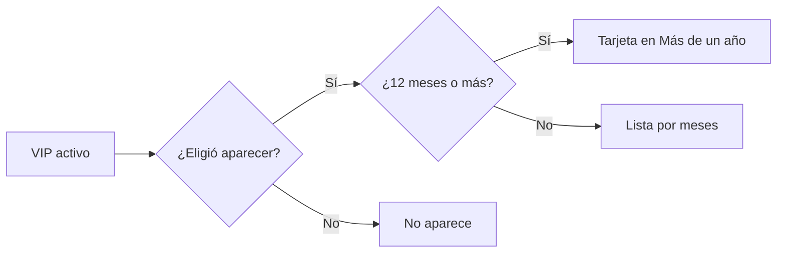

# Plan: Tu nombre en los créditos de la web (VIP)

> Planeación original. Estado: **propuesta**, prototipo para pasarle a Daniel (backend) y a Esteban (frontend).
>
> **Aviso:** Kyan pidió hacer "lo que falte" de la lista VIP mientras no estaba, así que este plan se escribió junto con el prototipo y no antes.

## Decisiones tomadas

| Tema | Decisión | Por qué |
|---|---|---|
| Dónde se ve | `/demo/creditos` del frontend nuevo, solo en `pnpm dev` | Es una página nueva y no es parte del perfil |
| Qué tiene | "Hecho por" (Kyan, Daniel y Esteban con su rol) y "Gracias a los VIP" | Los créditos del equipo y los de los que bancan |
| Orden de los VIP | Por meses de VIP; los de un año o más, en tarjetas aparte | Premia quedarse |
| Aparecer | Cada VIP elige si aparece, desde su configuración. Viene prendido | Hay gente que no quiere figurar |
| Si se vence el VIP | Sale de la lista | Los créditos son de los que bancan ahora |

## Lo que tendría que hacer cada uno

- **Daniel:** una ruta pública con los VIP activos que eligieron aparecer y sus meses, y la preferencia `show_in_credits` en la cuenta.
- **Esteban:** la página de créditos y el switch en la configuración de la cuenta.
