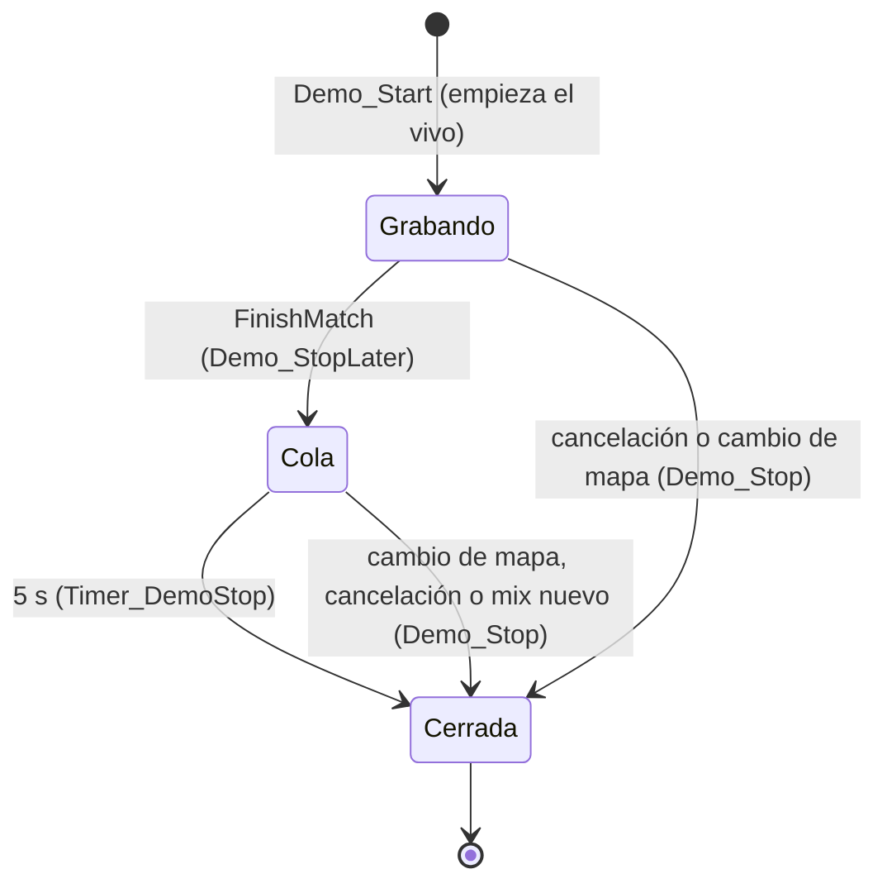

# La demo sigue grabando unos segundos después del final del mix: documentación

## Qué hace

Cuando un mix termina, el reporter ya no corta la grabación de SourceTV en el acto: la corta 5 segundos después (`DEMO_TAIL_SECONDS`). El resultado se manda igual que antes, en el mismo momento.

Antes, la demo terminaba en el tick de la última kill del mix. El juego dibuja la imagen 0,1 s atrás de lo que recibe (`cl_interp`), así que al reproducir la demo esa kill no se llegaba a ver: la demo se acababa y aparecía el menú. Las jugadas de la última ronda tampoco tenían sus segundos de después. Pasó con el 3k de la ronda 29 en de_cbble ([`2026-10-29-clips-pov-y-final-demo`](../2026-10-29-clips-pov-y-final-demo/)).

## Reglas

- Solo el final normal (`FinishMatch`) deja la cola de 5 s. Una cancelación (admin, abandono o cambio de mapa) corta en el acto, como antes.
- `Demo_Stop` siempre borra el corte pendiente. Si en esos 5 s cambia el mapa o empieza otro mix, la demo se cierra en ese momento y no queda ningún timer suelto.
- La vuelta al calentamiento (`csstv_end_delay`, 15 s) llega después del corte.
- Los ticks de las jugadas no cambian: se cuentan desde el inicio de la grabación.
- La subida de las demos no cambia:
  - El job de SFTP del VPS espera a que el tamaño del archivo no cambie.
  - El Worker del panel reintenta si el tamaño de la descarga no coincide con el del listado.

## Dónde está cada cosa

| Qué | Archivo |
|---|---|
| `DEMO_TAIL_SECONDS`, `g_hDemoStopTimer`, `Demo_StopLater`, `Timer_DemoStop` y los cambios en `Demo_Start` y `Demo_Stop` | `server/addons/sourcemod/scripting/csstv/qol.inc` |
| `FinishMatch` con `Demo_StopLater` | `server/addons/sourcemod/scripting/csstv_reporter.sp` |
