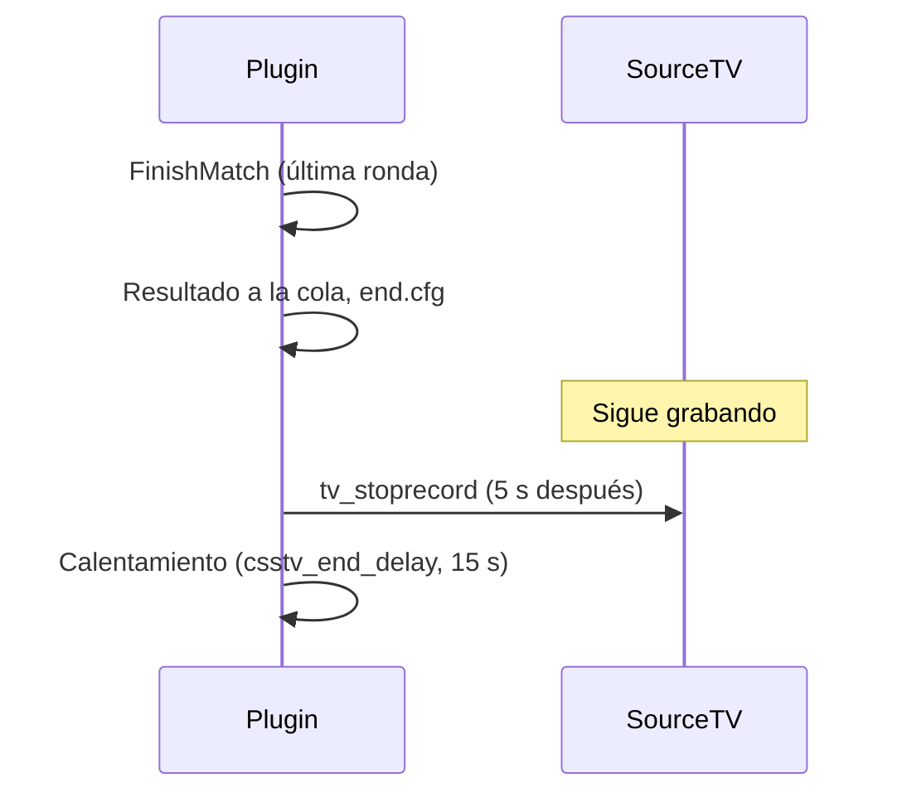

# Plan: la demo sigue grabando unos segundos después del final del mix

> Planeación original. Estado: **pedido por Daniel (2026-10-29)**, después de los reprocesos del 3k de la ronda 29 en de_cbble ([`2026-10-29-clips-pov-y-final-demo`](../2026-10-29-clips-pov-y-final-demo/)).

## Decisiones tomadas

| Tema | Decisión | Por qué |
|---|---|---|
| Qué se cambia | `FinishMatch` deja de cortar la demo en el acto: la corta un timer 5 s después | Hoy la demo termina en el tick de la última kill. El juego dibuja 0,1 s atrás (`cl_interp`), así que una kill en ese tick no se ve nunca y la jugada no tiene sus segundos de después |
| Cuánto | 5 s, fijo (`DEMO_TAIL_SECONDS`), sin cvar | Alcanza para los 2 s de después de los clips y el retraso de dibujo. Sin cvar no hay que tocar el cfg de ningún servidor |
| Cancelaciones | Siguen cortando en el acto | Un mix cancelado no tiene "última ronda" que mostrar, y el descarte borra la demo a los 3 s |
| Cambio de mapa o mix nuevo antes de los 5 s | `Demo_Stop` (en `OnMapEnd`, `BackToWarmup` y `CancelMatch`) borra el timer y corta. `Demo_Start` corta antes una que siga grabando | Nunca quedan dos grabaciones ni un timer suelto |
| Versión | Va en la 2.7.0, que todavía no se desplegó | Así sale en una sola tanda en el real, RBK y flow |
| Subida de las demos | Sin cambios | El job de SFTP espera a que el tamaño no cambie, y el Worker del panel reintenta si el tamaño de la descarga no coincide con el listado |

## 1. El flujo

## 2. Cambios en el plugin

- `csstv/qol.inc`:
  - `DEMO_TAIL_SECONDS` y `g_hDemoStopTimer`.
  - `Demo_StopLater()`, que crea el timer, y `Timer_DemoStop`.
  - `Demo_Stop()` borra el timer antes de cortar.
  - `Demo_Start()` corta antes una demo que siga grabando.
- `csstv_reporter.sp`: `FinishMatch` llama a `Demo_StopLater()` en lugar de `Demo_Stop()`.

## 3. Pruebas

- Compilar.
- Con bots en el servidor local (`csstv_send 0` y cola vacía):
  - terminar un mix y ver en la consola el `tv_stoprecord` unos 5 s después;
  - leer la demo con `render/leer_demo.py`: el último tick tiene que ser unos 500 ticks posterior al `round_end` final.
- Cambiar de mapa justo después del final: la demo se cierra y no queda ningún timer.

## 4. Despliegue

Con la 2.7.0, en el real, RBK y flow en la misma tanda: lo que diga la guía de [`2026-10-29-medallas-datos`](../2026-10-29-medallas-datos/).
