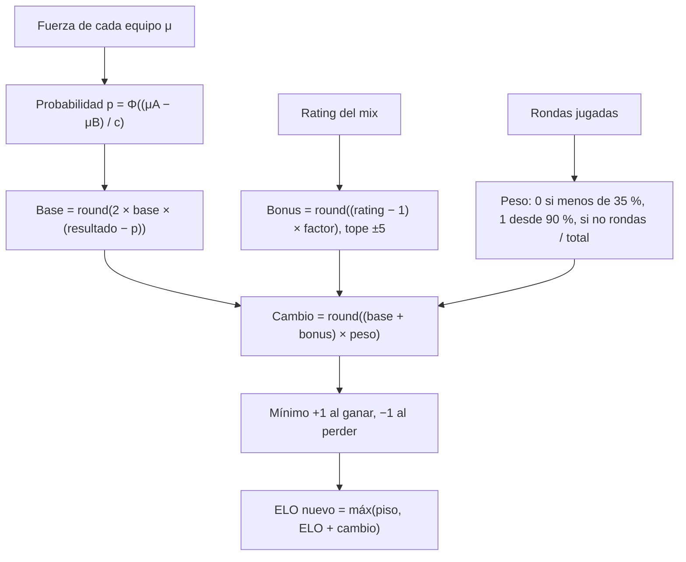

# Plan: Desglose completo de tu fórmula de ELO (VIP)

> Planeación original. Estado: **propuesta**, prototipo para pasarle a Daniel (backend) y a Esteban (frontend).

## Decisiones tomadas

| Tema | Decisión | Por qué |
|---|---|---|
| Dónde se ve | `/demo/elo` del frontend nuevo (`kyan/ejemplo-matchmaking`), solo en `pnpm dev` | Patrón de los demás demos |
| Fórmula | La misma de `elo_apply_match` (`20261014120000_elo_participacion.sql`), copiada a TypeScript | Lo que se muestra tiene que dar el mismo número que la base |
| Qué se muestra | Cada mix como un "ticket": probabilidad de ganar, base, bonus por rating, peso por rondas, mínimo ±1, piso de ELO y resultado | Son exactamente los pasos del cálculo |
| Simulador | Sliders de probabilidad, rating y rondas jugadas, y resultado ganado, perdido o empate | Para entender qué mueve el número |
| Parámetros | Los de `elo_config` por defecto (base 30, bonus 5, factor 10, piso 100, 35 % y 90 %) | Son los del servidor |
| Sin VIP | Se ve el resultado de cada mix; el desglose está con candado | Muestra el beneficio |

## 1. El cálculo que se desglosa

## 2. Lo que tendría que hacer cada uno

- **Daniel:** una ruta con el desglose de cada mix de un jugador.
  - La base ya guarda `elo_before`, `elo_after`, `elo_delta` y `win_prob`.
  - Faltan `rating`, `rounds`, el total de rondas y el peso. O se guardan, o se recalculan con el `elo_config` de ese momento.
- **Esteban:** una pestaña o un panel en el perfil con el ticket de cada mix.

## 3. Orden de implementación

1. `features/elo/formula.ts`: la fórmula en TypeScript, con tests contra los ejemplos de la documentación.
2. `features/elo/demo.ts`: 10 mixes de ejemplo.
3. `features/elo/EloBreakdown.tsx` y `routes/demo.elo.tsx`.
