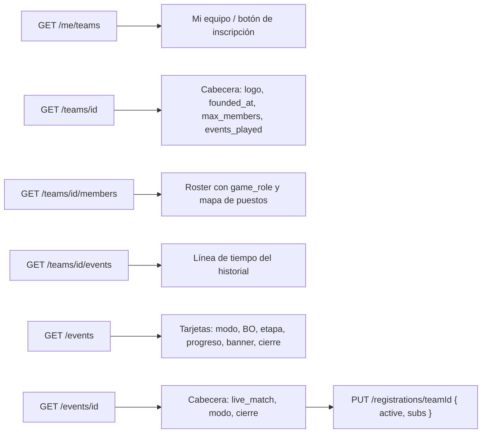

# Equipo y Torneos con la API nueva: documentación

## Qué hace

El backend respondió al contrato de Equipo y Torneos (`contrato-frontend-equipo-torneos.md`, commit `9b4eefa`). Este requerimiento adapta el frontend a esa API:
- la inscripción a torneos pasa a **activos y suplentes** según el **modo de juego** del torneo;
- se activa todo lo que estaba en "Próximamente" en las dos vistas;
- el listado de torneos deja de pedir datos por tarjeta.

## Torneos

- **Modo de juego:** cada torneo tiene `game_mode` (`5v5`, `2v2`…), `players_per_team` (activos) y `subs_max` (0 a 4). Se muestra en la tarjeta ("5v5 · Eliminación directa · BO3 · Final BO3"), en la cabecera y en Información ("5v5 · 5 activos + hasta 2 suplentes", o "…, sin suplentes").
- **Tarjetas del listado:** BO, etapa actual y barra de progreso salen de `EventSummary` (`bo`, `bo_final`, `current_stage`, `progress`). No se pide nada por tarjeta.
- **Banner:** `banner_url` como imagen en la tarjeta y en el detalle; sin imagen, el patrón rayado. Subirlo es del panel del organizador, que todavía no existe.
- **Cierre de inscripciones:** con `registration_closes_at`:
  - la tarjeta dice "Cupo · cierra en 2 d";
  - Información muestra "Cierre de inscripciones";
  - la nota del botón del inscripto dice "puedes cambiarlo o cancelar hasta el {fecha}".
  
  Pasado el cierre, el líder sin inscribir ve "Inscripciones cerradas" y el inscripto ve sus botones deshabilitados. El backend responde `409 REGISTRATION_CLOSED` igual.
- **Partida en vivo:** `live_match` del detalle. Nota del botón: "Semifinal · Mapa 2 de 3 · de_dust2".
- **Inscripción:** diálogo con el roster del equipo.

  | Miembro | Qué puede ser |
  |---|---|
  | Activo o suplente del equipo, con SteamID | **Activo** o **Suplente** (botón de dos estados por fila) |
  | Sin SteamID | Nada ("Sin SteamID vinculado") |
  | Coach | Nada ("El coach no se inscribe") |

  - Tiene que haber exactamente `players_per_team` activos y hasta `subs_max` suplentes. Al llenarse un cupo, el botón se deshabilita en las demás filas.
  - Por defecto van como activos los primeros Activos del equipo con SteamID. Al cambiar los inscritos, el diálogo parte de lo inscripto (`registrations[].players[].role`).
  - Se envía `{ active, subs }` en el orden del roster.
- **Errores:** `REGISTRATION_CLOSED`, `PLAYER_NOT_LINKED`, `COACH_NOT_ALLOWED` y `BUSINESS_RULE` muestran el mensaje del backend.

## Equipo

- **Mis equipos:** `GET /me/teams` (con `my_role`) en `/myteam` y en el botón de inscripción a torneos.
- **Cabecera:**
  - "Mi equipo · desde {founded_at}";
  - "{n}/{max_members} en el roster", con el máximo que configura el admin.
- **KPI "Torneos jugados" y Vitrina:** `record.events_played`.
- **Escudo:** muestra `logo_url` si existe (fondo `card` con borde); si no, o si la imagen no carga, la sigla o las iniciales.
- **Logo:**
  - **Crear equipo:** "Subir imagen" abre el recorte cuadrado (el mismo de la foto de perfil) y la vista previa del escudo lo muestra. La solicitud va en `multipart/form-data` con `logo`.
  - **Mi equipo:** el líder tiene un botón de cámara sobre el escudo. Sin logo, sube uno; con logo, el menú ofrece "Subir otro logo" o "Quitar logo".
  - **Recorte:** 512×512, en PNG para conservar la transparencia (en JPEG si pesa más de 2 MB).
- **Roster:**
  - el menú ⋯ cambia el estado (Activo, Suplente o Coach) con `PATCH /teams/{id}/members/{playerId}`, sin topes;
  - cada fila muestra el puesto del perfil y desde cuándo está ("AWPer · desde ene 2025").
- **Roles de equipo:** cada miembro aparece en el lugar del mapa de su `game_role` (Entry fragger va en Entry). Varios pueden compartir un lugar: hasta 3 caras y "+n". Rifler, Otro y los que no eligieron puesto van en "Otros puestos". El coach no aparece. Es solo lectura: cada jugador elige su puesto en su perfil.
- **Historial:** "Torneos en los que participó" es una línea de tiempo con `GET /teams/{id}/events`. Cada torneo muestra un punto, el nombre, las fechas y un chip con el resultado:
  - naranja para Campeón;
  - rojo para En curso;
  - gris para el resto, con "3.er puesto" cuando el backend lo sabe.
- **Invitar:** estado en el roster (Activo, Suplente o Coach) y mensaje opcional (hasta 200 caracteres).
- **Invitaciones recibidas:** "{quién} te invita como {estado}" y el mensaje.
- **Pedidos para entrar:** el nivel del jugador y su mensaje.
- **Buscar equipo:** filtro de una opción ("Buscan activo / suplente / coach", que va como `looking_for`) y etiquetas "Busca activo…" en cada equipo. Si no busca nada: "No está buscando jugadores" o "Roster completo".
- **Pendiente de diseño:** el control para que el líder edite `looking_for`.

## Dónde está cada cosa

Todo dentro de `web/frontend/`.

| Qué | Archivo |
|---|---|
| Códigos de error nuevos | `src/api/errors.ts` |
| Recorte genérico, del avatar y del logo | `src/lib/image.ts` (`cropImage`, `cropAvatar`, `cropLogo`) |
| Diálogo de recorte (redondo o cuadrado) | `src/features/profile/AvatarCropDialog.tsx` |
| Torneos: tipos, modelo, vistas | `src/features/events/` (`queries.ts`, `model.ts`, `EventList`, `EventView`, `SummaryTab`, `RegisterDialog`, `ui.tsx`) |
| Equipo: consultas y mutaciones nuevas | `src/features/teams/queries.ts` (`myTeamsOptions`, `teamEventsOptions`, `useSetMemberRole`, `useUploadLogo`, `useRemoveLogo`) |
| Equipo: mapa de puestos, resultados | `src/features/teams/model.ts` (`rolesMap`, `RESULT_LABEL`, `resultText`) |
| Logo (elegir, recortar, cámara del líder) | `src/features/teams/TeamLogo.tsx` |
| Escudo con logo | `src/features/teams/ui.tsx` (`TeamCrest`) |
| Roster, invitar, secciones, cabecera | `Roster.tsx`, `InviteDrawer.tsx`, `sections.tsx`, `TeamView.tsx`, `CreateTeam.tsx`, `FindTeam.tsx`, `NoTeam.tsx` |
| Mis equipos | `src/routes/_app/myteam.tsx` |
| e2e | `e2e/team.spec.ts`, `e2e/team-fixtures.ts`, `e2e/events.spec.ts`, `e2e/event-fixtures.ts` |
