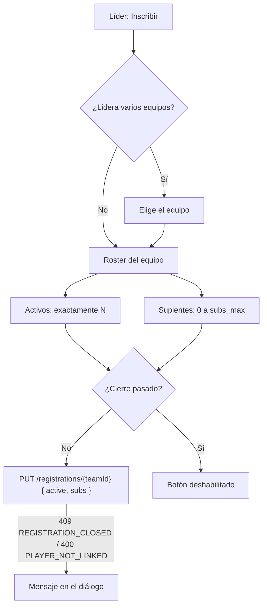

# Plan: Equipo y Torneos con la API nueva

> Planeación original. Estado: **aprobado** el 2026-10-29 ("Si todo", Esteban).

El backend respondió a nuestro contrato (`contrato-backend-equipo-torneos.md`) con `contrato-frontend-equipo-torneos.md`, el commit `9b4eefa` y la bitácora [`2026-10-28-equipo-torneos-api`](../2026-10-28-equipo-torneos-api/). Hay cambios que **rompen** lo que el frontend tenía (la inscripción a torneos y `players_min`/`players_max`) y, además, la API ya trae casi todo lo que hoy se ve con "Próximamente" en Equipo y Torneos.

Objetivo:
- que el frontend vuelva a compilar;
- activar lo que ya tiene backend;
- cerrar las dos vistas.

Va antes de los [ajustes visuales del perfil, el ranking y los mixes](../2026-10-29-ajustes-visuales-perfil-ranking-mixes/PLAN.md).

## Decisiones tomadas

| Tema | Decisión | Por qué |
|---|---|---|
| Inscripción | Diálogo con dos grupos: **Activos** (exactamente `players_per_team`) y **Suplentes** (de 0 a `subs_max`). Un miembro está en uno o en ninguno; el coach no se ofrece | Contrato nuevo: `{ active, subs }` |
| Inscritos por defecto | Los `player` del equipo con SteamID como activos (hasta el cupo), y ningún suplente | Igual que antes; un `sub` del equipo también puede ser activo |
| Modo de juego | El modo (`5v5`, `2v2`…) aparece en la cabecera y en Información: "5v5 · 5 activos + hasta 2 suplentes" | `game_mode`, `players_per_team`, `subs_max` |
| Listado de torneos | Se quitan los pedidos por tarjeta: BO, etapa y progreso salen de `EventSummary` | T1 resuelto |
| Banner | `banner_url` como imagen (`object-cover`) en las tarjetas y el detalle; null → el patrón rayado | T2. Subirlo es del panel del organizador (`/admin/events`, hoy placeholder): fuera de este plan |
| Cierre de inscripciones | "Cupo · cierra en 2 d" en la tarjeta, la fecha en Información y la nota del botón "puedes cancelar hasta el {fecha}". Pasado el cierre, el líder ve el botón deshabilitado | T3; el backend responde `409 REGISTRATION_CLOSED` |
| Partida en vivo | `live_match` del detalle: "Semifinal · Mapa 2 de 3 · de_dust2" | T4; deja de deducirse de las partidas |
| Estado en el roster | Se activan Activo / Suplente / Coach en el menú ⋯, **sin topes** | E1: el backend no tiene topes por estado |
| Invitar | Se activa "Estado en el roster" y se suma un mensaje opcional (hasta 200 caracteres) | E1 y E8 |
| Roles de equipo | El mapa ubica a cada miembro en el lugar de **su puesto del perfil** (`game_role`); varios pueden compartir un lugar. Rifler, Otro y los que no eligieron puesto van en una fila debajo. Solo lectura: "Cada jugador elige su puesto en su perfil" | E2: no hay `GET`/`PUT /roles` |
| Logo | El escudo muestra `logo_url` si existe (si no, la sigla). Se activa "Subir imagen" en Crear equipo, con el recorte cuadrado del avatar (`react-easy-crop`), a 512×512 | E3: el frontend recorta |
| Cambiar el logo después | El líder ve un botón de cámara sobre el escudo de Mi equipo (mismo patrón que el avatar de Mi perfil), con "Quitar logo" | E3; reutiliza un patrón que ya existe |
| `looking_for` | Se activan los filtros de Buscar equipo y la etiqueta de qué busca cada equipo | E4 |
| Editar `looking_for` | **Queda pendiente de diseño**: no hay control en el handoff. Se pide a Claude Design | Regla de Esteban: lo visual nuevo pasa antes por diseño |
| Historial | "Torneos en los que participó" como la línea de tiempo del handoff (punto, nombre, fechas y chip de resultado), con `GET /teams/{id}/events`; KPI "Torneos jugados" con `record.events_played` | E5 |
| "Desde {fecha}" | `founded_at` | E6 |
| Mis equipos | `GET /me/teams` (con `my_role`) en `/myteam` y en el botón de inscripción | E7: se quita un pedido por equipo |
| Invitaciones y pedidos | Quién invitó, el mensaje y el estado propuesto en la tarjeta de invitación; nivel y mensaje en los pedidos que ve el líder | E8 |
| Tope del roster | `max_members` del equipo en lugar del 10 fijo | El admin lo configura |
| Errores | Mensajes para `ROSTER_FULL`, `COACH_NOT_ALLOWED`, `REGISTRATION_CLOSED`, `PLAYER_NOT_LINKED` (con los alias), `INVALID_FILE` y `FILE_TOO_LARGE`; el `message` del backend cuando lo trae | Contrato |

## 1. El flujo de inscripción

## 2. Cambios (`web/frontend/src/`)

- `api/errors.ts`: los códigos nuevos.
- `lib/image.ts`: recorte genérico (`cropImage` con tamaño y formato); el del avatar pasa a usarlo.
- `features/profile/AvatarCropDialog.tsx` → diálogo de recorte reutilizable (forma redonda o cuadrada, título).
- **Torneos** (`features/events/`):
  - `queries.ts`: tipos nuevos y `{ active, subs }`;
  - `model.ts`: BO y etapa desde `EventSummary`, el cierre, el modo y la partida en vivo;
  - `EventList`, `EventView`, `SummaryTab`, `RegisterDialog`: lo de la tabla de arriba.
- **Equipo** (`features/teams/`):
  - `queries.ts`: `useSetMemberRole`, `useUploadLogo`, `useRemoveLogo`, `teamEventsOptions`, `myTeamsOptions`, invitar con `role` y `message`, `looking_for` en la búsqueda, la solicitud de equipo con `logo`;
  - `model.ts`: `max_members`, resultados del historial, el mapa de puestos;
  - `ui.tsx` (`TeamCrest` con logo), `Roster`, `InviteDrawer`, `sections` (roles, historial, KPI), `TeamView` (cámara del líder, `founded_at`), `CreateTeam`, `FindTeam`, `NoTeam` (invitaciones).
- `routes/_app/myteam.tsx`: `GET /me/teams`.

## 3. Pruebas

- **Unitarias:** el modelo de los dos módulos (inscripción con activos y suplentes, cierre, historial, mapa de puestos) y el recorte.
- **e2e:** se actualizan los datos simulados a las formas nuevas.
  - **Torneos:** inscribir con activos y suplentes (comprobando el `PUT { active, subs }`), cierre pasado, "Mapa 2 de 3", tarjetas sin pedidos extra.
  - **Equipo:** cambiar el estado (`PATCH`), invitar con estado y mensaje, mapa de puestos, historial, filtros de Buscar.
  - **Logo contra la API real:** subir un logo en la solicitud de un equipo con la cuenta de prueba.
- **Contra la API local:** el torneo de prueba de la base local (`pruebas/` de `2026-10-25-torneos`) con una inscripción real.
- **Visual:** capturas en claro y oscuro, de 320 a 1440px.

## 4. Requisitos

- La base local con las migraciones `20261028*` y los replanteos 31 a 34 (hecho el 2026-10-29, con respaldo en `~/.v34frag/local-antes-equipo-torneos-api-2026-10-29.dump`).
- La API local (`csapi5`) exportada desde la rama al día.

## 5. Orden

1. Errores, recorte genérico y tipos.
2. Torneos (vuelve a compilar).
3. Equipo.
4. Pruebas y capturas.
5. `DOCUMENTACION.md`, `GUIA_IMPLEMENTACION.md`, la fila del índice. Cerrar Equipo y Torneos en sus guías, si no queda nada en "Próximamente" salvo lo que espera diseño.
