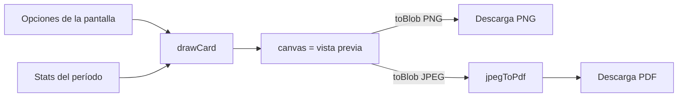

# Exportar tus stats en imagen o PDF (prototipo VIP)

Prototipo de Kyan para que lo terminen Daniel (backend) y Esteban (frontend). Está en el frontend nuevo (`C:/Users/Agus/Documents/repo-mm-ejemplo`, rama `kyan/ejemplo-matchmaking`), en la ruta `/demo/exportar`, solo con `pnpm dev`.

## Qué hace

El jugador arma una tarjeta con sus stats y la descarga como PNG o PDF para subirla a las redes.

| Opción | Valores |
|---|---|
| Formato | Cuadrado 1080 × 1080, Historia 1080 × 1920, Horizontal 1600 × 900 |
| Período | Temporada 3, Últimos 30 días, Histórico |
| Estilo | CM League, Claro, VIP dorado (este último solo con VIP) |
| Stats | Hasta 6 de: K/D, Rating, HS %, ADR, Victorias, Mixes, MVP, ELO máximo, Mejor racha y Mejor mapa |
| Foto de perfil | Prendida o apagada (viene prendida) |

**Foto de perfil:** prendida, va la foto redonda con un aro del color del estilo al lado del nombre. La insignia de nivel pasa a ser chica, en la esquina de la foto. La foto se recorta al centro para que no se deforme.

- **Sin foto:** si el jugador no tiene foto, o la foto no carga, va la inicial del nick.
- **Apagada:** vuelve la insignia de nivel grande.
- **Barra Demo:**
  - **Probar con mi foto:** elegir una imagen de la compu.
  - **Jugador sin foto:** ver cómo queda la inicial.

La tarjeta siempre lleva el logo, el nick con el tag, la insignia de nivel, el ELO con la barra al próximo nivel, la fecha y `cmleague.lat`.

- **Historia:** suma los 3 mapas más jugados y el gráfico de ELO.
- **Horizontal:** pone el gráfico a la derecha.
- **Cuadrado:** no tiene gráfico, porque con 6 stats no entra. Las stats ocupan el alto que queda.

**Sin VIP**, la vista previa sale con la marca de agua "VISTA PREVIA". Los botones de descarga muestran un candado y avisan que es un beneficio VIP.

En el celular aparece además el botón **Compartir** (`navigator.share`), que manda el PNG directo a la app que elijas.

## Cómo está hecho

| Archivo (en `web/frontend/src/`) | Qué tiene |
|---|---|
| `features/export/card.ts` | Formatos, estilos, lista de stats y `drawCard`, que dibuja la tarjeta en un `<canvas>` con la API 2D. Antes de dibujar espera las fuentes (Inter y Geist Mono) y el logo |
| `features/export/pdf.ts` | `jpegToPdf`: arma a mano un PDF 1.4 de una página con la tarjeta como JPEG (`DCTDecode`). La página mide lo mismo que la imagen a 96 ppp |
| `features/export/demo.ts` | Stats de ejemplo de "Pepon" para los tres períodos. El historial de ELO sale de un generador con semilla |
| `routes/demo.exportar.tsx` | La pantalla: opciones a la izquierda, vista previa a la derecha y la barra Demo con el switch "Ser VIP" |

El nivel y la barra al próximo nivel salen de `LEVEL_FLOORS` del frontend (`features/player/labels.ts`), que tiene los mismos pisos que el backend (`web/backend/src/lib/db.ts`). Los colores de la insignia siguen la misma regla que `LevelBadge`: 10 naranja, 8 y 9 naranja oscuro, 4 a 7 blanco y 1 a 3 gris.

No se agregó ninguna dependencia. La vista previa es el mismo canvas que se descarga, así que lo que se ve es exactamente lo que sale.

## Lo que falta para la versión real

- **Daniel:** una ruta con las stats agregadas de un jugador por período. Tiene que devolver lo que hoy está en `ExportStats` (`demo.ts`): ELO, ELO máximo, mixes, victorias, K/D, rating, HS %, ADR, MVP, mejor racha, 3 mapas con su % de victorias y el ELO después de cada mix. También tiene que decir si el jugador es VIP.
- **Daniel, foto de perfil:**
  - La ruta tiene que mandar `avatar_url`, que ya existe en la API.
  - El storage de las fotos tiene que responder con `Access-Control-Allow-Origin`. Si no, el navegador no deja descargar la tarjeta con la foto y la tarjeta sale con la inicial.
- **Esteban:** un botón "Exportar stats" en el perfil propio que abra esta pantalla con los datos reales.
- La tarjeta se arma en el navegador. Si se quiere que de verdad no se pueda descargar sin VIP, alcanza con no mandar las stats sin VIP. La marca de agua sola se puede saltear con una captura de pantalla.

## Pruebas (2026-10-29, en el navegador del frontend local)

- Se revisaron los tres formatos y los tres estilos, y que la marca de agua aparezca al apagar VIP.
- PNG: se descargó uno de 1,17 MB con el nombre `cmleague-pepon-season-wide.png`.
- PDF: se descargó uno de 111 KB. Empieza con `%PDF-1.4`, los offsets de la tabla `xref` coinciden y el visor de PDF de Chrome lo abre bien.
- **Foto de perfil:** se probaron la foto de ejemplo, una imagen apaisada subida con "Probar con mi foto" (se recortó bien al centro), "Jugador sin foto" (la inicial) y el switch apagado (vuelve la insignia grande). El PDF con foto se generó bien (103 KB) y no hubo errores en la consola.
- No se probó **Compartir** en un celular.
- No se probó una foto real del storage, así que el CORS queda sin probar.
