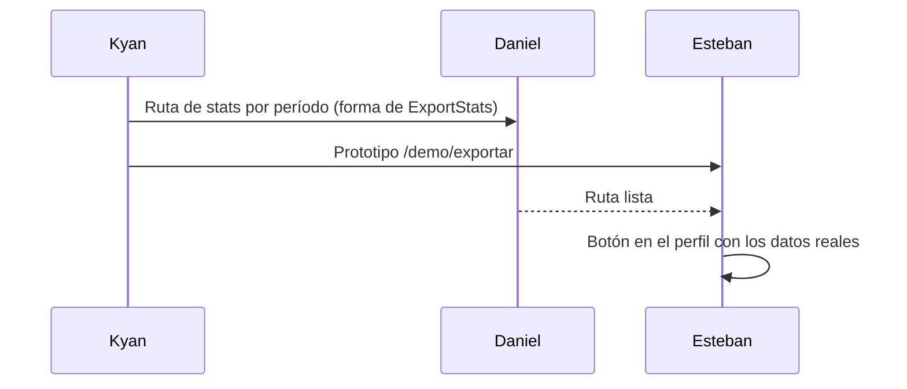

# Guía: exportar stats (prototipo)

## Ver el prototipo

1. Levantar el frontend nuevo con la configuración `frontend-mm-ejemplo` de `.claude/launch.json` (puerto 5173).
2. Abrir `http://localhost:5173/demo/exportar`.

No necesita la API ni la base: los datos están en memoria.

## Cambios respecto del plan

- **Cuadrado:** quedó sin gráfico de ELO. Con 6 stats no entraba, así que las stats ocupan el alto que queda.
- **Historia:** además de lo que decía el plan, muestra los 3 mapas más jugados.

## Archivos nuevos

En `repo-mm-ejemplo/web/frontend/src/` (rama `kyan/ejemplo-matchmaking`, **sin commit**):

- `features/export/card.ts`
- `features/export/pdf.ts`
- `features/export/demo.ts`
- `routes/demo.exportar.tsx`

`routeTree.gen.ts` lo regenera Vite solo al levantar `pnpm dev`.

## Pasar a la versión real

- No toca el plugin: no hay nada que subir al servidor real ni a RBK.
- No tiene `CHANGELOG_DISCORD.txt` porque los jugadores todavía no lo pueden usar. Se escribe cuando Esteban lo publique.

## Revertir

Borrar los cuatro archivos nuevos.
