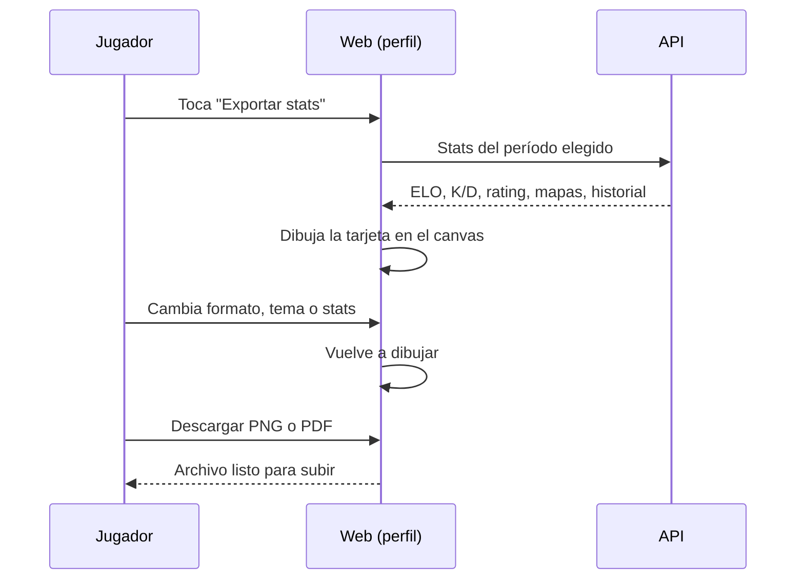

# Plan: Exportar tus stats en imagen o PDF para redes (VIP)

> Planeación original. Estado: **propuesta**, prototipo para pasarle a Daniel (backend) y a Esteban (frontend).

## Decisiones tomadas

| Tema | Decisión | Por qué |
|---|---|---|
| Dónde se ve | Ruta `/demo/exportar` del frontend nuevo (`repo-mm-ejemplo`, rama `kyan/ejemplo-matchmaking`), solo en `pnpm dev` | Es el patrón de los demás demos (`demo.tienda.tsx`, `demo.widget.tsx`) |
| Datos | En memoria, con la forma de lo que ya devuelve el perfil (`PlayerDetail`, historial de ELO, mapas) | Es un prototipo: la API la arma Daniel |
| Cómo se dibuja la tarjeta | Un `<canvas>` con la API 2D del navegador | La vista previa es exactamente lo que se descarga y no hace falta instalar ninguna librería |
| Imagen | PNG con `canvas.toBlob` | Formato que aceptan todas las redes |
| PDF | Un PDF de una página armado a mano con la tarjeta como JPEG (`DCTDecode`) | Sin dependencias nuevas; un PDF con una imagen son unas 40 líneas |
| Formatos | Cuadrado 1080 × 1080 (post), Historia 1080 × 1920 y Horizontal 1600 × 900 (Twitter/X) | Los tamaños que piden Instagram y Twitter |
| Período | Temporada actual, últimos 30 días e histórico | Son los que ya existen en el ranking y el perfil |
| Qué stats van | El jugador elige hasta 6 de una lista (ELO, K/D, rating, HS %, ADR, % de victorias, mixes, MVP, mejor mapa) | Cada uno quiere mostrar lo que le sale bien |
| Estilos | Tres temas de color (CM League, Oscuro, VIP dorado) | El dorado solo con VIP |
| Sin VIP | Se ve la vista previa con marca de agua y los botones de descarga piden VIP | Muestra qué se pierde sin bloquear el ejemplo |
| Compartir | En el celu, `navigator.share` con el archivo; en la PC, descargar | Es lo que permite el navegador |

## 1. El flujo completo

## 2. La tarjeta

- Logo de CM League, nick con tag del equipo, insignia de nivel y ELO con la barra al próximo nivel.
- Las stats elegidas en una grilla.
- Un gráfico de línea con la evolución del ELO del período.
- Pie con el período y `cmleague.lat`.

## 3. Lo que tendría que hacer cada uno

- **Daniel (backend):** una ruta con las stats agregadas de un jugador por período (temporada, 30 días, histórico) y la marca de VIP. Si las descargas cuentan como beneficio, chequear el VIP del lado del servidor no hace falta: la tarjeta se arma en el navegador.
- **Esteban (frontend):** pasar el prototipo al perfil (botón en `/player/$nick` y en el propio perfil) con los datos reales.

## 4. Requisitos antes de empezar

- Ninguno: no hay dependencias nuevas ni cambios en la base.

## 5. Orden de implementación

1. `features/export/StatsCard.ts`: dibujo de la tarjeta en canvas.
2. `features/export/pdf.ts`: PDF de una página con un JPEG.
3. `features/export/demo.ts`: datos de ejemplo.
4. `routes/demo.exportar.tsx`: la pantalla con las opciones y la barra Demo.
5. Probar en el navegador las tres medidas, los temas y las dos descargas.
