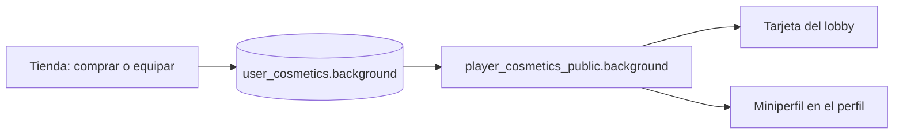

# Fondo de miniperfil: documentación

## Qué es

Un tipo de cosmético nuevo, `background`, que en la tienda se llama "Fondos". Es una imagen animada que va detrás de la tarjeta chica del jugador, como el fondo de miniperfil de Steam. Cada cuenta equipa uno, igual que el marco o el tema.

## Dónde se ve

| Lugar | Qué muestra |
|---|---|
| Lobby del matchmaking ("Mi grupo") | La tarjeta de cada integrante con:<ul><li>su fondo</li><li>su marco</li><li>el efecto de nombre</li><li>la insignia VIP</li></ul> |
| Sala de la partida (lista de jugadores) | El marco, el efecto de nombre y la insignia VIP. El fondo no, porque la fila es chica. |
| Tienda | La pestaña Fondos. La vista previa de cada fondo es la tarjeta completa. En la cabecera, "Tu miniperfil" con lo que tenés puesto o estás probando. |
| Mi perfil | La sección "Miniperfil" con la tarjeta. |

## Los 24 fondos

Todos son SVG de 400 × 400 con animación SMIL y `preserveAspectRatio="xMidYMid slice"`. Se recortan para llenar tanto la tarjeta del lobby (3:4) como la del perfil (apaisada). Están en `assets/perfil/fondos/` y los genera `pruebas/generar_fondos.py`.

| Colección | Para | Fondos |
|---|---|---|
| Counter-Strike (1000 pts) | Todos | Granada de humo, Radar, Lluvia de casquillos, Neón, Tormenta, Consola |
| Mapas de CS:S (800 pts) | Todos | Atardecer en el desierto, Brasas del pueblo, Planta nuclear, Oficina nevada |
| Sudamérica (800 pts) | Todos | Cruz del Sur, Carnaval |
| Series míticas | VIP | Luna roja, Aura dorada, Portal verde, Cristales del desierto, Ciudad de humo, Del otro lado, Energía alien, El gran golpe |
| Series míticas 2 | VIP | Abismo |
| Arsenal | VIP | Fuego cruzado, Bóveda de oro, Escamas de dragón |

Para que el nick y el nivel se lean con cualquier fondo, el componente `CardBackground` pone encima un degradé oscuro, más fuerte abajo.

## Base de datos

Todo está en `supabase/migrations/20261029200000_fondo_miniperfil.sql`:

- **`shop_items.kind`:** acepta `'background'`.
- **`user_cosmetics.background`:** columna nueva, con referencia a `shop_items` y `on delete set null`.
- **`set_my_cosmetics`:** acepta `background`, con las mismas reglas que `frame`.
- **`player_cosmetics_public.background`:** vacío si la cuenta ya no puede usarlo.
- **`admin_item_revoke`:** al quitar el artículo, también lo desequipa.
- **Carga:** los 24 fondos.

## Frontend nuevo

| Pieza | Qué hace |
|---|---|
| `shop/cosmetics.tsx` → `CardBackground` | Pone el fondo y el degradé detrás de una tarjeta con `isolate`. |
| `shop/cosmetics.tsx` → `MiniCard` | La tarjeta chica: fondo, avatar con marco, nombre con efecto y nivel. |
| `shop/cosmetics.tsx` → `FramedAvatar` | Suma `frameSrc`, para quien ya tiene la URL del marco (el matchmaking). |
| `matchmaking/types.ts` → `MmCosmetics` | `background_url`, `frame_url`, `name_class` y `vip`, en `MmMe`, `MmPartyMember` y `MmPlayer`. Son opcionales: sin datos se ve como antes. |
| `matchmaking/GroupSlots.tsx`, `room/RoomOverview.tsx` | Dibujan lo de `MmCosmetics`. |
