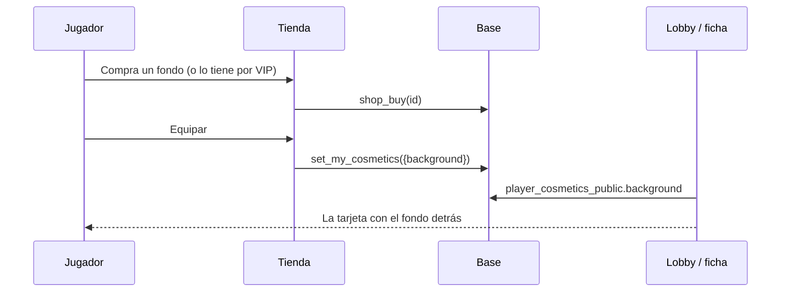

# Plan: fondo de miniperfil

> Planeación original. Estado: **propuesta**, pedida por Kyan el 2026-10-29.

Un tipo de cosmético nuevo: un fondo animado que va detrás de la tarjeta chica del jugador. Es la idea del "fondo de miniperfil" de Steam. Se ve en:

- la tarjeta del lobby del matchmaking;
- la tarjeta de la ficha;
- la vista previa de la tienda.

## Decisiones tomadas

| Tema | Decisión | Por qué |
|---|---|---|
| Tipo | `background` en `shop_items.kind`. En la tienda se llama "Fondos" | Es otro lugar del perfil, como el marco o el tema. Se equipa uno por cuenta. |
| Formato | SVG 400 × 400 con SMIL y `preserveAspectRatio="xMidYMid slice"`, en `assets/perfil/fondos/` | La misma imagen tiene que llenar la tarjeta del lobby (3:4) y la del perfil (apaisada). El dibujo va centrado para que se pueda recortar por cualquier lado. |
| Legibilidad | El componente pone un degradé oscuro encima del fondo | El nick, el nivel y el ELO se tienen que leer con cualquier fondo. |
| Cantidad | 24 fondos: 12 para todos (CS, mapas, países) y 12 VIP (series, arsenal) | Mismo equilibrio entre todos y VIP que el resto del catálogo. |
| Precio | CS 1000, mapas y países 800, VIP sin precio | Es el cosmético más visible, así que va al nivel de los marcos. |
| Base | Migración nueva, `20261029200000_fondo_miniperfil.sql` | Funciona corra antes o después la de la tienda, que todavía no está en producción. |
| Dónde se muestra | Frontend nuevo, como ruta `demo.*` | Kyan pidió ver todo en el frontend nuevo. La web vieja no muestra la pestaña porque su lista de tipos no la incluye. |

## 1. El flujo completo

## 2. Base de datos

En `supabase/migrations/20261029200000_fondo_miniperfil.sql`:

- **`shop_items.kind`:** el check pasa a aceptar `'background'`.
- **`user_cosmetics.background`:** columna nueva, `text`, con referencia a `shop_items`.
- **`set_my_cosmetics`:** acepta la clave `background`, con las mismas reglas que `frame`. Lo que equipás tiene que ser de ese tipo y tenés que poder usarlo.
- **`player_cosmetics_public`:** suma `background`, que queda vacío si la cuenta ya no puede usarlo.
- **`admin_item_revoke`:** si le sacan el artículo a alguien, también se lo desequipa.
- **Carga:** se cargan los 24 fondos en `shop_items`.

## 3. Assets

- **Generador:** `pruebas/generar_fondos.py` escribe:
  - los SVG en `assets/perfil/fondos/`;
  - los artículos en `assets/perfil/catalogo.json` (pasa a la versión 7);
  - el bloque de carga de la migración.
- **Copia al frontend nuevo:** el resultado se copia a `web/frontend/public/cosmetics/` en `kyan/ejemplo-matchmaking`.

## 4. Frontend nuevo (`kyan/ejemplo-matchmaking`)

- **`types.ts`:** suma `background` a `ItemKind`, `KINDS` y `Equipped`.
- **`cosmetics.tsx`:** componente `MiniCard`, la tarjeta chica con el fondo, el avatar con marco, el nombre con efecto y el nivel.
- **Tienda:**
  - pestaña Fondos;
  - una tarjeta de cada artículo que muestra el fondo dentro de la `MiniCard`;
  - la `MiniCard` en la vista previa de la cabecera.
- **Mi perfil:** la `MiniCard`, junto a lo que tenés equipado.
- **Lobby:**
  - `MmMe` suma `background_url` (opcional);
  - `MemberCard` lo dibuja detrás de la tarjeta, con el degradé encima;
  - el demo del matchmaking trae un fondo puesto.

## 5. Requisitos antes de empezar

Ninguno. Todo se prueba en local con los demos.

## 6. Orden de implementación

1. Generador y SVG; revisarlos en el navegador.
2. Catálogo y migración.
3. Tipos y `MiniCard`.
4. Tienda y Mi perfil.
5. Lobby.
6. `tsc`, `eslint` y prueba en `/demo/tienda` y `/demo/matchmaking`.
