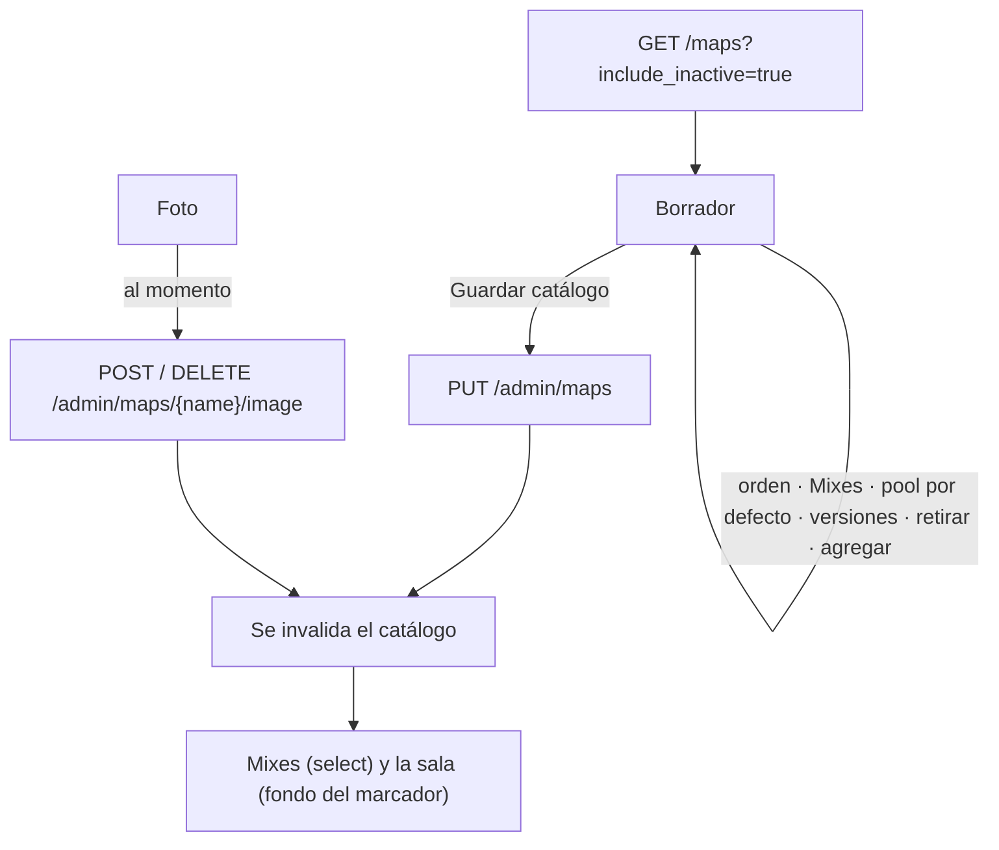

# Administración › Mapas y el selector de pool: documentación

## Qué hace

**Administración › Mapas** (`/admin/maps`, solo admin) administra el catálogo `map_pool`: qué mapas salen en Mixes, cuáles forman el pool por defecto del veto, el orden, las versiones de servidor de cada uno, su foto y cuáles están retirados.

**`MapPoolPicker`** es el bloque "Mapas del veto" de los formularios de Torneos y PCW: el pool por defecto o los mapas elegidos. Queda listo para cuando se hagan esos formularios.

## La pantalla

- **Resumen:** cuántos mapas salen en Mixes, cuántos hay en el pool por defecto (en rojo si son menos de 2), cuántos no tienen foto y cuántos están retirados. Cada tarjeta filtra la lista.
- **Lista:** miniatura, nombre y versiones; flechas para subir y bajar, interruptores de Mixes y del pool por defecto, y el estado. Búsqueda por nombre o versión y filtros (en la URL, con el mapa elegido).
- **Borrador:** los cambios de la lista y del panel no se mandan uno por uno. Aparece una barra "N mapas con cambios sin guardar" con **Descartar** y **Guardar catálogo**, que manda la lista entera con `PUT /api/v1/admin/maps`. No deja guardar con menos de 2 mapas en el pool por defecto. Salir de la sección con cambios pide confirmación.
- **Panel del mapa:**
  - **Foto:** se sube o se quita al momento, con una vista de cómo queda en la sala. JPG, PNG o WebP de hasta 2 MB. Un mapa nuevo todavía sin guardar no puede tener foto;
  - **Versiones del servidor:** agregar y quitar, salvo la primera, que es el nombre;
  - **Retirar:** lo saca de Mixes y del pool por defecto. Volver a ponerlo disponible no los prende solo.
- **Agregar mapa:** nombre del `.bsp` y si sale en Mixes o en el pool por defecto. Entra al borrador al final de la lista.

## Reglas (las mismas que la API)

| Regla | Dónde |
|---|---|
| Nombre y versiones: `^[a-z0-9_]{2,40}$`, sin repetir entre mapas, hasta 5 versiones | `catalog.ts`: `newMapError` y `versionError` |
| Al menos 2 mapas en el pool por defecto | `saveError` |
| Un retirado no sale en Mixes ni en el pool por defecto | `setActive`, `inMixes`, `inDefaultPool` y `toBody` |
| Foto: JPG, PNG o WebP de hasta 2 MB | `imageError` |
| Pool de un torneo o PCW: entre el BO más alto y 20 mapas; un retirado se conserva si ya estaba, pero no se agrega | `features/maps/pool.ts` |

## Dónde está cada cosa

| Qué | Archivo |
|---|---|
| Página, lista y barra de guardar | `web/frontend/src/features/admin/maps/AdminMapsPage.tsx` |
| Panel del mapa | `…/admin/maps/MapPanel.tsx` |
| Agregar mapa | `…/admin/maps/AddMapDialog.tsx` |
| Reglas del borrador | `…/admin/maps/catalog.ts` |
| Mutaciones | `…/admin/maps/queries.ts` |
| Selector de pool y sus reglas | `web/frontend/src/features/maps/MapPoolPicker.tsx` y `pool.ts` |
| Ruta | `web/frontend/src/routes/_app/admin.maps.tsx` |
