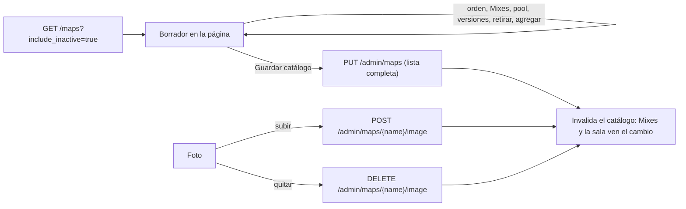

# Plan: Administración › Mapas y el selector de pool de Torneos y PCW

> Planeación original. Estado: **aprobado** por Daniel el 2026-10-29 ("apruebo el diseño de mapas, impleméntalo"). Pedido de Daniel el 2026-10-29.

El backend del catálogo de mapas está hecho (replanteo `30`, bitácora [`2026-10-25-pool-mapas-torneos-pcw`](../2026-10-25-pool-mapas-torneos-pcw/DOCUMENTACION.md)). Al frontend le faltaban la pantalla de Administración › Mapas (marcas, orden, versiones y foto) y el selector del pool en Torneos y PCW.

## Decisiones tomadas

| Tema | Decisión | Por qué / quién |
|---|---|---|
| Fuente del diseño | Las pantallas "Mapas (propuesta)" y "Pool de mapas en Torneos y PCW (propuesta)" del canvas "Admin · Servidores y ELO" | Aprobadas por Daniel el 2026-10-29 |
| Sección | `/admin/maps`, solo admin, entre Servidores y ELO y Usuarios | Diseño aprobado |
| Guardar | Orden, Mixes, pool por defecto, versiones, retirar y agregar se juntan en un borrador. "Guardar catálogo" manda la lista completa con `PUT /api/v1/admin/maps` | El `PUT` recibe el catálogo entero |
| Foto | Se sube o se quita al momento (`POST` y `DELETE /api/v1/admin/maps/{name}/image`), aparte del borrador. Un mapa nuevo todavía sin guardar no tiene foto | Son endpoints propios; el mapa tiene que existir |
| Validaciones en el navegador | Nombre y versiones con `^[a-z0-9_]{2,40}$`, sin repetir entre mapas, hasta 5 versiones; al menos 2 en el pool por defecto; un retirado sale de Mixes y del pool por defecto; foto JPG, PNG o WebP de hasta 2 MB | Las mismas reglas que la API: el error se ve antes de guardar |
| Filtro y mapa elegido | En la URL (`?filter=` y `?map=`) | Igual que las demás secciones |
| Selector de pool | Componente `MapPoolPicker` con sus reglas (mínimo según el BO, máximo 20, retirados que se conservan). Queda listo para los formularios de Torneos y PCW, que todavía no existen en el frontend nuevo | Diseño aprobado; las páginas de Torneos y PCW son otro requerimiento |
| Mapas faltantes por servidor | Fuera de este plan | Depende del plugin |

## 1. El flujo completo

## 2. Archivos

| Archivo | Cambio |
|---|---|
| `src/auth/permissions.ts` | Sección `maps` |
| `src/features/shell/nav.ts` | Ítem "Mapas" |
| `src/routes/_app/admin.maps.tsx` | Ruta nueva con `filter` y `map` |
| `src/features/admin/maps/` | `AdminMapsPage`, `MapPanel`, `AddMapDialog`, `catalog.ts` (reglas puras del borrador) y `queries.ts` |
| `src/features/maps/MapPoolPicker.tsx` y `pool.ts` | El selector y sus reglas |
| Pruebas | Reglas del borrador, del pool y de permisos y navegación |

## 3. Requisitos

- Nada en el backend: usa los endpoints del replanteo `30`, ya en local.
