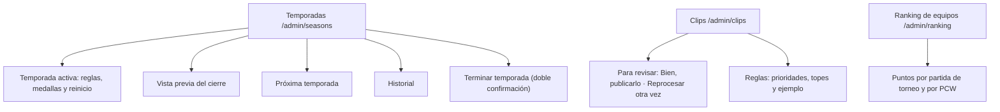

# Administración › Temporadas, Clips y Ranking de equipos: documentación

## Qué hace

Tres secciones nuevas de Administración, solo para admins, entre Servidores y ELO y Mapas.

## Temporadas

- **Encabezado:** la temporada activa con su avance, cuándo termina (06:00 de Argentina), cuánto falta, cuántos están en el ranking de cuántos jugaron, y **Terminar temporada**.
- **Temporada activa:** nombre, fecha de fin, top con medalla, mínimo de mixes, medallas por tramo y reinicio de los nivel 10. Se guarda con `PATCH /api/v1/admin/seasons/{id}`, que manda solo lo que cambió. Las temporadas cerradas no cambian.
- **Medallas por tramo:** se edita dónde termina cada tramo, el ícono y el nombre, con la vista de cómo queda en la ficha. Agregar y quitar tramos los vuelve a encadenar. No deja guardar con huecos o con un tramo fuera del top.
- **Reinicio:** deslizador del porcentaje y piso. La prueba ("2540 → 2055") se calcula en el navegador con la fórmula del contrato, con un ELO escrito o el de un jugador buscado por nick. Al lado, cuatro ejemplos fijos.
- **Vista previa del cierre:** `GET /api/v1/admin/seasons/preview` con las reglas del formulario de la activa, también las que no se guardaron, con 400 ms de retardo. Muestra el resumen (jugadores, en el ranking, medallas, reinicios y cuánto bajan) y la tabla con filtros, búsqueda y páginas.
- **Próxima temporada:** los mismos campos con la duración en días. Se guarda con `PUT /api/v1/admin/seasons/config`.
- **Historial:** las cerradas, con campeón, medallas, reglas y link al ranking final.
- **Terminar temporada:** el diálogo muestra el resumen de la vista previa con las reglas guardadas y pide escribir `estoy seguro`. Manda `POST /api/v1/admin/seasons/{id}/close`.
- **Sin temporadas:** "Abrir la temporada 1" (`POST /api/v1/admin/seasons`) y solo la pestaña Próxima temporada.

## Clips

- **Para revisar:** `GET /api/v1/admin/clips/review`, del más viejo al más nuevo, cada 30 s. Cada tarjeta muestra el video (`url` mientras está en R2; si no, el reproductor de Drive), el tipo de jugada, el jugador, si es VIP, la partida y cuántas veces se reprocesó. **Bien, publicarlo** (`approve`) y **Reprocesar otra vez** (`reprocess`). Mientras se graba, el botón de aprobar queda apagado. El sidebar muestra cuántos esperan.
- **Reglas:** prioridad de cada tipo (1 a 99, con "antes N" si cambió y "Volver a la escala de fábrica"), clips por jugador, por partida y por VIP, y el ejemplo "Así quedaría un mix" con jugadas inventadas. El video aparece como "Próximamente", con los valores actuales. `PATCH /api/v1/admin/clips/config` manda solo lo que cambió.

El primer "Reprocesar" de un clip va en la jugada, dentro de la partida. Esa pantalla todavía no existe en el frontend nuevo (`GET /api/v1/matches/{id}/clips`): hasta entonces, la lista "Para revisar" solo recibe clips reprocesados desde otro lado.

## Ranking de equipos

Los puntos por partida ganada: de torneo (ranking de siempre) y de PCW (vista "con PCW"). Al lado, cómo quedaría el top 10 de torneos con el valor nuevo de torneo (victorias × puntos, con el desempate de la API). Se guarda con `PUT /api/v1/admin/ranking/config` y vale al instante para todo el ranking, también lo ya jugado.

## Comunes

- **Borrador y barra de "cambios sin guardar":** `SaveBar` en `features/admin/ui.tsx`, compartida con Mapas.
- **Subpestañas** en la URL (`?tab=`).

## Dónde está cada cosa

| Qué | Archivo (en `web/frontend/src/`) |
|---|---|
| Temporadas | `features/admin/seasons/` (`AdminSeasonsPage`, `SeasonFormView`, `PreviewTab`, `HistoryTab`, `seasons.ts`, `queries.ts`) |
| Clips | `features/admin/clips/` (`AdminClipsPage`, `ReviewTab`, `RulesTab`, `clips.ts`, `queries.ts`) |
| Ranking de equipos | `features/admin/ranking/` (`AdminRankingPage`, `queries.ts`) |
| Rutas | `routes/_app/admin.seasons.tsx`, `admin.clips.tsx` y `admin.ranking.tsx` |
| Permisos y menú | `auth/permissions.ts`, `features/shell/nav.ts`, `queries.ts` y `AppSidebar.tsx` |
