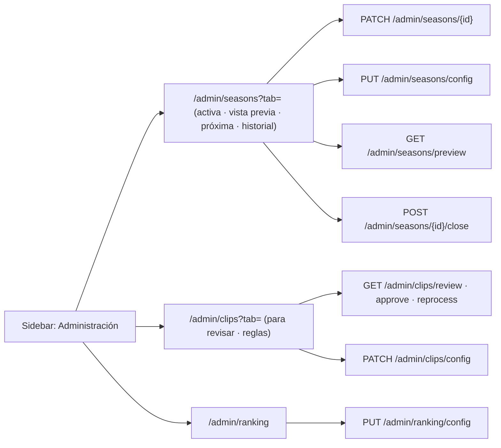

# Plan: Administración › Temporadas, Clips y Ranking de equipos

> Planeación original. Estado: **aprobado** por Daniel el 2026-10-29 ("apruebo el diseño de clips y temporadas, impleméntalos… te permito implementar de una vez ranking de equipos"). Pedido de Daniel el 2026-10-29.

El backend de las tres cosas está hecho: temporadas (contrato `temporadas.md`, sección 8f), clips (contrato `admin.md`, "Clips (admin)") y puntos del ranking de equipos (`GET`/`PUT /api/v1/admin/ranking/config`). Al frontend le faltaban las pantallas.

## Decisiones tomadas

| Tema | Decisión | Por qué / quién |
|---|---|---|
| Fuente del diseño | Las pantallas "Clips (propuesta)" y "Temporadas (propuesta)" del canvas "Admin · Servidores y ELO" | Aprobadas por Daniel el 2026-10-29 |
| Ranking de equipos | Sin diseño previo: una pantalla chica con los dos valores (torneo y PCW) y cómo quedaría el top con el valor nuevo de torneo | Daniel autorizó implementarla sin diseño |
| Secciones | `/admin/seasons`, `/admin/clips` y `/admin/ranking`, solo admin, entre Servidores y ELO y Mapas | Diseño aprobado |
| Subpestañas | En la URL (`?tab=`), como las demás secciones | Igual que Servidores, Jugadores y Usuarios |
| Formularios | Borrador con barra de "cambios sin guardar" (Descartar y Guardar), como en Mapas | Diseño aprobado |
| Clips · Reglas | `PATCH /api/v1/admin/clips/config` con solo lo que cambió. Ejemplo "Así quedaría un mix" calculado en el navegador con jugadas inventadas | El contrato pide mandar solo lo que cambia; el ejemplo no necesita la API |
| Clips · Para revisar | `GET /api/v1/admin/clips/review` con "Bien, publicarlo" y "Reprocesar otra vez". Contador en el sidebar | Diseño aprobado |
| Botón "Reprocesar" dentro de la partida | Fuera de este plan: el frontend todavía no muestra los clips de una partida (`GET /api/v1/matches/{id}/clips`) | Va con la pantalla de jugadas destacadas |
| Temporadas · prueba del reinicio | Fórmula del contrato en el navegador, con un ELO escrito o un jugador buscado | Lo pide el contrato |
| Temporadas · vista previa | `GET /api/v1/admin/seasons/preview` con las reglas del formulario de la activa, con 400 ms de retardo | Lo pide el contrato |
| Terminar temporada | Doble confirmación: resumen y después escribir `estoy seguro` | Obligatorio según el contrato |
| Sin temporadas | "Abrir la temporada 1" (`POST /api/v1/admin/seasons`) y la pestaña Próxima temporada | Diseño aprobado |

## 1. El flujo completo

## 2. Archivos

| Archivo | Cambio |
|---|---|
| `src/auth/permissions.ts` | Secciones `seasons`, `clips` y `ranking` |
| `src/features/shell/nav.ts`, `queries.ts` y `AppSidebar.tsx` | Ítems nuevos y contador de clips para revisar |
| `src/routes/_app/admin.seasons.tsx`, `admin.clips.tsx` y `admin.ranking.tsx` | Rutas nuevas |
| `src/features/admin/seasons/`, `clips/` y `ranking/` | Páginas, consultas y reglas puras con sus pruebas |
| `src/features/admin/ui.tsx` | La barra de "cambios sin guardar" pasa a ser compartida (la usan Mapas y las nuevas) |

## 3. Requisitos

- Nada en el backend: los endpoints ya existen en local.
