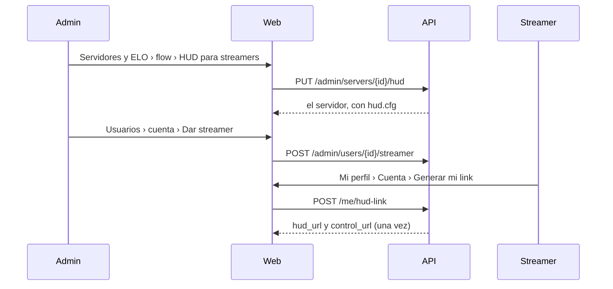

# Frontend del HUD: documentación

## Qué hace

La web ya administra el HUD del relay ([`2026-10-29-hud-relay-vps`](../2026-10-29-hud-relay-vps/DOCUMENTACION.md)). El admin configura el HUD de cada servidor y da o quita la marca de streamer; el streamer genera su link de OBS desde Mi perfil. Todo sigue el diseño aprobado ("HUD del relay: pantallas", sobre el canvas "Admin · Servidores y ELO").

## Servidores y ELO

- **Fila de cada servidor:** celda "HUD" con un chip: "Recibiendo" (llegó un paquete en el último minuto), "Activo · sin señal", "Apagado · <puerto>" o "Sin HUD".
- **Panel, sección "HUD para streamers"** (debajo de "Acceso del servidor"):
  - Chip de estado, último paquete y quién lo está transmitiendo.
  - Puerto del relay (27500 a 27519; vacío saca el HUD) y Activo/Apagado. "Activo" queda deshabilitado sin SourceTV, con el aviso para cargarla.
  - Las líneas de `cfg/sourcemod/csstv_hud.cfg`, con "Copiar líneas" y el recordatorio de subirlas a todos los servidores en la misma tanda.
  - "Guardar HUD", "Clave nueva" (con confirmación: hasta subirla, el relay descarta los paquetes) y "Sacar el HUD" (con confirmación).

## Usuarios

- Filtro "Streamers" y chip "Streamer" al lado del rol.
- Panel, sección "Streamer del HUD" (debajo del VIP): desde cuándo, quién la dio y si generó el link (de `GET /admin/streamers`), o cuándo se la quitaron. "Dar streamer" y "Quitar streamer", con confirmación. Se le avisa a la cuenta.

## Mi perfil › Cuenta

- Tarjeta "HUD para OBS" arriba de Contraseña, solo si la cuenta es streamer: desde cuándo y de cuándo es su link, y cómo agregarlo en OBS.
- "Generar mi link" (o "Generar otro link", con confirmación porque el anterior deja de andar). El resultado se muestra una sola vez en el diálogo de los secretos, con el link de OBS y el del panel, cada uno con "Copiar".

## Avisos

`streamer_granted` ("Ya puedes transmitir con el HUD", link a Mi perfil › Cuenta) y `streamer_revoked`.

## Dónde está cada cosa

| Qué | Archivo |
|---|---|
| Sección del HUD, chip y validación del puerto | `web/frontend/src/features/admin/servers/HudSection.tsx` |
| Celda HUD y sección en el panel | `web/frontend/src/features/admin/servers/ServersTab.tsx` |
| Mutaciones del HUD | `web/frontend/src/features/admin/servers/queries.ts` (`useSetServerHud`, `useNewHudKey`) |
| Marca de streamer | `web/frontend/src/features/admin/users/AccountsTab.tsx` (`StreamerSection`) y `queries.ts` |
| Tarjeta de Mi perfil | `web/frontend/src/features/profile/sections/HudCard.tsx`, `AccountSection.tsx` y `profile/queries.ts` (`useNewHudLink`) |
| Textos de los avisos | `web/frontend/src/features/shell/notifications/model.ts` |
| Pruebas | `HudSection.test.tsx`, `StreamerSection.test.tsx`, `HudCard.test.tsx`, `admin/rules.test.ts` y `notifications/model.test.ts` |
