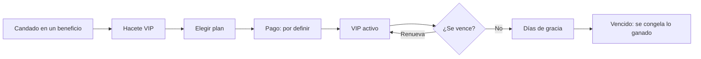

# Plan: Página "Hacete VIP"

> Planeación original. Estado: **propuesta**, prototipo de Kyan para pasarle a Daniel (pagos y backend) y a Esteban (frontend).

## Decisiones tomadas

| Tema | Decisión | Por qué |
|---|---|---|
| Dónde se ve | `/demo/vip` del frontend nuevo (`kyan/ejemplo-matchmaking`), solo en `pnpm dev` | Patrón de los demás demos |
| Qué tiene | Los planes, una tabla de qué tenés con y sin VIP, y el estado de tu VIP (activo, por vencer, vencido) con lo que pasa cuando se vence | Es donde el jugador decide pagar, y donde se definen los planes y las reglas de vencimiento |
| Planes | Mensual, 3 meses y 6 meses, con descuento por pagar varios meses | Es el "descuento por pago de varios meses" de la lista VIP |
| Precios | De ejemplo y en una tabla aparte, fácil de cambiar | Los precios los decide Kyan |
| Pago | El prototipo no cobra: el botón muestra el resumen y dice que el medio de pago está por definir | Es una decisión de Kyan y Daniel (Mercado Pago, transferencia, alta manual…) |
| Tabla de beneficios | Solo los beneficios que existen o están prototipados, agrupados en web, juego y misiones, y comunidad; los que faltan, como "Próximamente" | Prometer solo lo que hay |
| Vencimiento | Una tabla con qué pasa con cada beneficio cuando se vence, con lo decidido y lo propuesto marcado distinto | Hoy está decidido para algunos y falta para el resto |
| Candados | Todos los candados y avisos de "es para VIP" de los prototipos llevan un botón **Hacete VIP** a esta página | Hoy solo muestran un mensaje |

## Lo que tendría que hacer cada uno

- **Kyan:** precios, si Premium y VIP son dos niveles o uno, los días de gracia y lo que falta de la tabla de vencimiento.
- **Daniel:** el medio de pago, la tabla de suscripciones, una sola función "¿es VIP?" para todas las rutas y el alta manual desde el admin.
- **Esteban:** la página y "Mi suscripción" en la configuración de la cuenta.
