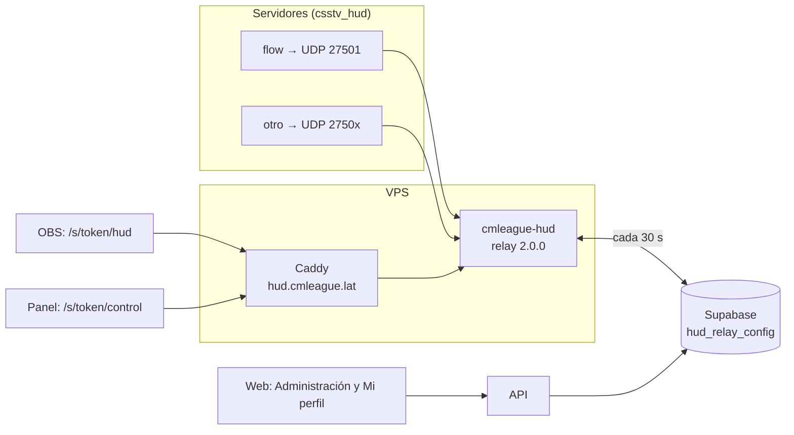
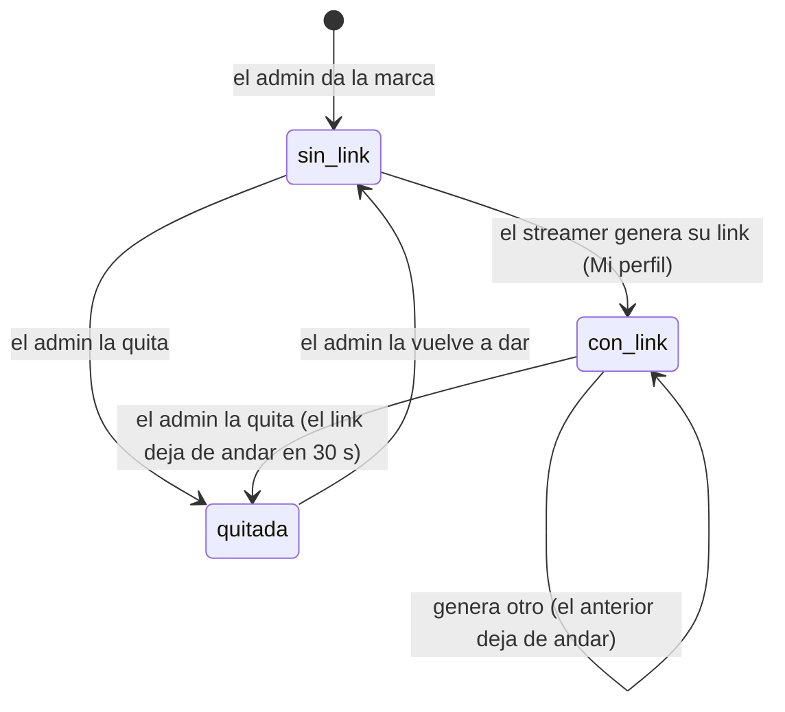

# Relay del HUD en el VPS, administrado desde la web: documentación

## Qué hace

El HUD de observer (vida, plata, armas y kills de los 10 jugadores encima de la imagen de la SourceTV) ya no depende de un relay en la PC del streamer con un túnel de playit.gg. Un solo relay en el VPS atiende a todos los servidores: cada uno manda sus paquetes UDP a `hud.cmleague.lat` por su propio puerto (del 27500 al 27519), con su propia clave.

Todo se administra desde la web. El admin elige qué servidores mandan HUD y quién puede transmitir. Cada streamer genera su link de OBS desde Mi perfil y elige en su panel qué servidor transmite. El relay lee esa configuración de la base cada 30 segundos, así que ningún cambio necesita reiniciar nada. Además le informa a la base quién está transmitiendo y cuándo llegó el último paquete de cada servidor.

## El HUD de cada servidor

En `game_servers` (replanteo `36`):

| Columna | Qué es |
|---|---|
| `hud_port` | Puerto UDP del relay para ese servidor, del 27500 al 27519, sin repetir. `null`: sin HUD |
| `hud_enabled` | El relay lo atiende |
| `hud_key` | Clave de 24 caracteres que genera la base al poner el puerto (`csstv_hud_key` del servidor) |
| `hud_seen_at` | Último paquete que recibió el relay |

- **Sin SourceTV no hay HUD:** activarlo pide `connect_address` y `tv_port`, y si se los sacan, se apaga solo (trigger `game_servers_hud_off`). El streamer transmite la imagen de la SourceTV, y su panel le muestra el `connect`.
- El admin lo configura con `PUT /api/v1/admin/servers/{id}/hud` y regenera la clave con `POST …/hud/key`. Cada servidor del admin trae `hud`, con las líneas del `csstv_hud.cfg` listas para copiar, si el relay está recibiendo y quién lo está transmitiendo.
- **En el servidor de juego** solo cambia `cfg/sourcemod/csstv_hud.cfg`: `csstv_hud "1"`, `csstv_hud_host "hud.cmleague.lat"`, y el puerto y la clave de ese servidor. El plugin no cambió (`csstv_hud` 1.1.0).

## Streamers

La marca de streamer es de la **cuenta**, como el VIP, y no un rol: un moderador o un organizador también puede transmitir.

- `hud_streamers` guarda el hash del token, nunca el token. `POST /api/v1/me/hud-link` lo devuelve una sola vez, con los dos links: `https://hud.cmleague.lat/s/<token>/hud` (OBS) y `/s/<token>/control` (panel).
- Dar y quitar la marca avisa a la cuenta (`streamer_granted` y `streamer_revoked`).
- **Panel del streamer:** elige el servidor entre los que tienen HUD activo (si hay uno solo, queda elegido), ve si llegan datos, quién más lo está transmitiendo (se avisa, pero se deja elegir igual) y el `connect` de la SourceTV. Los nombres de los equipos, el jugador enfocado y lo que se muestra son de cada streamer.

## El relay (`hud/relay` 2.0.0)

- **Modo VPS** si `hud.json` trae `apiUrl`, `anonKey` y `relayToken` (el token de `hud_relays`, como el Worker de demos). Llama a `hud_relay_config` cada 30 segundos con la clave anon: recibe los servidores activos (puerto, clave y SourceTV) y los hashes de los streamers, e informa las sesiones (quién tiene `/hud` abierto y dónde) y el último paquete de cada servidor.
- **Un canal por servidor:** su clave, su cola de retraso (el `tv_delay` que manda el plugin) y su partida. Un servidor nunca descarta ni pisa los paquetes de otro.
- **Rutas con token:** todo va debajo de `/s/<token>/`. Un token desconocido o revocado, y cualquier ruta sin token, responden 404. Las páginas mandan `Referrer-Policy: no-referrer` para que el token no salga a Google Fonts.
- Si la base no responde, sigue con la última configuración buena. Un streamer revocado pierde la conexión en la siguiente consulta.
- **Modo local** (la PC del streamer, sin `apiUrl`): igual que la 1.x, por si hace falta de respaldo.
- `/healthz` (sin token): estado, versión y commit, para el chequeo del despliegue.

## En el VPS

| Pieza | Detalle |
|---|---|
| `cmleague-hud.service` | `node relay.mjs` como `cmleague`, con `HUD_RELAY_CONFIG=/etc/cmleague/hud.json` y lo de cada streamer en `/var/lib/cmleague-hud` (`StateDirectory`) |
| `/etc/cmleague/hud.json` | URL de Supabase, clave anon y token del relay (root:cmleague, 640) |
| Fuentes de los íconos | `/srv/cmleague/hud/fonts/cstrike/resource/` (`clientmodkillfeed.ttf` y `cs.ttf`, de ClientMod, fuera del repo) |
| Caddy | `hud.cmleague.lat` → `127.0.0.1:8090`, sin compresión (retendría los eventos), sin Referer y sin la URL en el log |
| Firewall | UDP 27500 a 27519 |
| `HUD_BASE_URL` | En `api.env`: los links de OBS y el host del cfg |
| Despliegue | `deploy/vps/desplegar.sh hud` (pruebas, `pnpm build:node`, subida, restart y `/healthz` con el commit; vuelve sola a la versión anterior si falla) |

## Dónde está cada cosa

| Qué | Archivo / ubicación |
|---|---|
| Base | `supabase/replanteo/36_hud_relay.sql`; inversa y pruebas en `docs/bitacora/2026-10-14-replanteo-modelo-datos/` |
| API | `web/backend/src/routes/hud.ts`, `schemas/hud.ts`, `services/hud.ts`; `hud` en `routes/admin-servers.ts`; `streamer` en `routes/me.ts` y `routes/admin-players.ts` |
| Relay | `hud/relay/src/` (`hub.ts`, `channel.ts`, `remote.ts`, `server.ts`, `control.ts`, `config.ts`, `main.ts`) y `public/` |
| VPS | `deploy/vps/cmleague-hud.service`, `hud.json.example`, `Caddyfile`, `preparar.sh` y `desplegar.sh` |
| Contrato del frontend | `docs/frontend/contrato/admin.md`, `cuenta.md` y `notificaciones.md` |
