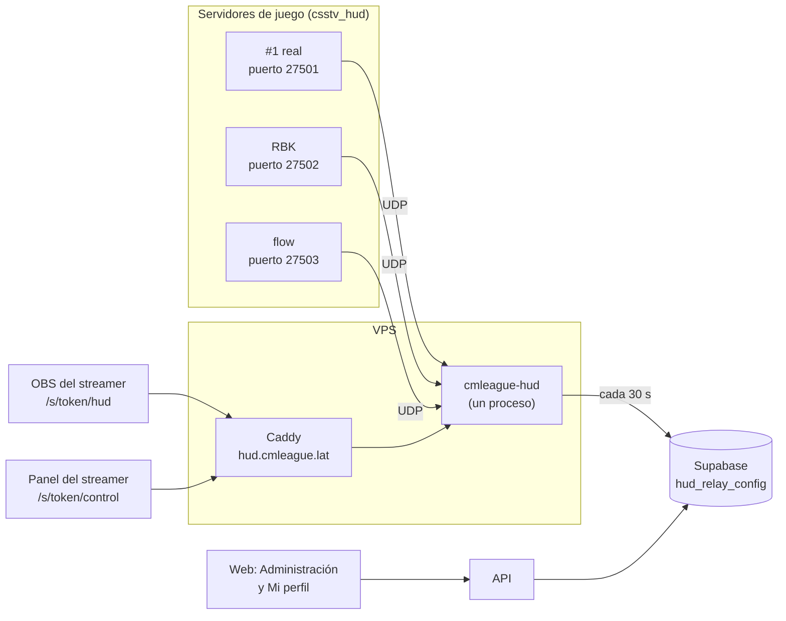
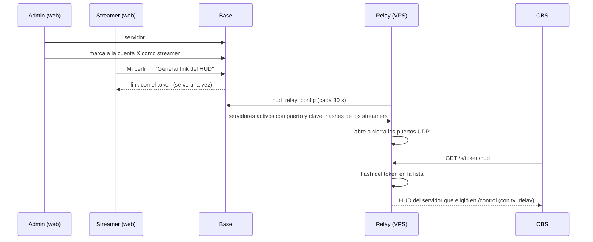

# Plan: Relay del HUD en el VPS, administrado desde la web

> Planeación original. Estado: **aprobado** el 2026-10-29.

Hoy el relay del HUD ([`2026-10-22-hud-observer`](../2026-10-22-hud-observer/PLAN.md)) corre en la PC del streamer, con un túnel de playit.gg, y atiende **un solo servidor**: una clave, un puerto UDP y una página `/hud` sin autenticación (está protegida solo porque escucha en `127.0.0.1`). El plan del VPS ([`2026-10-28-despliegue-vps-ovh`](../2026-10-28-despliegue-vps-ovh/PLAN.md), sección 4.3) dejó para después pasarlo al VPS y pidió un token por streamer antes de publicarlo.

Este plan lleva el relay al VPS, hace que atienda **a todos los servidores a la vez** (un puerto UDP por servidor) y lo administra desde la web: qué servidores mandan HUD y quién puede transmitir.

## Decisiones tomadas

| Tema | Decisión | Por qué |
|---|---|---|
| Cuántos relays | **Uno solo** en el VPS, que abre un puerto UDP por servidor | Daniel, 2026-10-29. Agregar un servidor es cargar su puerto en la web, sin tocar el VPS. Un solo `hud.cmleague.lat` |
| Cómo sabe de qué servidor es un paquete | Por el **puerto** en el que llegó. Cada servidor tiene además su propia clave (`hud_key`), que el relay valida | El puerto no depende del contenido del paquete. La clave evita paquetes falsos |
| Configuración por servidor | En **Administración › Servidores**: puerto del relay (opcional, único, del 27500 al 27519), HUD activo o no, y la clave generada por la base | Daniel, 2026-10-29 |
| SourceTV | Cada servidor suma su **dirección de SourceTV** (`tv_address`, `host:puerto`). **Sin ella no se puede activar el HUD** | Daniel, 2026-10-29. El streamer transmite la imagen de la SourceTV: sin ella el HUD no tiene sobre qué ir. `/control` le muestra el `connect` listo para copiar |
| Qué servidor transmite cada streamer | **Automático:** el relay sabe qué streamer tiene `/hud` abierto y en qué servidor, y lo informa a la base. Administración › Servidores muestra "Transmitiendo: X" y `/control` marca los servidores que ya transmite otro | Una marca manual quedaría puesta si el streamer cierra OBS sin desmarcar y trabaría a los demás. Dos streamers en el mismo servidor funcionan (cada uno con su estado): `/control` **avisa** "ya lo transmite X" y deja elegir igual (Daniel, 2026-10-29) |
| Servidor desactivado | El relay cierra su puerto y no le pasa nada a ningún streamer. El HUD muestra "sin señal" | Daniel, 2026-10-29. El servidor de juego puede seguir mandando hasta que se cambie su `.cfg`: el relay lo descarta |
| De dónde lee la configuración el relay | De la base, cada 30 segundos, con una función RPC y un token propio (`hud_relay_config(p_token)`), igual que el Worker de demos | La API del VPS no tiene la clave de servicio, y el relay no la necesita. Un cambio en la web llega en 30 segundos sin reiniciar nada |
| Streamers | Una **marca de la cuenta**, como el VIP (`hud_streamers`), no un rol | Daniel, 2026-10-29. `role` es uno solo: un moderador o un organizador también puede transmitir |
| Quién administra | **Solo admins**: el HUD de cada servidor y quién es streamer | Daniel, 2026-10-29 |
| Qué puede transmitir un streamer | **Cualquier servidor con HUD activo**; lo elige en su `/control` | Daniel, 2026-10-29 |
| Acceso del streamer | Un link con su token: `https://hud.cmleague.lat/s/<token>/hud` (OBS) y `/s/<token>/control`. El streamer lo genera desde **Mi perfil** y lo ve una sola vez; generar otro invalida el anterior. En la base solo queda el hash | OBS no puede iniciar sesión ni escribir usuario y contraseña. Es el mismo patrón que los tokens del Worker de demos |
| Lo que elige cada streamer | El servidor, el jugador enfocado, los nombres de los equipos y qué se muestra: **por streamer**. Hoy es uno solo para todos | Dos streamers a la vez se pisarían |
| Relay en la PC del streamer | Sigue funcionando como hoy (`relay.json` sin `apiUrl`) | Queda como respaldo si el VPS falla, y no rompe a nadie hasta el cambio |
| Íconos del feed | Las fuentes de ClientMod (`clientmodkillfeed.ttf` y `cs.ttf`) se copian al VPS a mano, **fuera del repo**, y el relay las sirve solo con un token válido | Hoy las busca en la PC del streamer. Son de ClientMod: no se versionan ni se publican sueltas |

## 1. El flujo completo





## 2. Base de datos (replanteo `36_hud_relay.sql`)

Con su inversa y sus pruebas SQL. El número queda después de la `35` (notificaciones programadas), que va por su propio plan.

- **`game_servers`:** `hud_port integer` (nulo, único, `between 27500 and 27519`), `hud_enabled boolean not null default false`, `hud_key text` (la genera la base al poner el puerto; 24 caracteres sin `|`, que es el separador del protocolo) y `tv_address text` (mismo formato que `connect_address`). Un `check` impide `hud_enabled` sin `hud_port` ni `tv_address`.
- **`hud_sessions`:** qué streamer tiene el HUD abierto en qué servidor (`user_id`, `server_id`, `seen_at`). La escribe el relay en cada actualización; una fila de más de 1 minuto cuenta como cerrada.
- **`hud_streamers`:** `user_id` (clave primaria, a `profiles`), `token_hash` (nulo hasta que genera su link), `granted_by`, `created_at`, `revoked_at`, `revoked_by`. Revocar no borra la fila, como el VIP.
- **`hud_relays`:** `name`, `token_hash`, `active`, `created_at`, `last_seen_at`. Como `demo_workers`. El token del relay se crea con SQL.
- **Funciones:**
  - `hud_relay_config(p_token)` (`anon`; valida el token y actualiza `last_seen_at`): los servidores con `hud_enabled` y puerto (`id`, `name`, `hud_port`, `hud_key`) y los streamers sin revocar con token (`user_id`, `alias`, `token_hash`).
  - `admin_set_server_hud(p_server, p_port, p_enabled)` y `admin_regenerate_hud_key(p_server)` (solo admin).
  - `admin_grant_streamer(p_user)` y `admin_revoke_streamer(p_user)` (solo admin; avisan con `streamer_granted` y `streamer_revoked`, categoría `account`).
  - `hud_streamer_new_token()` (el propio streamer): guarda el hash y devuelve el token una sola vez.

## 3. API

| Endpoint | Qué hace |
|---|---|
| `GET /api/v1/admin/servers` y `GET …/{id}` | Suman `hud` (`port`, `enabled`, `key`, `last_packet_at` si el relay lo informa) |
| `PUT /api/v1/admin/servers/{id}/hud` | `{ port, enabled }`. `409` si el puerto ya lo usa otro servidor |
| `POST /api/v1/admin/servers/{id}/hud/key` | Clave nueva (hay que copiarla al `.cfg` de ese servidor) |
| `GET /api/v1/admin/streamers` | Lista de streamers, con fecha y quién lo dio |
| `POST /api/v1/admin/users/{id}/streamer` y `…/streamer/revoke` | Dar y quitar la marca |
| `GET /api/v1/me/profile` | Suma `streamer: { since, has_link } \| null` |
| `POST /api/v1/me/hud-link` | Genera el link (`{ hud_url, control_url }`) y lo devuelve una vez. Solo streamers |

El dominio de los links sale de una variable nueva, `HUD_BASE_URL` (`https://hud.cmleague.lat`).

## 4. Relay (`hud/relay`)

- **Modo VPS** si `relay.json` tiene `apiUrl`, `anonKey` y `relayToken`. Sin eso, el modo local de hoy, igual que ahora.
- **Configuración en vivo:** cada 30 segundos llama a `hud_relay_config`. Abre un socket UDP por cada servidor activo y cierra los que ya no están. Si la base no responde, sigue con la última configuración buena y lo dice en el log.
- **Un canal por servidor:** su modelo del juego, su cola de retraso y su última secuencia (hoy son únicos). Así un servidor no descarta los paquetes de otro.
- **Rutas con token:** `/s/<token>/hud`, `/s/<token>/control`, `/s/<token>/events` y `/s/<token>/api/control`. El relay compara el hash SHA-256 del token con la lista. Un token desconocido o revocado responde `404` (no `401`, para no confirmar que existe). La conexión de `/events` de un token revocado se corta en la siguiente actualización.
- **Estado por streamer:** el servidor elegido y lo de `/control`, guardados en `StateDirectory` de systemd (`/var/lib/cmleague-hud/control.json`, por `user_id`).
- **`/control`:** suma un selector de servidor con los que tienen HUD activo, si llegan paquetes de cada uno, quién más lo está transmitiendo y el `connect` de su SourceTV.
- **Dos streamers en el mismo servidor:** se permite. `/control` avisa "ya lo transmite X" y deja elegir igual.
- **Presencia:** en cada consulta a la base, el relay informa qué streamers tienen `/hud` conectado y en qué servidor (`hud_relay_config` recibe esa lista y actualiza `hud_sessions`).
- **HTTP:** sigue en `127.0.0.1:8090`. Lo publica Caddy.

## 5. VPS (`deploy/vps/`)

- `cmleague-hud.service`: `StateDirectory=cmleague-hud`, `relay.json` en `/etc/cmleague/hud.json` (600), y se habilita.
- **Firewall:** UDP del 27500 al 27519 abierto.
- **Caddy:** se descomenta el bloque de `hud.cmleague.lat` (el DNS ya existe).
- **Fuentes:** `/srv/cmleague/hud/fonts/cstrike/resource/` con las dos `.ttf`, copiadas a mano desde la PC de Daniel.
- `desplegar.sh hud`: el destino que faltaba (build de Linux, `rsync`, reinicio y chequeo de que responde).

## 6. Servidores de juego

El plugin **no cambia**: ya tiene `csstv_hud`, `csstv_hud_host`, `csstv_hud_port` y `csstv_hud_key`. Cambia solo `cfg/sourcemod/csstv_hud.cfg`:

```
csstv_hud "1"
csstv_hud_host "hud.cmleague.lat"
csstv_hud_port "<el de ese servidor en la web>"
csstv_hud_key "<la de ese servidor en la web>"
```

- **En el real, RBK y flow en la misma tanda**, por SFTP. Vale desde el próximo cambio de mapa (en flow no hay consola).
- **Estado de hoy** (`docs/PENDIENTES.md`, 1.15, y la bitácora de flow): RBK y flow tienen `csstv_hud` apagado y sin host ni clave. **El real ya no lo tiene**: lo sacó kyan el 2026-10-25. Hay que volver a subirlo (`csstv_hud.smx` y su `.cfg`) y avisarle a kyan antes.
- **Cambio de regla:** `csstv_hud_port` y `csstv_hud_key` pasan a ser **propios de cada servidor**, como el token del reporter. Se suman a esa lista en `CLAUDE.md` y en la referencia de configuración igual en todos (`2026-10-22-rbk-igual-al-real/DOCUMENTACION.md`).

## 7. Frontend

- **Administración › Servidores:** en cada servidor, la dirección de SourceTV y una sección "HUD" con el puerto, el interruptor (deshabilitado sin SourceTV), la clave (copiar y regenerar con confirmación), las líneas del `.cfg` listas para copiar, si el relay está recibiendo y quién lo está transmitiendo.
- **Administración › Usuarios:** "Dar streamer" y "Quitar streamer" en la ficha de la cuenta, como el VIP, y un filtro.
- **Mi perfil:** si la cuenta es streamer, una tarjeta "HUD para OBS" con "Generar link" (se ve una vez, con aviso de que el anterior deja de andar) y una guía corta de OBS.
- **Notificaciones:** textos de `streamer_granted` y `streamer_revoked`.

Va en un requerimiento aparte del frontend, sobre el contrato que deja este.

## 8. Contrato del frontend

`docs/frontend/contrato/admin.md` (HUD por servidor y streamers), `cuenta.md` (`streamer` y el link) y `notificaciones.md` (los dos tipos nuevos). Una fila en las novedades del `README.md`.

## 9. Pruebas

- **SQL:** puerto repetido o fuera de rango; clave sin `|`; solo un admin configura y da la marca; `hud_relay_config` con token bueno, malo y desactivado; un streamer revocado o sin token no aparece.
- **Relay (Vitest):** abrir y cerrar sockets cuando cambia la configuración; dos servidores a la vez sin mezclarse; token bueno, malo y revocado; estado de `/control` por streamer; la base caída mantiene la última configuración.
- **API:** unitarias e integración contra la Supabase local.
- **De punta a punta, en local:** el servidor de pruebas (`E:\CSS DEDICATED SERVER\server`, con `csstv_send 0` y la cola vacía) mandando al relay local en modo VPS, con OBS o el navegador en `/s/<token>/hud`.

## 10. Requisitos antes de empezar

- Aprobar este plan. El de notificaciones programadas (`35`) va antes.
- Las dos `.ttf` de ClientMod para el VPS (las tiene Daniel).
- El despliegue al VPS y el cambio de `.cfg` en los tres servidores se hacen **con el visto bueno de Daniel**, al final, por la regla de "web primero, plugins al final".

## 11. Orden de implementación

1. Replanteo `36` con su inversa y las pruebas SQL.
2. API, esquemas y pruebas; `HUD_BASE_URL`.
3. Relay: modo VPS, canales por servidor, rutas con token, estado por streamer y `/control` con selector. Pruebas.
4. `deploy/vps/`: unidad, Caddy, firewall y `desplegar.sh hud`.
5. Contrato del frontend.
6. Prueba de punta a punta con el servidor local.
7. `DOCUMENTACION.md`, `GUIA_IMPLEMENTACION.md`, `docs/PENDIENTES.md` (despliegue y `.cfg` de **real, RBK y flow**), `CLAUDE.md` (valores propios de cada servidor) y la fila en `docs/bitacora/README.md`.
