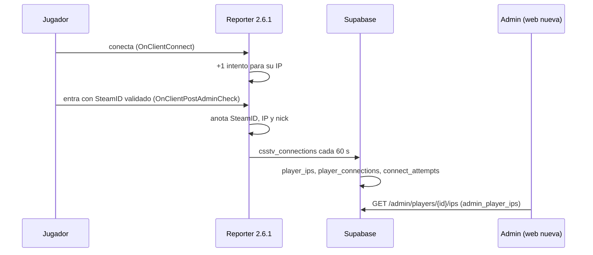

# IPs de los jugadores: documentación

## Qué hace

Cada vez que alguien entra a un servidor de CMLeague, el reporter anota su SteamID, su IP y su nick. También cuenta cada intento de conexión por IP, aunque nunca llegue a validar el SteamID: eso sirve para ver un ataque. Cada 60 segundos manda lo que juntó a la base, en uno o varios pedidos chicos.

Desde la 2.6.1, si hay un pico de intentos manda sin esperar los 60 segundos, y los intentos pendientes también se guardan en disco: si el servidor se cae, se mandan al volver a arrancar.

La IP queda atada al **SteamID** (no a la ficha). Un SteamID puede tener todas las IPs que quiera; el tope de SteamID por ficha no cambia. La ficha ve sus IPs a través de sus SteamID.

Es un dato personal: **solo lo ven los admins**, en Administración › Jugadores. Nunca sale en la API pública ni en los perfiles.



## Datos

| Tabla | Qué guarda | Cuánto dura |
|---|---|---|
| `player_ips` | Una fila por SteamID64 e IP: primera y última vez, veces, último servidor y último nick | Para siempre |
| `player_connections` | Cada entrada con el SteamID validado: fecha, servidor, SteamID64, IP y nick | 90 días |
| `connect_attempts` | Conexiones por servidor, IP y hora (también las que no validan el SteamID) | 90 días |

- Las tres tienen RLS sin políticas y sin permisos para `anon` ni `authenticated`: solo las leen las funciones `security definer` y la clave de servicio.
- Lo de más de 90 días lo borra `csstv_connections` de vez en cuando (2 % de las llamadas), porque producción no tiene `pg_cron`.

## La función del plugin: `csstv_connections`

`csstv_connections(p_token, p_seen, p_attempts)`, migración `supabase/migrations/20261029180000_ips_jugadores.sql`:

- Valida el token del servidor con `csstv_auth`. Un token malo responde `{"ok": false, "error": …}` con HTTP 200, como `csstv_whois`.
- `p_seen`: hasta 64 entradas `{"steam", "ip", "nick"}`.
  - El SteamID se pasa a SteamID64 con `csstv_steam64`: STEAM_0 y STEAM_1 son el mismo.
  - Se descartan los bots, los SteamID rotos y las IPs inválidas o con máscara.
  - El nick se corta en 64 caracteres.
- `p_attempts`: hasta 256 `{"ip", "n", "t"}`. Se suman en la fila de la hora de `t` (el primer intento, unix), si es de las últimas 48 horas; si no, en la hora actual (migración `20261029200000_ips_intentos_hora.sql`). Tope de 100 000 por entrada.
- Responde `{"ok": true, "seen": n, "attempts": n}`.

## El plugin (`csstv_reporter` 2.6.1, `csstv/ips.inc`)

| Qué | Cómo |
|---|---|
| Intentos | `OnClientConnect`, sin bots ni SourceTV. Un `StringMap` IP → {cantidad, primer intento}, con un tope de 1024 IPs a la vez (256 en la 2.6.0) |
| Pico (2.6.1) | Con 30 intentos desde el último envío, o 10 de una sola IP, manda en el momento. Como mucho un envío adelantado cada 5 segundos |
| Disco (2.6.1) | `data/csstv/ips_intentos.txt`: una línea por IP (`ip intentos primer_intento`) con los intentos pendientes. Se reescribe cada 5 segundos si cambió algo y se borra cuando queda vacío. No es un log: como mucho 1024 líneas (unos 40 KB). Al arrancar se suma lo que tenga (sin lo de más de 48 horas) y se manda a los 15 segundos. Las entradas con SteamID no van a disco |
| Entradas | `OnClientPostAdminCheck`, con `GetClientAuthId(AuthId_Steam2, validado)`. Nick saneado con `Claim_SafeNick`. Tope de 64 a la vez |
| Envío | Cada 60 segundos, pedidos de menos de 1900 bytes (como el resto del plugin), hasta 8 por vuelta. Lo que no entra queda para la siguiente |
| Si falla | Se descarta y queda en el log de errores de SourceMod (`IPs: no se pudieron registrar…`) |
| Cvar | `csstv_ips "1"`. Con `0`, o con `csstv_send "0"` o `csstv_enabled "0"`, no junta ni manda nada |
| Comando | `sm_csstv_ips` (RCON): muestra lo pendiente y lo manda ya |
| Solo pruebas | `csstv_ips_fake "<steam>" "<ip>" "<nick>" [intentos]`, solo con `CSSTV_DEBUG` |

## La web nueva (replanteo `38`)

- `admin_player_ips(ficha)` (solo admin): las IPs de todos los SteamID de la ficha (`player_steam_all`), la más reciente primero. Por cada una trae las **otras fichas** que entraron desde esa IP y cuántos SteamID sin ficha.
- `GET /api/v1/admin/players/{id}/ips`: 404 si la ficha no existe, `Cache-Control: no-store`.
- Administración › Jugadores › detalle de la ficha › **IPs**. Por cada IP muestra:
  - las veces, la última vez, desde cuándo y el último nick;
  - el SteamID, si la ficha tiene varios;
  - "También la usaron", con un link a cada ficha que la abre en el panel.
  - Se ven 5 y el resto con "Ver todas". Capturas en [`pruebas/`](pruebas/).

## Consultas útiles (SQL Editor de producción)

```sql
-- IPs de un SteamID
select * from player_ips where steam_id = csstv_steam64('STEAM_0:1:12345') order by last_seen_at desc;
-- SteamID que entraron desde una IP
select * from player_ips where ip = '1.2.3.4' order by last_seen_at desc;
-- IPs con más conexiones en las últimas 24 horas (ataques)
select g.name, a.ip, sum(a.count) from connect_attempts a join game_servers g on g.id = a.server_id
 where a.hour > now() - interval '24 hours' group by 1, 2 order by 3 desc limit 20;
```

## Dónde está cada cosa

| Qué | Archivo / ubicación |
|---|---|
| Migraciones de producción | `supabase/migrations/20261029180000_ips_jugadores.sql` y `20261029200000_ips_intentos_hora.sql` (la hora de `t`) |
| Pruebas de la migración | `docs/bitacora/2026-10-29-ips-jugadores/pruebas/ips_jugadores.sql` |
| Replanteo | `supabase/replanteo/38_ips_jugadores.sql`, con su inversa y su prueba en `docs/bitacora/2026-10-14-replanteo-modelo-datos/` |
| Plugin | `server/addons/sourcemod/scripting/csstv/ips.inc` y `csstv_reporter.sp` (2.6.1); `server/addons/sourcemod/plugins/csstv_reporter.smx` |
| API | `web/backend/src/routes/admin-players.ts`, `web/backend/src/schemas/admin.ts`, `web/backend/test/integration/ips.test.ts` |
| Frontend | `web/frontend/src/features/admin/players/FichasTab.tsx` (`Ips`) y `queries.ts` |
| Contrato | `docs/frontend/contrato/admin.md` |
| Changelog para jugadores | [`CHANGELOG_DISCORD.txt`](CHANGELOG_DISCORD.txt) |
