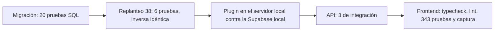

# IPs de los jugadores: guía de implementación

## Estado

- **Implementado y probado en local el 2026-10-29**, commiteado en `feat/frontend-fase-1` (`85f7fc2`).
- **Desplegado el 2026-10-29 en todo**, a pedido de Daniel (ver "Despliegue"). Falta verificarlo con el primer jugador que entre a cada servidor y publicar el changelog.
- El orden que se siguió:
  1. La migración `20261029180000_ips_jugadores.sql` en **producción** (SQL Editor) y en **staging**.
  2. El reporter 2.6.0 en **los tres servidores en la misma tanda**: el genérico al real (`SFTP_CSS_*`) y el licenciado a RBK (`SERVER1_*`) y a flow (`SERVER2_*`), con `server/build_licenciado.sh`. Se carga en el próximo cambio de mapa: no recargar con una partida en curso.
  3. El replanteo `38` en staging, y la API y la web en el VPS (`deploy/vps/desplegar.sh api` y `web`). En el corte, la `38` va después de la `37`.
  4. Publicar el [`CHANGELOG_DISCORD.txt`](CHANGELOG_DISCORD.txt).
- Si el plugin llega antes que la migración, cada envío falla (la función no existe) y queda en el log de errores. No afecta las partidas.

## Cambios respecto del plan

- Se sumó `sm_csstv_ips` (RCON), que muestra lo pendiente y lo manda ya, y `csstv_ips_fake`, que solo existe en la compilación de pruebas (`CSSTV_DEBUG`). Sin un cliente del juego, eran la única forma de probar los lotes y el envío de punta a punta.
- Los pedidos se arman de menos de 1900 bytes, hasta 8 por vuelta, como el resto del plugin (el ingest usa cuerpos de 2 KB).
- `csstv_connections` corta el SteamID en 40 caracteres y atrapa el error de `csstv_steam64` con un número que no entra en `bigint`. Si no, un solo SteamID roto tiraba todo el lote.

## Pruebas

1. **Migración** (base local): se aplicó dos veces (es re-ejecutable) y `pruebas/ips_jugadores.sql` dio **20 de 20**. Cubre:
   - token inválido;
   - STEAM_0 y STEAM_1 como el mismo SteamID;
   - varias IPs por SteamID y varios SteamID por IP;
   - IPv6;
   - descarte de bots, SteamID rotos, IPs inválidas y máscaras;
   - topes de 64 y 256;
   - que `anon` no lea las tablas;
   - el borrado de lo de más de 90 días.
2. **Replanteo `38`**: **6 de 6**, una segunda aplicación aborta y la inversa deja la estructura idéntica (`pruebas/estructura.sql`). Cubre que un usuario común no las ve, los dos SteamID de la ficha, la IP compartida con otra ficha y con un SteamID sin ficha, y la ficha sin IPs.
3. **Plugin**, compilado con el `spcomp` 1.8 del servidor local, sin errores ni avisos. El genérico pesa 119 242 bytes y su md5 es `8aabf8437cfbcd92fed517d0eea4da9d`.
   - Se probó la compilación `CSSTV_DEBUG` en el servidor local, con `csstv_reporter.cfg` apuntando a la Supabase **local** y un servidor de prueba local. Antes se respaldaron el cfg y el `.smx` y la cola estaba vacía. Por RCON:
     - entradas e intentos llegaron a las tres tablas;
     - 40 entradas y 240 IPs se mandaron completas en varios pedidos;
     - con un token malo quedó en el log de errores;
     - con `csstv_send 0` se descarta sin mandar.
   - Después se restauraron el cfg y el `.smx` originales (comparados byte a byte) y se borraron el servidor y los datos de prueba.
   - `srcds` lanzado con la salida redirigida se traba en `CTextConsoleWin32::GetLine` y no atiende RCON: hay que abrirlo en su propia ventana, como `start_server.bat`.
   - No se probó con un cliente del juego de verdad: `OnClientConnect` y `OnClientPostAdminCheck` se verifican con el primer jugador que entre después del despliegue.
4. **API**: `pnpm typecheck`, **392** unitarias y `test/integration/ips.test.ts` (**3 de 3**). Cubren:
   - la función con el token y con un token malo;
   - que la API pública no lee las tablas;
   - 401, 403 y 404;
   - la ficha con la IP compartida.
   - En `src/db/types.ts` se dejó afuera, otra vez, el cambio de `vip_status` de la migración `vip_dias` (otro requerimiento, sin commit).
5. **Frontend**: `pnpm gen:api`, typecheck, lint y **343** pruebas. Captura en 1440 px, en claro y en oscuro, con datos inventados en la base local, una cuenta admin temporal y el link a la otra ficha probado. Después se borró todo.

## Despliegue (2026-10-29)

1. **Producción** (`PG_*`, Session pooler): primero una lectura (`csstv_auth` y `csstv_steam64` existen; `player_ips` todavía no). Después la migración con `psql` y `notify pgrst, 'reload schema'`. Se comprobó por la API pública, con la URL y la clave del plugin y un token falso: `{"ok": false, "error": "Token de servidor inválido o revocado"}`.
2. **Staging:** la migración y el replanteo `38`.
3. **VPS:** `desplegar.sh api` y `desplegar.sh web`, los dos en `85f7fc23653b`.
4. **Servidores**, con [`pruebas/desplegar_ips.py`](pruebas/desplegar_ips.py) (`paramiko` en un entorno virtual del scratchpad):
   - Builds licenciados: `server/build_licenciado.sh be0fd76c-6bdc-477e-a843-6efc309b5ca9 rbk` y `… 7b01c85b-bc3e-4aa3-9ab5-3c2044157034 flow`.
   - Primero `inspect`: los tres tenían la 2.5.0 (el real con el md5 `494f6c54` del repo; RBK `5d8a5379`; flow `0697263a`).
   - Después `apply`. En cada servidor:
     - la 2.5.0 pasó a `plugins/disabled/csstv_reporter_2.5.0.smx` (en el real y en RBK se borró `disabled/csstv_reporter_2.3.1.smx`, para dejar 3);
     - se subió la 2.6.0, con el md5 verificado: real `8aabf843`, RBK `854b84f9`, flow `d0200467`;
     - se agregó `csstv_ips "1"` al `csstv_reporter.cfg`, verificado.
   - El cfg y el `.smx` anteriores quedaron respaldados en el scratchpad de la sesión, fuera del repo (el cfg tiene el token).
   - No se recargó nada: se carga en el próximo cambio de mapa de cada servidor.

## Verificar después de desplegar

- En el log de SourceMod de cada servidor: sin `IPs: no se pudieron registrar`.
- `sm_csstv_ips` por RCON responde.
- En producción, después de que entre alguien: `select count(*), max(last_seen_at) from player_ips;`.

## Revertir

- Plugin: volver al 2.5.0 en los tres servidores, o `csstv_ips "0"`.
- Web nueva: inversa `docs/bitacora/2026-10-14-replanteo-modelo-datos/reversas/38_ips_jugadores.sql`.
- Producción: `drop function public.csstv_connections(text, jsonb, jsonb); drop function public.csstv_ip(text); drop table public.connect_attempts, public.player_connections, public.player_ips;`. Borra los datos.
