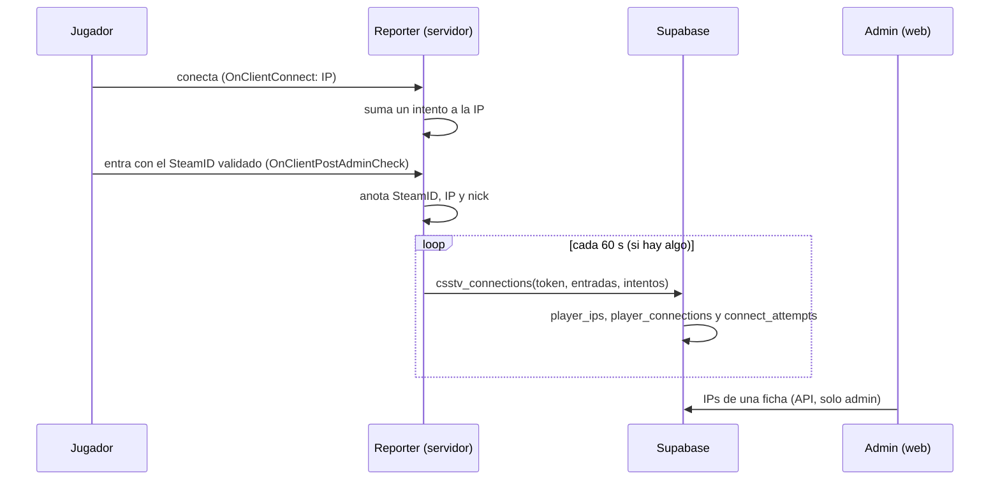

# Plan: registro de las IPs de los jugadores

> Planeación original. Estado: **aprobado** por Daniel el 2026-10-29 (respondió las cuatro preguntas del diseño).

Hoy guardamos los SteamID de cada ficha pero no la IP desde la que se conectan. Daniel quiere un registro: un SteamID puede tener todas las IPs que quiera (el tope sigue siendo solo de SteamID por ficha), se guarda **al entrar al servidor** (no al jugar un mix) y sirve también para ver ataques.

## Decisiones tomadas

| Tema | Decisión | Por qué |
|---|---|---|
| Cuándo empieza | **Ya, en producción**: migración `supabase/migrations/20261029180000_ips_jugadores.sql`, que no toca nada de la web vieja | Los servidores mandan a la Supabase de producción. Como replanteo, no se guardaría nada hasta el corte |
| Qué se guarda | **Resumen** por SteamID e IP para siempre (`player_ips`: primera y última vez, cuántas veces, último servidor y nick) y **registro** de cada entrada por 90 días (`player_connections`) | El resumen es chico y sirve para las multicuentas. El registro muestra cuándo y desde dónde entró cada uno |
| Intentos sin SteamID validado | **Sí, aparte**: `connect_attempts` por servidor, IP y hora, con un contador. Se borra a los 90 días | Es lo que sirve para ver un ataque (muchas conexiones de una IP). Un contador por hora no deja que una inundación llene la base |
| Vínculo | La IP queda atada al **SteamID** (SteamID64), no a la ficha. La ficha la ve a través de sus SteamID | Daniel: "la IP está vinculada a un SteamID". El tope de SteamID por ficha no cambia |
| Quién la ve | **Solo admins**. Nunca pública ni para moderadores. En Administración › Jugadores: las IPs de la ficha y las otras fichas que usaron la misma IP | Es un dato personal. Las fichas que comparten IP ayudan a detectar multicuentas |
| Cómo llega | El reporter junta las entradas en memoria y las manda **en lote cada 60 segundos** a una función nueva, `csstv_connections`, con el token del servidor | Un pedido HTTP por conexión sería otra forma de tumbar el servidor durante un ataque |
| Borrado de lo viejo | La misma `csstv_connections` borra, de vez en cuando, lo que tiene más de 90 días | Producción no tiene `pg_cron` |

## 1. El flujo completo

## 2. Base de datos

**Migración de producción** `supabase/migrations/20261029180000_ips_jugadores.sql`:

- `player_ips(steam_id, ip inet, first_seen_at, last_seen_at, times, last_server_id, last_nick)`, con clave `(steam_id, ip)` e índice por `ip`.
- `player_connections(id, at, server_id, steam_id, ip, nick)`, con índices por `steam_id`, `ip` y `at`. Se borra a los 90 días.
- `connect_attempts(server_id, ip, hour, count)`, con clave `(server_id, ip, hour)`. Se borra a los 90 días.
- RLS activado y sin políticas: nadie las lee por PostgREST, solo las funciones `security definer` y la clave de servicio.
- `csstv_connections(p_token, p_seen jsonb, p_attempts jsonb)` valida el token con `csstv_auth`. Topes: 64 entradas y 256 intentos por lote, nick de 64 caracteres y la IP tiene que ser válida. Convierte el SteamID con `csstv_steam64`. Responde `{"ok": true, "seen": n, "attempts": n}`.

**Replanteo `38_ips_jugadores.sql`**, para la web nueva (va con el corte y en staging):

- `admin_player_ips(p_player uuid)` (solo admin): las IPs de todos los SteamID de la ficha (`player_steam_all`), con primera y última vez, cuántas veces, el SteamID y las **otras fichas** que usaron esa IP (id y alias).

## 3. Plugin (`csstv_reporter` 2.6.0)

- `csstv/ips.inc`:
  - `OnClientConnect`: suma un intento a la IP (sin bots ni SourceTV) en un `StringMap`, con un tope de 256 IPs por lote.
  - `OnClientPostAdminCheck`: anota SteamID, IP y nick, sin bots, con un tope de 64 por lote.
  - Un timer de 60 segundos manda el lote si hay algo y lo vacía, con la misma URL y la misma clave que `!whois`.
  - Si falla, se descarta: es un registro, no una partida.
- `csstv_ips "1"` (cvar) para apagarlo.
- Build genérico y licenciado (RBK y flow). **Se despliega en el real, RBK y flow en la misma tanda**, cuando la migración esté en producción.

## 4. API y frontend

- `GET /api/v1/admin/players/{id}/ips` (admin): las filas de `admin_player_ips`.
- Administración › Jugadores, en el detalle de la ficha: sección "IPs" con IP, SteamID, primera y última vez, veces y "También la usaron", con links a esas fichas.

## 5. Requisitos antes de empezar

- Supabase local con las migraciones y los replanteos hasta la `37`.
- `spcomp` del servidor local para compilar.

## 6. Orden de implementación

1. Migración, prueba SQL e inversa. Probarla en la base local.
2. Replanteo `38`, prueba e inversa.
3. Plugin 2.6.0: compilar, y probar contra la Supabase **local** (nunca contra producción).
4. API, `pnpm gen:api` y la sección del frontend.
5. Documentación, contrato, `PENDIENTES.md` y changelog para jugadores (aviso de que se registra la IP).
6. **Con el OK de Daniel:** la migración en producción y en staging, la `38` en staging, el plugin en el real, RBK y flow, y la API y la web en el VPS.
