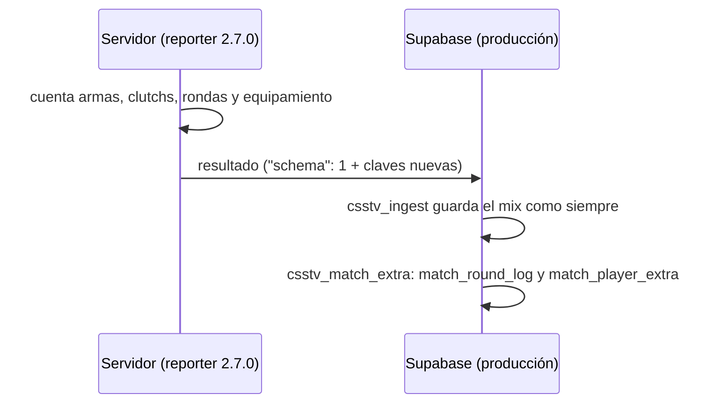

# Datos del reporter para las medallas: documentación

## Qué hace

Desde la 2.7.0, el `csstv_reporter` cuenta en cada mix lo que piden las medallas y la base de producción lo guarda. Así, cuando se haga el corte a la web nueva, ya va a haber datos acumulados:

- kills y headshots por arma;
- clutchs (1v1 a 1v5) e intentos;
- rondas sobrevividas, ganadas de CT y de T, pistolas y ecos ganados;
- bombas que plantó y explotaron;
- el registro de rondas con el equipamiento de cada bando.

La web vieja no cambia y no los ve. Se guardan en dos tablas nuevas, no en `matches` ni en `match_player_stats`, que la web vieja carga completas en cada visita.



No hace falta ningún Worker: los datos viajan con el resultado de siempre, por `ingest_server_chunk`.

## El resultado del plugin

Mismo `"schema": 1`. `csstv_ingest` rechaza todo lo que no sea 1, y una base que no conoce las claves nuevas las ignora. Por eso el plugin y la base se pueden desplegar en cualquier orden.

**Por ronda** (`rounds`): se agregan `a_eq` y `b_eq`, el equipamiento promedio de cada bando al terminar el freezetime (`round_freeze_end`). `-1` = no se pudo medir.

**Por jugador** (`players`):

| Clave | Qué cuenta |
|---|---|
| `survived` | Rondas en las que terminó vivo |
| `won_ct`, `won_t` | Rondas ganadas jugando de CT o de T |
| `pistol_won` | Ganó la primera ronda de una mitad del reglamentario (las de prórroga no) |
| `eco_won` | Ganó una ronda en la que su bando era eco: promedio propio < $1500 y del rival ≥ $3500. No cuenta la primera ronda de ninguna mitad, tampoco en la prórroga |
| `bombs_exploded` | Bombas que plantó y explotaron. Cuenta también la que explota después de que su bando ganó por eliminación |
| `clutches` | `{"1v1": n, …, "1v5": n}` ganados |
| `clutch_tries` | Veces que quedó último vivo de su bando contra al menos un rival |
| `weapon_kills`, `weapon_hs` | `{"awp": n, …}`, solo armas con kills a rivales |

Reglas:

- **Clutch:** cuando un bando se queda con un solo vivo contra al menos uno, ese jugador intenta el clutch, una vez por ronda. Si su bando gana la ronda, cuenta como ganado contra los rivales que quedaban, aunque él muera después (por ejemplo, con la bomba). Las muertes después del fin de la ronda no cuentan.
- **Equipamiento:** la suma, por jugador vivo, de sus armas (sin la C4), granadas, chaleco (650, o 1000 con casco) y kit, con los precios de v34. El promedio es por bando.
- **Armas** (nombres de `player_death`): `glock`, `usp`, `p228`, `deagle`, `elite`, `fiveseven`, `m3`, `xm1014`, `mac10`, `tmp`, `mp5navy`, `ump45`, `p90`, `galil`, `famas`, `ak47`, `m4a1`, `sg552`, `aug`, `scout`, `sg550`, `awp`, `g3sg1`, `m249`, `knife`, `hegrenade`.
- Los contadores están en `g_Stats`, así que `!rr` también los vuelve atrás.

## La base (migración `20261029210000_medallas_datos.sql`)

| Tabla | Qué guarda |
|---|---|
| `match_round_log` | Una fila por mix: `rounds` con `n`, `winner`, `a_side`, `reason`, `a_eq` y `b_eq`. También para los mixes de plugins anteriores (sin `a_eq` ni `b_eq`), porque el registro de rondas ya venía en el resultado y la base lo descartaba |
| `match_player_extra` | Una fila por jugador y mix, con la misma clave que `match_player_stats` (`match_id`, `steam_id`) y borrado en cascada. Sin fila = el mix es de un plugin anterior a 2.7.0 (sin dato, no cero) |

- RLS como `match_player_stats`: todos leen y solo los admins cambian.
- `csstv_match_extra(match, payload)`:
  - valida cada valor;
  - un dato inválido queda en `null`;
  - ante un error, avisa y deja el resultado guardado igual.

  No se puede llamar con `anon` ni `authenticated`.
- `csstv_ingest` se parcha agregando una línea antes del `return v_id;` final, sobre la definición instalada. Por eso funciona en producción y en staging, que tienen versiones distintas. En producción la función tiene saltos de línea de Windows, así que el ancla acepta `\r\n`. Los replanteos `04`, `06`, `07` y `15` parchan otros lugares, así que la línea sobrevive al corte.

## Consultas útiles

```sql
-- kills con AWP por jugador (todos los mixes con 2.7.0)
select s.steam_id, sum((e.weapon_kills ->> 'awp')::int) awp
  from match_player_extra e join match_player_stats s using (match_id, steam_id)
 group by 1 order by 2 desc nulls last limit 20;
-- clutchs ganados
select steam_id, sum(clutch_1v1 + clutch_1v2 + clutch_1v3 + clutch_1v4 + clutch_1v5) from match_player_extra group by 1 order by 2 desc;
```

## Dónde está cada cosa

| Qué | Archivo |
|---|---|
| Plugin | `server/addons/sourcemod/scripting/csstv/stats.inc` (contadores, clutchs, equipamiento), `csstv/json.inc` (claves nuevas), `csstv_reporter.sp` (eventos, 2.7.0) |
| Migración | `supabase/migrations/20261029210000_medallas_datos.sql` |
| Pruebas | `pruebas/medallas_datos.sql` (17) |
| Despliegue a los servidores (real y flow) | `pruebas/desplegar_medallas.py` |
| Qué medalla usa qué dato | [`INVESTIGACION.md`](INVESTIGACION.md) |
