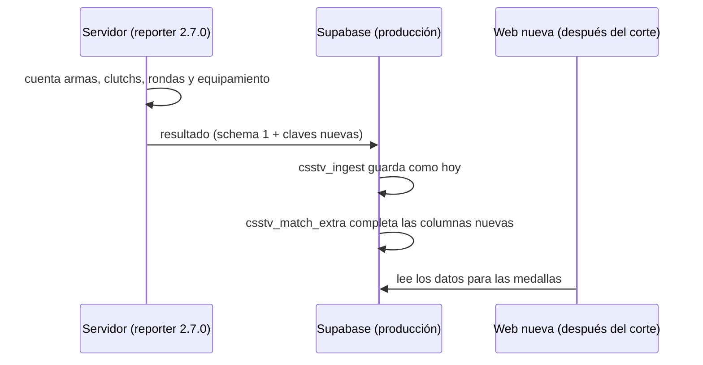

# Plan: datos del reporter para las medallas

> Planeación original. Estado: **aprobado** por Daniel el 2026-10-29 ("hagámoslo para salir a la bd de producción para que en la web nueva ya tengamos dichas estadísticas, en la web vieja no hagamos nada").

Parte de [`INVESTIGACION.md`](INVESTIGACION.md), que cruza cada medalla con lo que manda el plugin.

## Decisiones tomadas

| Tema | Decisión | Por qué |
|---|---|---|
| Formato del resultado | Claves nuevas en el JSON, sin cambiar `"schema": 1` | `csstv_ingest` rechaza todo lo que no sea 1. Así el plugin y la base se despliegan en cualquier orden |
| Dónde se guarda | En la base de producción de hoy, con una migración | Los datos se juntan desde ya y pasan a la web nueva en el corte, porque los replanteos no rehacen `match_player_stats` ni `matches` |
| Web vieja | No cambia nada | Pedido por Daniel |
| Cómo se parcha `csstv_ingest` | Se agrega una sola línea (`perform csstv_match_extra(v_id, p);`) antes del `return v_id;` final, sobre la definición instalada | Producción y staging tienen definiciones distintas (staging ya tiene los replanteos). Los replanteos `04`, `06`, `07` y `15` parchan otros fragmentos, así que la línea sobrevive al corte |
| Datos que faltaban | Columnas nulas: `null` es "el plugin no lo mandaba" | Las medallas tienen que distinguir "0" de "sin dato" |
| Registro de rondas | Se guarda en `matches.round_log` | Hoy el plugin lo manda y la base lo descarta. Las medallas de equipo (remontada, muro, pistolas) lo necesitan |
| Ecos | El plugin manda el valor promedio del equipamiento de cada bando por ronda y cuenta `eco_won` con umbrales fijos ($1500 propio, $3500 rival) | Con el valor por ronda guardado, la web puede recalcular con otros umbrales sin perder nada |
| Clutchs | Se guarda el desglose 1v1…1v5 y los intentos | Así la pregunta de si cuenta el 1v1 se decide en la web, sin perder datos |
| Versión | `csstv_reporter` 2.7.0 | Funcionalidad nueva |

## 1. El flujo completo

## 2. Plugin (`csstv/stats.inc`, `csstv/json.inc`, `csstv_reporter.sp`)

Contadores nuevos por jugador, dentro de `g_Stats` (así `!rr` los vuelve atrás junto con el resto):

| Clave JSON | Qué cuenta |
|---|---|
| `survived` | Vivo al terminar la ronda |
| `won_ct`, `won_t` | Rondas ganadas jugando de CT o de T |
| `pistol_won` | Ganó la primera ronda de una mitad del reglamentario |
| `eco_won` | Ganó una ronda en la que su bando era eco (sin las primeras rondas de cada mitad, también las de prórroga) |
| `bombs_exploded` | Bombas que plantó y explotaron |
| `clutches` | `{"1v1": n, …, "1v5": n}` ganados |
| `clutch_tries` | Veces que quedó último vivo de su bando contra al menos un rival |
| `weapon_kills`, `weapon_hs` | `{"awp": n, …}`, solo armas con kills |

Por ronda, en `rounds`: `a_eq` y `b_eq`, el valor promedio del equipamiento de cada bando al terminar el freezetime (`round_freeze_end`), con la tabla de precios de v34. `-1` si no se pudo medir.

## 3. Base de datos (migración de producción `20261029210000_medallas_datos.sql`)

- `match_player_stats`: `rounds_survived`, `rounds_won_ct`, `rounds_won_t`, `pistol_won`, `eco_won`, `bombs_exploded`, `clutch_1v1` … `clutch_1v5`, `clutch_tries` (enteros nulos), `weapon_kills` y `weapon_hs` (jsonb nulos).
- `matches.round_log` (jsonb nulo).
- `csstv_match_extra(uuid, jsonb)`: valida y guarda lo anterior. Si algo viene mal, lo ignora sin hacer fallar el resultado.
- Parche a `csstv_ingest` sobre la definición instalada. Re-ejecutable.
- Se aplica en producción, en staging y en la base local.

## 4. Requisitos antes de empezar

Ninguno nuevo.

## 5. Orden de implementación

1. Migración y pruebas SQL en la base local.
2. Plugin 2.7.0 y prueba con bots en el servidor local contra la Supabase local.
3. Builds licenciados de RBK y flow.
4. Migración en producción y staging; plugin en el real, RBK y flow en la misma tanda.
5. Documentación y changelog.
