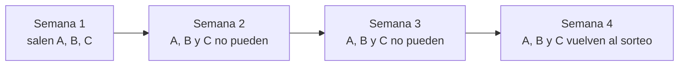

# Misiones semanales (prototipo)

Prototipo de Kyan para que lo terminen Daniel (backend y plugin) y Esteban (frontend). Está en el frontend nuevo (`repo-mm-ejemplo`, rama `kyan/ejemplo-matchmaking`), en `/demo/misiones`, solo con `pnpm dev`.

## Qué ve el jugador

- **Popout:** un botón con una mira en la barra de arriba. El número en naranja son las misiones completas que todavía no reclamó. Al tocarlo se abre un panel con:
  - Cuánto falta para que se renueven.
  - El bonus de la semana.
  - Las 6 misiones para todos y las 3 VIP, cada una con su barra de progreso, el premio y **Reclamar**.
- **Página de Misiones:**
  - La semana completa, en tarjetas con la dificultad.
  - El saldo de puntos y de monedas VIP.
  - Las semanas anteriores, con cuántas completaste y cuánto ganaste.
- **Sin VIP:** las 3 misiones VIP se ven borrosas, con candado.

| Por semana | Cuántas | Premio |
|---|---|---|
| Para todos, fáciles | 2 | 30 puntos |
| Para todos, medias | 3 | 60 puntos |
| Para todos, difícil | 1 | 120 puntos |
| Bonus por completar las 6 | — | 150 puntos |
| VIP (una de cada dificultad) | 3 | 20, 40 y 80 monedas VIP |

Los puntos son los de la tienda (un mix da 10 o 15). Las monedas VIP son las de la progresión VIP.

## La rotación

- **Semana:** empieza los lunes a las 06:00 de Argentina.
- **Cómo se eligen:** al azar, con una semilla por semana, así que la misma semana siempre da las mismas misiones.
- **Espera:** una misión que salió **no vuelve hasta dentro de 2 semanas**.
- **Tope por área en una misma semana:** 4 de juego, 3 de web y 2 de comunidad, para que no sean todas de matar gente.
- **Orden:** se elige de la más difícil a la más fácil, porque las difíciles tienen menos opciones.
- **Si no alcanza:** primero afloja el tope por área y después la espera, y en los dos casos avisa en la vista de admin.

## Las misiones y los datos del servidor

Las misiones de juego usan **los mismos datos que las medallas** (`docs/MEDALLAS_DATOS_REPORTER.md`). Cada métrica dice de dónde sale:

| Fuente | Qué es | Misiones |
|---|---|---|
| Plugin 1.8 | Lo que el `csstv_reporter` ya manda: kills, HS, asistencias, daño, entradas, k3 a k5, plantadas, defuses, rondas jugadas, mapa y ganador | Las de juego que salen desde ya |
| Web | Eventos de la web que se registran con las misiones: días que entraste, clips, demos, comparador, buscador, tienda, cosméticos, exportar stats y eventos | Las de web |
| Plugin nuevo | Lo que hay que pedir en la próxima versión del plugin (schema 2): kills por arma, clutchs, rondas sobrevividas, pistolas, ecos y bombas explotadas | 9 misiones que **esperan**: sobrevivir rondas, pistolas, kills con AWP, Deagle y cuchillo, clutchs (dos), eco y bombas explotadas |
| Falta sistema | Necesita algo que todavía no existe | 3 que **esperan**: jugar con alguien de tu grupo (dos, grupos del matchmaking) e invitar a un amigo (referidos) |

Las que esperan **quedan en el catálogo pero no salen en la rotación** (`isReady`). Cuando salga el plugin nuevo, alcanza con sumar `"plugin_v2"` a `READY_SOURCES` en `catalog.ts` y entran solas. El test comprueba que siguen respetando la espera.

**No se usan:** el MVP del mix, porque todavía no hay fórmula, y las flashes efectivas, wallbangs y noscopes, porque v34 no los tiene.

En total hay 58 misiones: 46 que ya pueden salir y 12 que esperan. Las que pueden salir son 12 fáciles, 13 medias y 6 difíciles para todos, y 5 de cada dificultad VIP. Con la espera de 2 semanas el mínimo es 6, 9 y 3 para todos y 3 de cada VIP, así que alcanza con margen. En 2 meses sale más del 80 % del catálogo.

## Cambiar las misiones

Todo está en `features/missions/catalog.ts`:

| Qué | Dónde |
|---|---|
| Sumar, sacar o cambiar una misión | `MISSIONS`, una fila por misión: título (`{n}`, `{map}` y `{weapon}` se reemplazan), área, métrica, objetivo, dificultad, VIP y activa |
| Apagar una sin borrarla | `active: false` |
| Lo que paga cada dificultad | `REWARDS` y `WEEK_BONUS` |
| Cuántas salen por semana | `SLOTS` |
| Tope por área | `AREA_MAX` |
| Semanas de espera | `COOLDOWN_WEEKS` |
| Qué datos ya existen | `READY_SOURCES` |

La vista **Admin → Misiones** del demo muestra:

- Si el catálogo alcanza para cada dificultad.
- Las próximas 8 semanas. Al tocar una misión se resaltan las semanas en las que sale.
- El catálogo completo, con un switch para activar cada misión, el objetivo editable y la fuente de los datos.
- El switch **Simular el plugin nuevo**, para ver la rotación con las misiones de schema 2.

Los cambios se ven al instante en la rotación.

## Archivos (en `web/frontend/src/`)

| Archivo | Qué tiene |
|---|---|
| `features/missions/catalog.ts` | Métricas con su fuente, misiones, recompensas y reglas |
| `features/missions/rotation.ts` | `pickWeek`, `rotation`, `weekIndex` y `minimumPool` |
| `features/missions/rotation.test.ts` | 10 tests: cantidades por semana, espera de 2 semanas en medio año, tope por área, variedad en 2 meses, que no salgan misiones sin datos, que con el plugin nuevo sigan bien, misma semilla igual resultado, mínimo del catálogo, aviso si no alcanza y el corte del lunes a las 06:00 |
| `features/missions/demo.ts` | Progreso simulado: mixes con stats al azar, eventos de la web, reclamar, bonus y pasar de semana |
| `features/missions/MissionsUi.tsx` | El popout, la fila de misión, el bonus y la página |
| `features/missions/AdminMissions.tsx` | La vista de admin |
| `routes/demo.misiones.tsx` | La ruta con la barra Demo |

## Lo que falta para la versión real

**Daniel:**

- **Tablas:**
  - `missions`: el catálogo, con las columnas de `Mission`.
  - `mission_weeks (week, mission_id)`: las misiones de cada semana, **guardadas por el cron al abrir la semana**, para que editar el catálogo no cambie semanas que ya salieron.
  - `mission_progress (user_id, week, mission_id, value, claimed_at)`.
- **Progreso:** con cada mix guardado, sumar las métricas de plugin a las misiones de la semana del jugador. Con cada evento de la web, sumar su métrica.
- **Rutas:** la semana del jugador con su progreso, reclamar (sumando puntos o monedas VIP con el mismo registro que la tienda, y chequeando VIP del lado del servidor) y la administración del catálogo.
- **Cron del lunes 06:00:** arma la semana con `pickWeek` usando las dos semanas anteriores guardadas.
- **Plugin nuevo:** cuando salga el schema 2, prender `plugin_v2` y entran las 9 misiones que esperan. Se despliega en nuestro servidor y en RBK en la misma tanda.

**Esteban:** el botón con el popout en la barra de arriba, la página de Misiones y Admin → Misiones.

## Pruebas (2026-10-29)

- **Tests:** los 10 pasan.
- **Popout:** con 4 mixes ganados, 1 perdido y varias acciones de la web, mostró 3 misiones para reclamar.
- **Reclamar:** las 3 sumaron +90 puntos y +80 monedas VIP.
- **Pasar de semana:** la semana quedó en el historial y la siguiente no repitió ninguna misión.
- **Admin:** se ven el chequeo del catálogo, las 8 semanas y la tabla.
- **Consola:** no hubo errores.
- **Sin revisar:** el modo claro y el celular.
