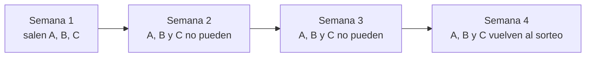

# Misiones semanales y Primeros pasos (prototipo)

Prototipo de Kyan para que lo terminen Daniel (backend y plugin) y Esteban (frontend). Está en el frontend nuevo (`repo-mm-ejemplo`, rama `kyan/ejemplo-matchmaking`), en `/demo/misiones`, solo con `pnpm dev`.

Hay dos tipos de misiones:

| Tipo | Qué son | Cómo se renuevan |
|---|---|---|
| **Semanales** | De juego y de comunidad: jugar, ganar, kills, HS, entradas, mapas, PCW… | Cada lunes salen nuevas al azar. Una que salió no vuelve hasta dentro de 2 semanas |
| **Primeros pasos** | Las de la web: votar un clip, subir un clip, entrar a la web 3 días distintos, comparar, buscar, equipar un cosmético, comprar en la tienda, anotarse a un evento… | **Una sola vez desde que te registrás.** No rotan, no se reinician y pagan una vez |

## Qué ve el jugador

- **Popout:** un botón con una mira en la barra de arriba. El número en naranja son las misiones completas que todavía no reclamó, de los dos tipos. El panel tiene dos pestañas:
  - **Esta semana:** cuánto falta para que se renueven, el bonus, las 6 para todos y las 3 VIP.
  - **Primeros pasos 3/14:** las de una sola vez. Las reclamadas van al final, y la pestaña muestra un punto naranja si hay alguna para reclamar.
- **Página de Misiones:** la semana completa, Primeros pasos, el saldo de puntos y de monedas VIP, y las semanas anteriores.
- **Sin VIP:** las misiones VIP, semanales y de Primeros pasos, se ven borrosas con candado.

| | Cuántas | Premio |
|---|---|---|
| Semanales para todos | 2 fáciles, 3 medias y 1 difícil | 10, 20 y 40 puntos |
| Bonus por completar las 6 semanales | — | 50 puntos |
| Semanales VIP | 1 de cada dificultad | 10, 20 y 40 monedas VIP |
| Primeros pasos | 11 para todos y 3 VIP | La misma tabla por dificultad |

Los puntos son los de la tienda y las monedas VIP las de la progresión VIP. Un mix da 10 de cada uno, y 5 más si ganás.

### Por qué esos valores

Las recompensas están en la misma escala que un mix, para que las misiones sumen sin tapar lo que se gana jugando:

| | Por semana |
|---|---|
| Jugar 6 mixes y ganar la mitad | 75 puntos |
| Completar las 6 semanales y el bonus | 170 puntos, lo que dan unos 12 mixes ganados (para completarlas hay que jugar varios) |
| Completar las 3 VIP | 70 monedas VIP |
| Primeros pasos, una sola vez | 180 puntos y 70 monedas VIP |

Con los valores del plan (30, 60 y 120 puntos, 150 de bonus y 20, 40 y 80 monedas VIP), la semana daba 510 puntos, siete veces lo que da jugar 6 mixes, y un marco de 900 salía en menos de dos semanas solo con misiones.

Dos tests (`economía de las misiones`) fallan si la semana completa paga más que 12 mixes ganados o si las VIP pagan más que 6.

## Reglas para que no se puedan farmear

Son para la versión real. Las tiene que aplicar la API al sumar el progreso; el prototipo no las simula.

| Métrica | Qué cuenta | Qué no cuenta |
|---|---|---|
| Todas las de juego | Mixes terminados en los que el jugador tuvo peso de ELO mayor a 0 (35 % de las rondas o más, la misma regla de `elo_weight`) | Mixes cancelados, borrados (`mix_deletions`), con bots o de práctica |
| `mixes_won`, `win_streak` | Ganados con peso de ELO mayor a 0 | Empates, que cortan la racha pero no la cuentan |
| `pcw_played` | PCW entre equipos registrados | PCW contra el propio equipo |
| `login_days` | Un día por fecha de Argentina (corte a las 00:00), con la sesión iniciada | Más de un login en el mismo día |
| `clips_voted` | Clips distintos, de otros jugadores | Votar dos veces el mismo clip, o un clip propio |
| `clips_uploaded` | Clips aprobados por moderación | Clips rechazados o borrados |
| `demos_watched` | Demos distintas | Abrir la misma demo varias veces |
| `compares`, `searches` | Una vez por combinación distinta en el día | Repetir la misma búsqueda o comparación |
| `shop_purchases`, `cosmetics_equipped` | Compras y equipados reales | Equipar y desequipar el mismo cosmético; las compras devueltas |
| `event_signups` | Inscripciones confirmadas a eventos distintos | Anotarse y desanotarse del mismo evento |

**Además:**

- **Reclamar:** cada misión se reclama una vez, y la API lo controla con `claimed_at`, no la web.
- **Pagos:** lo pagado queda en el mismo registro de la tienda, con el motivo "Misión: …", para poder auditarlo.
- **Admin:** un admin puede anular el progreso de una misión o el pago de un jugador que hizo trampa.

## La rotación de las semanales

- **Semana:** empieza los lunes a las 06:00 de Argentina.
- **Cómo se eligen:** al azar, con una semilla por semana, así que la misma semana siempre da las mismas misiones.
- **Espera:** una misión que salió **no vuelve hasta dentro de 2 semanas**.
- **Misma stat:** en una semana no puede salir dos veces la misma stat. Por ejemplo, "Ganá 1 mix" y "Ganá 3 mixes" no salen juntas.
- **Orden:** se elige de la más difícil a la más fácil, porque las difíciles tienen menos opciones.
- **Si no alcanza:** primero deja repetir la stat y después afloja la espera, y en los dos casos avisa en la vista de admin.

Las de Primeros pasos no entran nunca en la rotación.

## Las misiones y los datos del servidor

Las misiones de juego usan **los mismos datos que las medallas** (`docs/MEDALLAS_DATOS_REPORTER.md`). Cada métrica dice de dónde sale:

| Fuente | Qué es | Dónde se usa |
|---|---|---|
| Plugin 1.8 | Lo que el `csstv_reporter` ya manda: kills, HS, asistencias, daño, entradas, k3 a k5, plantadas, defuses, rondas jugadas, mapa y ganador | Semanales que salen desde ya |
| Web | Eventos de la web: días que entraste, clips, demos, comparador, buscador, tienda, cosméticos, exportar stats y eventos | Primeros pasos |
| Plugin nuevo | Lo que hay que pedir en la próxima versión del plugin (schema 2): kills por arma, clutchs, rondas sobrevividas, pistolas, ecos y bombas explotadas | 9 semanales que **esperan** |
| Falta sistema | Necesita algo que todavía no existe | 3 semanales que **esperan**: jugar con alguien de tu grupo (dos, con los grupos del matchmaking) e invitar a un amigo (referidos) |

Las que esperan **quedan en el catálogo pero no se muestran** (`isReady`). Cuando salga el plugin nuevo, alcanza con sumar `"plugin_v2"` a `READY_SOURCES` en `catalog.ts` y entran solas. El test comprueba que siguen respetando la espera.

**No se usan:** el MVP del mix, porque todavía no hay fórmula, y las flashes efectivas, wallbangs y noscopes, porque v34 no los tiene.

**Números:** hay 55 semanales y 14 de Primeros pasos.

- De las semanales, 43 ya pueden salir y 12 esperan.
- Las que ya pueden salir son 11 fáciles, 10 medias y 6 difíciles para todos, y 6, 5 y 5 VIP.
- Con la espera de 2 semanas el mínimo es 6, 9 y 3 para todos y 3 de cada VIP, así que alcanza.
- En 2 meses sale más del 80 % de las semanales.

## Cambiar las misiones

Todo está en `features/missions/catalog.ts`:

| Qué | Dónde |
|---|---|
| Sumar, sacar o cambiar una semanal | `MISSIONS` (helper `w`), una fila por misión: título (`{n}`, `{map}` y `{weapon}` se reemplazan), área, métrica, objetivo, dificultad, VIP y activa |
| Sumar, sacar o cambiar una de Primeros pasos | `FIRST_STEPS` (helper `o`), mismas columnas |
| Apagar una sin borrarla | `active: false` |
| Lo que paga cada dificultad | `REWARDS` y `WEEK_BONUS` |
| Cuántas semanales salen por semana | `SLOTS` |
| Semanas de espera | `COOLDOWN_WEEKS` |
| Qué datos ya existen | `READY_SOURCES` |

La vista **Admin → Misiones** del demo muestra:

- Si alcanzan las semanales de cada dificultad.
- Las próximas 8 semanas. Al tocar una misión se resaltan las semanas en las que sale.
- El catálogo completo, con las de Primeros pasos marcadas "Una vez". Cada fila tiene un switch para activarla, el objetivo editable y la fuente de los datos.
- El switch **Simular el plugin nuevo**.

## Archivos (en `web/frontend/src/`)

| Archivo | Qué tiene |
|---|---|
| `features/missions/catalog.ts` | Métricas con su fuente, semanales, Primeros pasos, recompensas y reglas |
| `features/missions/rotation.ts` | `pickWeek`, `rotation`, `sameStat`, `weekIndex` y `minimumPool` |
| `features/missions/rotation.test.ts` | 15 tests, que se detallan en Pruebas |
| `features/missions/demo.ts` | Progreso simulado. Las semanales se reinician con la semana; Primeros pasos tiene su propio progreso y su propia lista de reclamadas, que no se reinician |
| `features/missions/MissionsUi.tsx` | El popout con las dos pestañas, la fila de misión, el bonus y la página |
| `features/missions/AdminMissions.tsx` | La vista de admin |
| `routes/demo.misiones.tsx` | La ruta con la barra Demo |

## Lo que falta para la versión real

**Daniel:**

- **Tablas:**
  - `missions`: el catálogo, con la columna `once`.
  - `mission_weeks (week, mission_id)`: las semanales de cada semana, **guardadas por el cron al abrir la semana**, para que editar el catálogo no cambie semanas que ya salieron.
  - `mission_progress (user_id, week, mission_id, value, claimed_at)`. Para las de Primeros pasos, `week` va en `null`, se cuenta todo desde que se creó la cuenta y se reclaman una sola vez.
- **Progreso:**
  - Con cada mix guardado, sumar las métricas de plugin a las semanales de la semana del jugador.
  - Con cada evento de la web, sumar a Primeros pasos.
  - Las de Primeros pasos cuentan desde el registro: si la cuenta ya existía cuando se lancen, conviene arrancar con lo que se pueda calcular (días con login, clips subidos y votados).
- **Rutas:** la semana del jugador y sus Primeros pasos con el progreso, reclamar y la administración del catálogo.
  - Reclamar suma puntos o monedas VIP con el mismo registro que la tienda, y chequea el VIP del lado del servidor.
- **Cron del lunes 06:00:** arma la semana con `pickWeek` usando las dos semanas anteriores guardadas.
- **Plugin nuevo:** cuando salga el schema 2, prender `plugin_v2` y entran las 9 que esperan. Se despliega en nuestro servidor y en RBK en la misma tanda.

**Esteban:** el botón con el popout en la barra de arriba, la página de Misiones y Admin → Misiones.

## Pruebas (2026-10-29)

- **Los 15 tests pasan:**
  - Cantidades por semana.
  - Espera de 2 semanas en medio año de rotación.
  - Que no se repita la misma stat en una semana.
  - Que las de Primeros pasos nunca roten, y que las de web sean todas de Primeros pasos.
  - Variedad en 2 meses.
  - Que no salgan semanales sin datos, y que con el plugin nuevo siga respetando la espera.
  - Que la misma semilla dé el mismo resultado.
  - El mínimo del catálogo y el aviso si no alcanza.
  - El corte del lunes a las 06:00.
  - Que los mapas se muestren sin prefijo.
  - Que la semana y las VIP no paguen más que unos 12 y 6 mixes ganados.
- **En el navegador:**
  - Con 1 clip votado, 1 subido y 3 días de login se reclamaron 3 de Primeros pasos, por +120 puntos.
  - Al pasar de semana siguieron reclamadas y el progreso se mantuvo: 2 de 10 clips votados y 3 de 15 días.
  - El popout muestra "Primeros pasos 3/14" con las 14 filas.
  - Las semanales se reinician y no repiten.
  - No hubo errores en la consola.
- **Sin revisar:** el modo claro y el celular.
