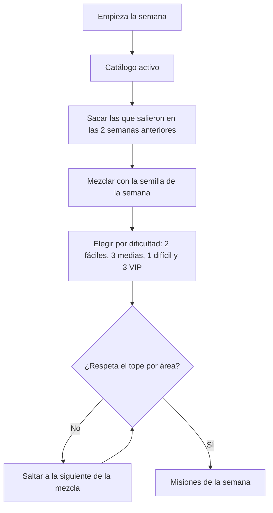
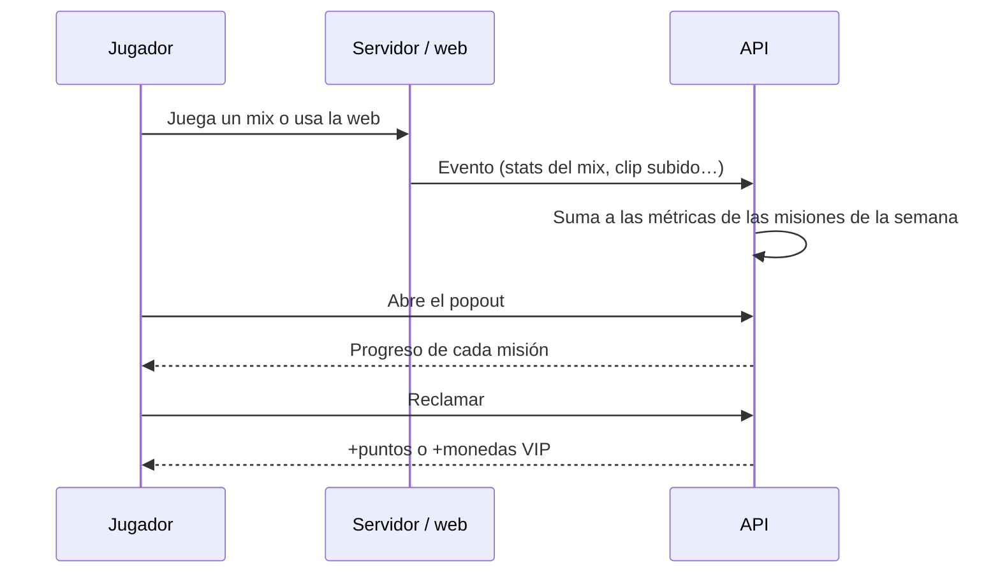

# Plan: Misiones semanales

> Planeación original. Estado: **propuesta**, prototipo de Kyan para pasarle a Daniel (backend y plugin) y a Esteban (frontend).

## Decisiones tomadas

| Tema | Decisión | Por qué |
|---|---|---|
| Dónde se ve | Un **popout** desde la barra de arriba (botón con contador de misiones para reclamar) y una **página de Misiones** con la semana completa, el historial y la vista de admin | El popout es lo que se mira después de cada mix sin salir de donde estás; la página es para lo que no entra en el popout |
| Prototipo | `/demo/misiones` del frontend nuevo (`kyan/ejemplo-matchmaking`), solo en `pnpm dev` | Patrón de los demás demos |
| Qué misiones | De juego (las stats que ya manda el plugin), de la web (clips, demos, tienda, buscador, comparador…) y de comunidad (grupo, PCW, eventos) | Kyan pidió que tengan que ver con la página y con el juego |
| Cuántas por semana | 6 para todos (2 fáciles, 3 medias y 1 difícil) y 3 VIP (una de cada dificultad) | Alcanza para que haya algo para cada tipo de jugador sin que sea una obligación |
| Rotación | Al azar cada semana, pero una misión que salió **no vuelve a salir en las 2 semanas siguientes** | Lo pidió Kyan |
| Catálogo | 30 misiones para todos (10 fáciles, 13 medias y 7 difíciles) y 15 VIP (5 por dificultad) | Con 2 semanas de espera, cada dificultad necesita por lo menos 3 veces las que salen por semana; con esto hay variedad para más de 2 meses |
| Variedad dentro de la semana | Tope por área: 4 de juego, 3 de web y 2 de comunidad | Que no salgan 6 misiones de matar gente |
| Fácil de cambiar | Todo el catálogo es una lista de datos (título, área, métrica, objetivo, dificultad, VIP, activa) y las recompensas son una tabla aparte por dificultad | Sumar, sacar o ajustar una misión es editar una fila |
| Azar reproducible | La rotación sale de una semilla por semana | El servidor y la vista de admin dan las mismas misiones |
| Recompensas | Puntos de la tienda para las de todos (30, 60 y 120 según dificultad) y monedas VIP para las VIP (20, 40 y 80); bonus de 150 puntos por completar las 6 | Usan las monedas que ya existen (`2026-10-29-tienda-web` y `2026-10-29-vip-progresion`) |
| Reclamar | Las misiones completas se reclaman con un botón | Da el momento de "gané algo" |
| Reinicio | Los lunes a las 06:00 de Argentina, como el cierre de temporada | La misma hora que el resto |
| Sin VIP | Ve las 3 misiones VIP con candado | Muestra el beneficio |

## 1. La rotación

## 2. El progreso

## 3. Lo que tendría que hacer cada uno

- **Daniel:**
  - Tablas `missions` (el catálogo), `mission_weeks` (las misiones de cada semana, guardadas al abrirse para que no cambien si se edita el catálogo) y `mission_progress` (por jugador y misión).
  - Sumar a las métricas con cada mix (las stats del plugin) y con cada evento de la web.
  - El cron del lunes que arma la semana y las rutas para ver, reclamar y administrar.
- **Esteban:** el popout en la barra de arriba, la página de misiones y la vista de admin.

## 4. Orden de implementación

1. `features/missions/catalog.ts`: métricas, misiones y recompensas.
2. `features/missions/rotation.ts`: la rotación, con tests de la espera de 2 semanas.
3. `features/missions/demo.ts`: progreso simulado.
4. El popout, la página, la vista de admin y `routes/demo.misiones.tsx`.
