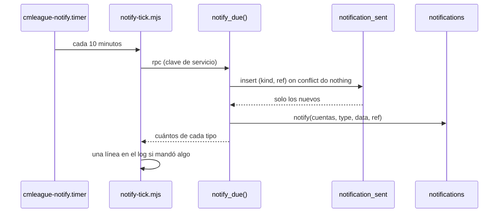
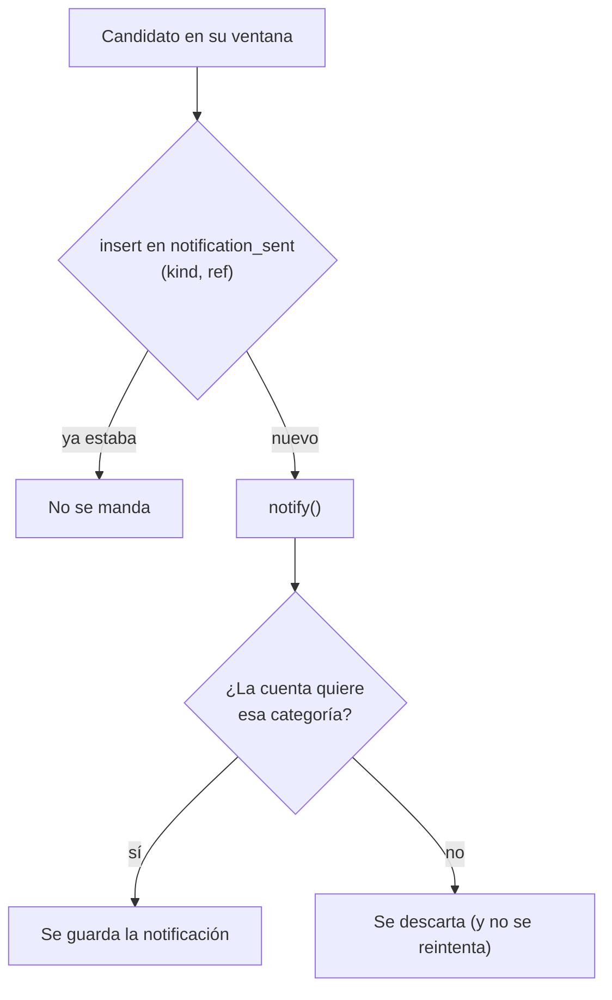

# Notificaciones programadas (segunda etapa): documentación

## Qué hace

La primera etapa de las notificaciones ([`2026-10-25-notificaciones`](../2026-10-25-notificaciones/DOCUMENTACION.md)) crea cada aviso en el momento en que pasa algo. Esta segunda etapa agrega los avisos que dependen **del paso del tiempo**: que una partida está por empezar, que un anuncio de PCW venció, que la temporada termina, que una partida de torneo sigue sin resultado o que un VIP está por vencer.

Los decide una función de la base, `notify_due()`, que corre cada 10 minutos desde un timer del VPS (`cmleague-notify`). Cada corrida mira una ventana de tiempo por tipo, manda lo que corresponda con `notify()` (que ya filtra preferencias y fichas sin cuenta) y anota cada aviso en `notification_sent` para no repetirlo.

## Los avisos

| `type` | Categoría | Cuándo (ventana) | A quién |
|---|---|---|---|
| `match_soon` | Torneos | Partida de torneo `upcoming` que empieza en menos de 1 hora | Los dos equipos (inscritos en el torneo o, si no hay inscripción, el roster) |
| `pcw_soon` | PCW | Lo mismo con una PCW aceptada | Los dos rosters |
| `pcw_expired` | PCW | Anuncio `open` cuyo horario ya pasó, hasta 7 días después | Quien lo publicó |
| `season_ending` | Temporadas | La temporada activa termina en menos de 24 horas | Quien jugó en la temporada al menos `ceil(min_matches / 2)` mixes, con su puesto (o `null`) y cuántos lleva |
| `match_no_result` | Administración | Partida de torneo `upcoming` o `live` 3 horas después de su horario, hasta 7 días después | Los admins y el organizador del torneo (si sigue siendo `organizer`) |
| `vip_expiring` | Cuenta | Un período de VIP termina en menos de 3 días, sin revocar y sin otro que lo continúe | La cuenta VIP |

En todas las partidas se dejan afuera los byes, los mapas de una serie (`parent_match_id`) y las que no tienen los dos equipos.

## No repetir

- La clave es la `ref`, por aviso y no por cuenta: `match_soon:<partida>:<horario>`, `pcw_expired:<anuncio>`, `season_ending:<temporada>`, `match_no_result:<partida>:<horario>` y `vip_expiring:<período>`.
- **Reprogramar** una partida cambia el horario de la `ref`, así que vuelve a avisar con la hora nueva.
- Quien tenía la categoría apagada no recibe el aviso, y si la prende después no le llega (como en la primera etapa).
- Las filas de `notification_sent` se borran a los 60 días.

## La tarea en el VPS

- `cmleague-notify.timer` corre cada 10 minutos con `Persistent=true` y lanza `cmleague-notify.service`.
- El servicio corre `node notify-tick.mjs` como `cmleague`, con `/etc/cmleague/season.env` (la misma clave de servicio que el cierre de temporadas) y el mismo endurecimiento.
- El script escribe una línea solo si mandó algo (`notify:tick: match_soon 2, vip_expiring 1`) y sale con `1` si falla, así el error queda en `journalctl -u cmleague-notify`.

## Dónde está cada cosa

| Qué | Archivo / ubicación |
|---|---|
| Tipos, `notification_sent` y `notify_due()` | `supabase/replanteo/35_notificaciones_programadas.sql` |
| Inversa y pruebas SQL | `docs/bitacora/2026-10-14-replanteo-modelo-datos/reversas/` y `pruebas/35_notificaciones_programadas.sql` |
| Llamada y resumen | `web/backend/src/jobs/notify-due.ts` |
| Script del timer (`pnpm notify:tick`) | `web/backend/scripts/notify-tick.mts` (build: `dist/notify-tick.mjs`) |
| Pruebas | `web/backend/test/unit/notify-due.test.ts` y `test/integration/notify-due.test.ts` |
| Unidades de systemd | `deploy/vps/cmleague-notify.service` y `.timer` |
| Contrato del frontend | `docs/frontend/contrato/notificaciones.md` |
