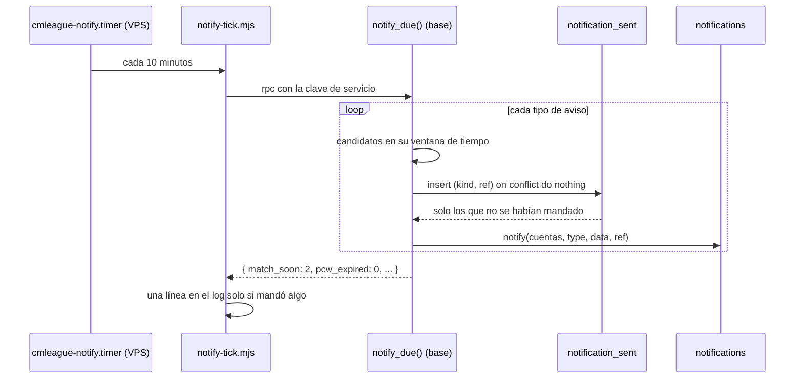

# Plan: Notificaciones programadas (segunda etapa)

> Planeación original. Estado: **aprobado** el 2026-10-29.

La primera etapa ([`2026-10-25-notificaciones`](../2026-10-25-notificaciones/PLAN.md), replanteo `28`) crea cada aviso en el momento en que pasa algo: un trigger o una función llama a `notify()`. Quedaron afuera los avisos que dependen **del paso del tiempo**, porque no hay ninguna acción que los dispare: hace falta una tarea que mire el reloj. Este plan los agrega con una función en la base y un timer en el VPS, igual que el cierre de temporadas.

## Decisiones tomadas

| Tema | Decisión | Por qué |
|---|---|---|
| Alcance | Los cuatro avisos de la segunda etapa (partida en 1 hora, PCW vencida sin rival, temporada por terminar y partida de torneo sin resultado) y el de "tu VIP vence en 3 días" | Son los que `docs/PENDIENTES.md` (sección 6) y el plan de VIP dejaron esperando esta tarea |
| Dónde se decide quién recibe qué | En la base: una función `notify_due()` que hace todo en una corrida | Igual que la primera etapa: los destinatarios y las preferencias ya viven en la base (`notify`, `match_users`, `notification_wants`) |
| Quién la corre | Un timer de systemd en el VPS cada 10 minutos (`cmleague-notify.timer`), con la clave de servicio | Es lo que dijo el plan del VPS ("más adelante, las tareas programadas de las notificaciones") y repite el patrón de `cmleague-season`. No se usa `pg_cron`: hoy no hay ninguna tarea programada dentro de Supabase y el VPS ya tiene el log y el reinicio |
| No repetir un aviso | Tabla `notification_sent (kind, ref)` con clave primaria: un aviso se manda una sola vez por `ref`. No se busca en `notifications` | `notifications` se recorta a 100 por cuenta y no guarda los avisos de quien apagó la categoría: buscar ahí repetiría avisos |
| Si cambia el horario | La `ref` de "partida en 1 hora" lleva el horario (`match_soon:<id>:<starts_at>`): si la partida se reprograma, se avisa de nuevo para la hora nueva | Un aviso con la hora vieja es peor que ninguno |
| Corridas perdidas | Cada corrida mira una **ventana**, no un instante: si el VPS estuvo apagado 30 minutos, la siguiente corrida manda lo que falte mientras todavía tenga sentido (por ejemplo, una partida que empieza en 20 minutos sí; una que ya empezó, no) | `Persistent=true` corre apenas arranca, pero no puede mandar tarde un aviso de "en 1 hora" |
| Texto | Como en la primera etapa: la base guarda `type` y `data`, y el frontend arma el título, el cuerpo y el link | Un solo lugar para el copy |
| Temporada por terminar | **24 horas antes**, a quien jugó en la temporada **al menos la mitad de los mixes que pide el ranking** (`ceil(min_matches / 2)`) | Daniel, 2026-10-29. Al que está cerca le sirve saber que le quedan horas; al que jugó uno solo, no |
| Partida de torneo sin resultado | **3 horas después** de su horario, al **organizador del torneo y a los admins** | Daniel, 2026-10-29 |

## 1. El flujo completo

`notify()` ya filtra a quien apagó la categoría, a las fichas sin cuenta y al autor (en una tarea programada no hay autor: `auth.uid()` es `null`).

## 2. Los avisos

| `type` | Categoría | Cuándo | A quién | `data` |
|---|---|---|---|---|
| `match_soon` | `tournament` | Partida de torneo (`kind = 'event'`), `upcoming`, que empieza en menos de 1 hora y todavía no empezó | Los jugadores de los dos equipos (`match_users`: los inscritos en el torneo o, si no hay inscripción, el roster) | `match_ref(id)` (equipos, torneo y `starts_at`) |
| `pcw_soon` | `pcw` | Lo mismo con una PCW aceptada (`kind = 'pcw'`) | Los dos rosters de la PCW (`match_users`) | `match_ref(id)` |
| `pcw_expired` | `pcw` | Un anuncio de PCW `open` cuyo horario (`starts_at`) ya pasó sin que nadie lo aceptara | Quien lo publicó (`pcw_posts.by_user`) | `post_id`, `starts_at`, `best_of`, `maps` |
| `season_ending` | `season` | La temporada activa termina en menos de 24 horas | Quien jugó en la temporada al menos `ceil(min_matches / 2)` mixes | `season_id`, `number`, `name`, `ends_at` y, para cada uno, `position` (o `null`), `matches` y `min_matches` (así el texto puede decir "te faltan 2 mixes para entrar al ranking") |
| `match_no_result` | `admin` | Partida de torneo `upcoming` o `live`, 3 horas después de su horario, sin resultado | El organizador del torneo (`events.organizer_id`, si sigue siendo `organizer`) y los admins | `match_ref(id)` |
| `vip_expiring` | `account` | Un período de VIP termina en menos de 3 días, sin otro período que lo continúe y sin estar revocado | La cuenta VIP | `ends_at` |

Detalles:

- **`match_no_result` va en la categoría `admin`**, que hoy solo reciben los admins (`getsAdminNotifications` en el frontend). Al organizador le llega igual porque `notify()` no mira el rol, pero la campana del organizador tiene que mostrarla: ver la sección 5.
- **`pcw_expired` no cambia el anuncio.** Sigue `open` hasta que lo limpie `pcw_cleanup` (7 días). El aviso solo le dice a quien lo publicó que nadie lo tomó, con un link para publicar otro.
- **`vip_expiring` no se manda a un VIP lifetime** (`ends_at` es `null`) ni si un período nuevo empieza antes de que termine el actual.
- **Ventanas:** `match_soon` y `pcw_soon`, de 0 a 60 minutos antes; `season_ending`, de 0 a 24 horas antes; `vip_expiring`, de 0 a 3 días antes; `pcw_expired` y `match_no_result`, hasta 7 días después (más tarde ya no sirve, y así una base vieja no manda una avalancha la primera vez).

## 3. Base de datos (replanteo `35_notificaciones_programadas.sql`)

Con su inversa (`reversas/35_…`) y sus pruebas SQL, como los anteriores.

- **Tipos nuevos** en `notification_category` (se reemplaza la versión de la `33`), con la categoría de la tabla de la sección 2: `match_soon` en `tournament`, `pcw_soon` y `pcw_expired` en `pcw`, `season_ending` en `season`, `match_no_result` en `admin` y `vip_expiring` en `account`.
- **Tabla `notification_sent`:** `kind text`, `ref text`, `sent_at timestamptz default now()`, clave primaria `(kind, ref)`. Sin RLS para `anon` ni `authenticated` (solo la usa la función). Las filas de más de 60 días se borran en la misma corrida.
- **`notify_due()`** (`security definer`, solo `service_role`): un bloque por tipo. Cada bloque inserta en `notification_sent` con `on conflict do nothing returning ref` y llama a `notify()` solo por esas filas. Devuelve un `jsonb` con cuántos avisos mandó de cada tipo.
- **Índices:** los que haga falta para que las consultas de cada corrida no recorran tablas enteras (`matches (status, starts_at)` si no existe; `pcw_posts (status, starts_at)`).

## 4. Backend y VPS

| Archivo | Qué hace |
|---|---|
| `web/backend/scripts/notify-tick.mts` (`pnpm notify:tick`) | Como `season-tick.mts`: llama a `notify_due()` con la clave de servicio, escribe una línea solo si mandó algo y sale con `1` si falla |
| `build.mjs` y `build-check.mjs` | Suman `notify-tick.mjs` al build de la API |
| `deploy/vps/cmleague-notify.service` y `.timer` | Copia de `cmleague-season.*`: cada 10 minutos, `Persistent=true`, mismo endurecimiento |
| `deploy/vps/season.env` | Se reusa (tiene `SUPABASE_URL` y la clave de servicio). Se cambia el comentario de "solo para el cierre de temporadas" a "tareas programadas" |
| `deploy/vps/preparar.sh` y `README.md` | Instalan y nombran las unidades nuevas |

La API no cambia: las notificaciones nuevas salen por `GET /api/v1/notifications` como las demás. Sí cambia el esquema de OpenAPI si `type` está enumerado.

## 5. Contrato del frontend

En `docs/frontend/contrato/notificaciones.md`: la sección "Segunda etapa (todavía no)" pasa a la tabla de tipos, con `data`, categoría, texto sugerido y link de cada uno. Una fila en las novedades del `README.md` del contrato.

Lo que tendría que hacer el frontend (requerimiento aparte):

- Textos y links de los seis tipos en `features/shell/notifications/model.ts`.
- Mostrar la categoría `admin` también al organizador, para `match_no_result` (hoy `getsAdminNotifications` es solo para admins).

## 6. Pruebas

- **SQL** (`pruebas/35_notificaciones_programadas.sql`): cada tipo dentro y fuera de su ventana; una segunda corrida no repite nada; reprogramar una partida avisa de nuevo; una cuenta que apagó la categoría no recibe y no queda marcada para siempre (ver sección 7); un VIP lifetime o con continuación no recibe.
- **Unitarias** (Vitest): el script con la RPC simulada (éxito, error y salida).
- **Integración**, con la Supabase local: una partida que empieza en 30 minutos genera `match_soon` para los dos equipos.

## 7. Un caso para decidir al implementar

Si una cuenta tiene la categoría apagada, `notify()` la filtra, pero la fila de `notification_sent` se guarda igual, porque es por `ref` (por partida, no por cuenta). Si la vuelve a prender, ese aviso ya no le llega. Es lo mismo que pasa en la primera etapa ("volver a prenderla no trae las viejas"), así que se acepta.

## 8. Requisitos antes de empezar

- Supabase local con la copia de producción (`pnpm db:start`). No se toca BETA.
- Se trabaja en la rama del backend (`feat/backend-api-fase-1`) y se mezcla en `feat/frontend-fase-1`, como con las demos de los servidores externos.
- El despliegue al VPS (timer y build) **no se hace en este requerimiento** sin el visto bueno de Daniel. La `35` se aplica en producción en el corte, después de la `28`.

## 9. Orden de implementación

1. Replanteo `35` con su inversa y las pruebas SQL.
2. `notify-tick.mts`, el script de `package.json`, el build y las pruebas unitarias y de integración.
3. Unidades de systemd, `preparar.sh` y `README.md` de `deploy/vps/`.
4. Contrato del frontend.
5. `DOCUMENTACION.md`, `GUIA_IMPLEMENTACION.md`, `docs/PENDIENTES.md` (cerrar la segunda etapa y sumar el despliegue del timer) y la fila en `docs/bitacora/README.md`.
