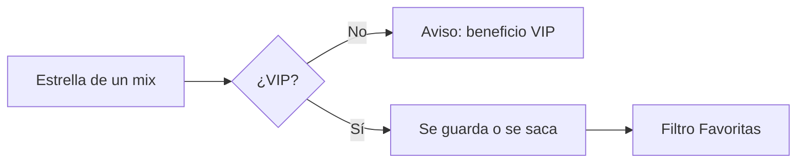

# Plan: Marcá partidas como favoritas (VIP)

> Planeación original. Estado: **propuesta**, prototipo para pasarle a Daniel (backend) y a Esteban (frontend).
>
> **Aviso:** Kyan pidió hacer "lo que falte" de la lista VIP mientras no estaba, así que este plan se escribió junto con el prototipo y no antes.

## Decisiones tomadas

| Tema | Decisión | Por qué |
|---|---|---|
| Dónde se ve | `/demo/favoritas` del frontend nuevo, solo en `pnpm dev`, con la tabla de `MixesList` | Es el listado de mixes, no el perfil |
| Cómo se marca | Una estrella al principio de cada fila | Un clic, sin salir del listado |
| Filtro | Segmentado "Todas mis partidas / Favoritas (n)", con el estilo del de Ranking | Así se encuentran las guardadas |
| Sin VIP | La estrella y el filtro avisan que es un beneficio VIP | Muestra el beneficio |
| Dónde se guardan | En el navegador en el demo; en la cuenta en la versión real | Tienen que estar en todos los dispositivos |

## Lo que tendría que hacer cada uno

- **Daniel:** una tabla `match_favorites (user_id, match_id, created_at)`, las rutas para marcar y desmarcar con chequeo de VIP, y el filtro `favorites=true` en `GET /api/v1/mixes`.
- **Esteban:** la estrella y el filtro en el listado de mixes.
