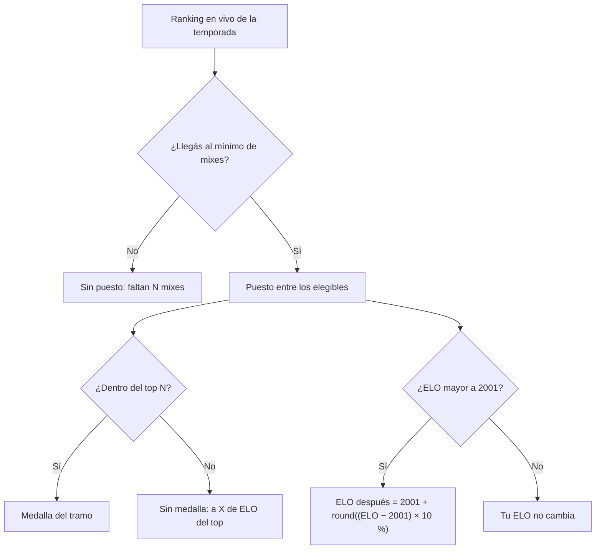

# Plan: Vista previa de tu próximo recálculo de ranking (VIP)

> Planeación original. Estado: **propuesta**, prototipo para pasarle a Daniel (backend) y a Esteban (frontend).

## Decisiones tomadas

| Tema | Decisión | Por qué |
|---|---|---|
| Qué es "el recálculo" | El cierre de la temporada (replanteo `24_temporadas.sql`): foto del ranking, medallas al top N con el mínimo de mixes y reinicio de los nivel 10 | Es lo que cambia el ranking de todos de una vez |
| Dónde se ve | `/demo/recalculo` del frontend nuevo, solo en `pnpm dev` | Patrón de los demás demos |
| Qué muestra | Cuenta regresiva al cierre, tu puesto, la medalla que te tocaría, tu ELO después del reinicio y cuántos mixes te faltan para el mínimo | Es lo que `season_live_standings` ya calcula "si cerrara ahora" |
| Simulador | "Si ganás o perdés N mixes más": ELO, puesto y medalla proyectados | Para saber qué te conviene antes del cierre |
| Reglas | Las de `season_config` por defecto: top 20, mínimo 20 mixes, reinicio al 10 % por encima de 2001, tramos Campeón, Subcampeón, Tercer puesto, Top 10 y Top 20 | Son las del servidor |
| Sin VIP | Se ve la cuenta regresiva y tu puesto; la proyección está con candado | Muestra el beneficio |

## 1. El flujo

## 2. Lo que tendría que hacer cada uno

- **Daniel:** exponer `season_live_standings` para el jugador logueado (puesto, `elo_after`, tramo) junto con los vecinos de arriba y de abajo. La proyección usa el cambio promedio por mix y se puede calcular en el navegador.
- **Esteban:** un panel en el perfil o en el ranking de la temporada.

## 3. Orden de implementación

1. `features/season/preview.ts`: reglas de puesto, tramo, reinicio y proyección.
2. `features/season/demo.ts`: ranking de ejemplo de una temporada.
3. `features/season/RecalcPreview.tsx` y `routes/demo.recalculo.tsx`.
