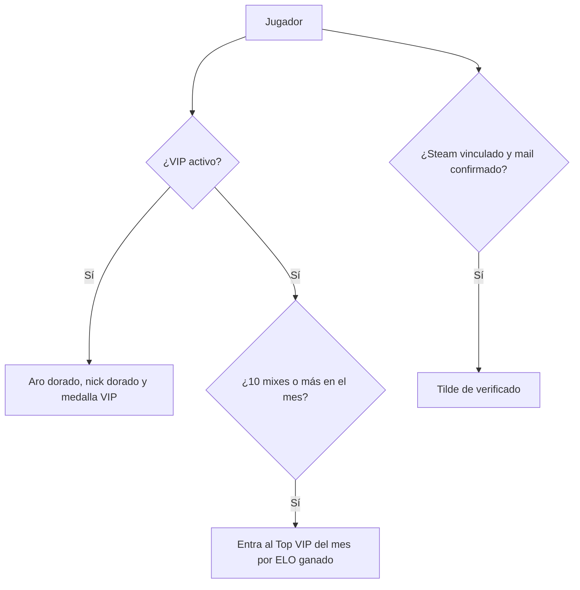

# Plan: Marcas VIP en el ranking y Top VIP del mes

> Planeación original. Estado: **propuesta**, prototipo para pasarle a Daniel (backend) y a Esteban (frontend).
>
> **Aviso:** Kyan pidió hacer "lo que falte" de la lista VIP mientras no estaba, así que este plan se escribió junto con el prototipo y no antes.

## Decisiones tomadas

| Tema | Decisión | Por qué |
|---|---|---|
| Qué entra | Tres ítems de la lista VIP: ícono y borde VIP junto al nombre en el ranking, la insignia de verificado y el mini-ranking "Top VIP del mes" | Los tres van en la página del ranking, que no es parte del perfil (el perfil es de Esteban) |
| Dónde se ve | `/demo/ranking-vip` del frontend nuevo, solo en `pnpm dev` | Patrón de los demás demos |
| Ícono VIP | La medalla VIP de CM League (`VipBadge` de la tienda), el nick en dorado y un aro dorado en el avatar | La medalla ya existe y se usa en el matchmaking |
| Verificado | Un tilde azul al lado del nick, con el texto "Cuenta verificada" | Es la señal que todos conocen |
| Top VIP del mes | Los VIP que más ELO ganaron en el mes, con al menos 10 mixes, en el mismo podio del ranking (`Podium`) más los puestos 4 a 10 | Premia jugar en el mes y no el ELO acumulado |
| Componentes | `VipName` y `VipAvatar`, para usar en cualquier lista de jugadores | Así se ve igual en el ranking, los mixes y el comparador |

## 1. Qué decide cada marca

## 2. Lo que tendría que hacer cada uno

- **Daniel:** sumar `vip` y `verified` a los jugadores del ranking (y de cualquier lista), y una ruta para el Top VIP del mes con `month_gain` y `month_matches`. Además, definir qué cuenta como verificado.
- **Esteban:** usar `VipName` y `VipAvatar` en `PlayersRanking` y sumar el Top VIP arriba del ranking.
