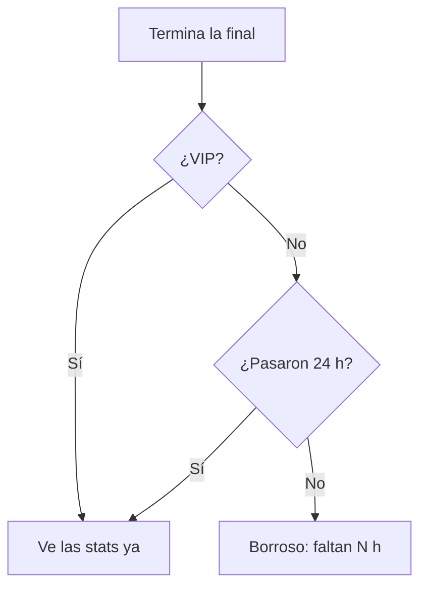

# Plan: Stats avanzadas post-torneo antes que nadie (VIP)

> Planeación original. Estado: **propuesta**, prototipo para pasarle a Daniel (backend) y a Esteban (frontend).
>
> **Aviso:** Kyan pidió hacer "lo que falte" de la lista VIP mientras no estaba, así que este plan se escribió junto con el prototipo y no antes.

## Decisiones tomadas

| Tema | Decisión | Por qué |
|---|---|---|
| Dónde se ve | `/demo/torneo-stats` del frontend nuevo, solo en `pnpm dev`; en la versión real, una pestaña de `/events/$id` | Es la página del torneo, no el perfil |
| Antes que nadie | Los VIP las ven apenas termina la final; el resto, 24 h después | Es el beneficio de la lista |
| Qué muestra | MVP del torneo (mejor rating), cuatro premios (más daño, más entradas, más clutches y mejor puntería) y la tabla de todos los jugadores, ordenable y filtrable por equipo | Lo que se comparte después de un torneo |
| Columnas | Mapas, Rating, K/D, ADR, HS %, Entradas, Clutches y 3k+ | "Avanzadas": más que la tabla de un mix |
| Sin VIP antes de las 24 h | Todo borroso con un cartel y la cuenta de horas | Muestra el beneficio |

## Lo que tendría que hacer cada uno

- **Daniel:**
  - Las stats por jugador del torneo, sumando sus mapas.
  - Entradas (primera kill de la ronda), clutches y multikills. El plugin ya manda `k3`, `k4` y `k5`, pero hay que ver si manda las entradas y los clutches.
  - Que la ruta no las devuelva sin VIP antes de las 24 h.
- **Esteban:** la pestaña de stats en la página del torneo.
