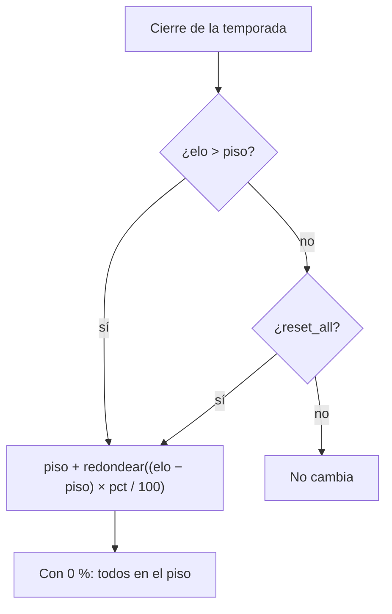

# Reinicio total de una temporada: documentación

## Qué hace

Al cerrar una temporada, el ELO de los jugadores se reinicia con dos valores: el **piso** (`reset_floor`) y el **porcentaje** que conservan (`reset_pct`). Hasta ahora solo se reiniciaba a quien estaba por encima del piso (los nivel 10, con el piso por defecto 2001). Quien estaba por debajo no cambiaba.

Ahora hay una tercera opción, **"Reiniciar también a los que están debajo del piso"** (`reset_all`). Con ella, la misma fórmula vale para todos: los de arriba bajan hacia el piso y los de abajo suben hacia el piso, y todos conservan el mismo porcentaje de su distancia al piso. Con **0 %** todos quedan exactamente en el piso: es el **reinicio total** (hard reset).

Como `reset_pct` y `reset_floor`, el valor se guarda en la configuración (la próxima temporada) y en cada temporada, que lo congela al cerrarse. Las temporadas que ya existían quedan con `false`.

## La fórmula

| ELO | 10 % sobre 2001 | 10 % sobre 2001 con `reset_all` | 0 % sobre 1000 con `reset_all` |
|---|---|---|---|
| 2540 | 2055 | 2055 | 1000 |
| 2001 | 2001 | 2001 | 1000 |
| 1500 | 1500 | 1951 | 1000 |
| 1001 | 1001 | 1901 | 1000 |

Con 100 % nadie cambia, con o sin `reset_all`.

## Quién "se reinicia"

El conteo de reinicios (el `reset` del cierre y de la vista previa) cuenta a quien el reinicio le cambia el ELO:

- Sin `reset_all`: los que están por encima del piso (como antes).
- Con `reset_all`: además, los que están por debajo. Quien está justo en el piso no cuenta.

En el resumen de la vista previa, `avg_drop` es el promedio de `elo − elo_after` de los que se reinician. Con `reset_all`, los de abajo suben, así que el promedio puede ser negativo.

## Base de datos (replanteo `37`)

| Objeto | Cambio |
|---|---|
| `season_config.reset_all`, `seasons.reset_all` | `boolean not null default false` |
| `season_reset_elo(elo, pct, piso, todos)` | Nueva. La de 3 parámetros queda igual |
| `elo_season_event`, `elo_season_event_key` | El cierre reinicia también a los de debajo del piso si la temporada tiene `reset_all` (vale igual en `elo_recompute_all` y `elo_recompute_player`) |
| `season_close_run` | `elo_after` de la foto, conteo de reiniciados y copia de `reset_all` de la configuración a la temporada siguiente |
| `season_start` | Copia `reset_all` de la configuración |
| `season_live_standings` | `elo_after` con `reset_all` |
| `season_list` | Suma `reset_all` (al final) |
| `season_update` | Suma `p_reset_all` (`null` = no cambia) |
| `set_season_config` | Suma `p_reset_all` (`default false`) |
| `season_preview`, `season_preview_summary` | Suman `p_reset_all` (`default false`) |

## API

| Endpoint | Cambio |
|---|---|
| `GET /api/v1/seasons`, `/seasons/current` | `reset_all` en cada temporada |
| `GET`/`PUT /api/v1/admin/seasons/config` | `reset_all`. En el `PUT` es opcional: si no llega, `false` |
| `PATCH /api/v1/admin/seasons/{id}` | `reset_all` opcional |
| `GET /api/v1/admin/seasons/preview` | Query `reset_all` (`true`/`false`, opcional, `false` por defecto) |

## Frontend

En **Administración › Temporadas**, la tarjeta del reinicio (en "Temporada activa" y en "Próxima temporada") suma un checkbox debajo del piso: "Reiniciar también a los que están debajo del piso", con la ayuda "Con 0 % todos quedan en el piso: reinicio total". Al marcarlo:

- el título pasa a "Reinicio de todos" y la explicación dice que todos se acercan al piso;
- la prueba con un ELO o un jugador dice "Gana N de ELO" cuando sube;
- los ejemplos muestran uno debajo del piso (1200).

También cambian:

- la vista previa del cierre, que manda `reset_all` y pinta en verde a los que suben y en rojo a los que bajan;
- el diálogo de "Terminar temporada", que dice "se reinician: todos se acercan a N de ELO";
- el historial, que suma "(todos)" al reinicio.

Capturas en [`pruebas/`](pruebas/): `reinicio-total-claro.png` (marcado, 0 % sobre 1000) y `reinicio-normal-oscuro.png` (sin marcar).

## Dónde está cada cosa

| Qué | Archivo / ubicación |
|---|---|
| Migración | `supabase/replanteo/37_reinicio_total.sql` |
| Inversa | `docs/bitacora/2026-10-14-replanteo-modelo-datos/reversas/37_reinicio_total.sql` |
| Pruebas SQL | `docs/bitacora/2026-10-14-replanteo-modelo-datos/pruebas/37_reinicio_total.sql` |
| Esquemas y rutas | `web/backend/src/schemas/seasons.ts`, `web/backend/src/routes/seasons.ts` |
| Tipos de la base | `web/backend/src/db/types.ts` |
| Pruebas de la API | `web/backend/test/unit/seasons-routes.test.ts`, `web/backend/test/integration/seasons.test.ts` |
| Contrato | `docs/frontend/contrato/temporadas.md`, `docs/frontend/contrato/api.md` |
| Fórmula y formulario | `web/frontend/src/features/admin/seasons/seasons.ts`, `SeasonFormView.tsx` |
| Vista previa, cierre e historial | `PreviewTab.tsx`, `AdminSeasonsPage.tsx`, `HistoryTab.tsx`, `queries.ts` (misma carpeta) |
