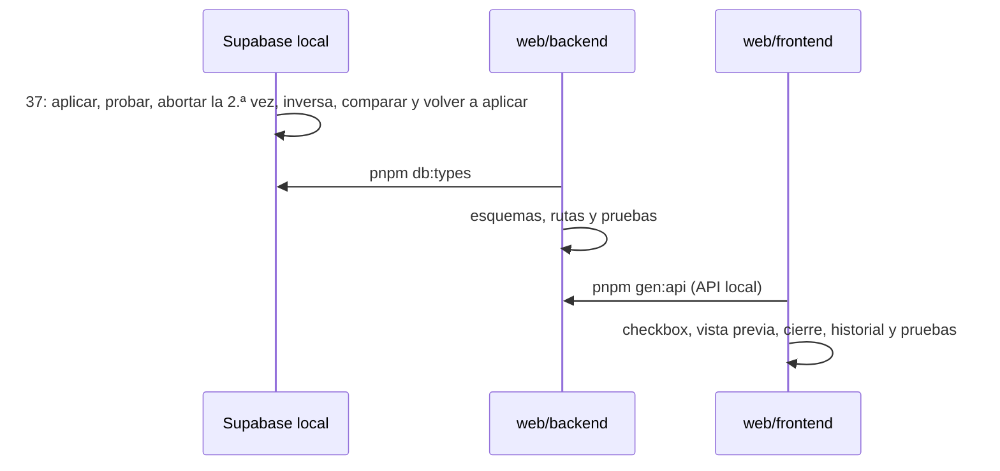

# Reinicio total de una temporada: guía de implementación

## Estado

- **Implementado y probado en local el 2026-10-29**, sin commit, en la rama `feat/frontend-fase-1`.
- **Falta:** cargar la `37` en staging, redesplegar la API y el frontend del VPS, probarlo en el navegador contra staging y, en el corte, aplicar la `37` en producción después de la `36` (`docs/PENDIENTES.md`, puntos 1.5 y 1.29).
- No toca el plugin: nada que subir al servidor real, a RBK ni a flow.

## Cambios respecto del plan

- En la vista previa, las filas que suben se pintan en verde (`text-win`) y solo las que bajan en rojo. Antes, todo lo que se reiniciaba iba en rojo.
- Los recuadros "Bajan en promedio" y "Bajan como máximo" de la vista previa no cambiaron. Con `reset_all`, el promedio puede salir negativo (los de abajo suben).

## Pasos

1. **Base:** `supabase/replanteo/37_reinicio_total.sql`, su inversa y su prueba. Se probó a mano con el mismo ciclo que `correr.sh`, porque `correr.sh` se corta en la `23` (deuda técnica 7.0):
   - aplicar la `37` y correr `pruebas/37_reinicio_total.sql`: **23 de 23 OK**;
   - una segunda aplicación aborta;
   - la inversa deja la estructura (`pruebas/estructura.sql`) **idéntica** a la de antes;
   - se vuelve a aplicar.
   - Con la `37` aplicada pasan también las pruebas de la `30` (28), la `34` (26) y la `35` (28).
   - La de la `24` falla en "la fecha de fin tiene que ser futura" con y sin la `37`. Es un problema anterior, anotado en `docs/PENDIENTES.md` (7.0).
2. **API:** `pnpm db:types`. La base local tenía aplicada la migración `20261029120000_vip_dias.sql`, que es de otro requerimiento y está sin commit, así que se dejó afuera su cambio en `vip_status`. Después, `reset_all` en `schemas/seasons.ts` y `routes/seasons.ts`.
   - `pnpm typecheck` sin errores.
   - Pruebas unitarias: **392 de 392**, con una nueva para el reinicio total.
   - Integración de temporadas: **9 de 9**, con el reinicio total en la vista previa y `reset_all: false` en la configuración.
3. **Frontend:** `pnpm gen:api` con la API local (`pnpm dev:node`).
   - `pnpm typecheck` y `pnpm lint` sin errores, y Prettier aplicado.
   - `pnpm test`: **342 de 342**, con pruebas nuevas de `resetElo`, `resetTitle` y `seasonPatch`.
4. **Captura:** con Playwright, en 1440 px, en claro y en oscuro, con una cuenta admin creada solo para eso en el Auth **local** (`captura37@test.local`), que se borró después. Las capturas están en `pruebas/`. No se apretó "Guardar".

## Desplegar en staging

1. Correr `supabase/replanteo/37_reinicio_total.sql` en la base de staging. Aborta si ya se aplicó.
2. Redesplegar la API del VPS (`deploy/`) y el frontend. La API nueva lee `reset_all`: **sin la `37`, `/api/v1/seasons` da 500**.
3. En Administración › Temporadas: marcar la opción en "Próxima temporada", guardar, recargar y verificar que siga marcada. En la vista previa del cierre, los de debajo del piso tienen que aparecer con su ELO nuevo.

## Revertir

- Base: `docs/bitacora/2026-10-14-replanteo-modelo-datos/reversas/37_reinicio_total.sql`. El ELO de un cierre que ya se hizo con `reset_all` queda como está; un `elo_recompute_all` lo rehace sin la opción.
- La API y el frontend de antes funcionan sin la columna, así que se revierten con el commit anterior.
