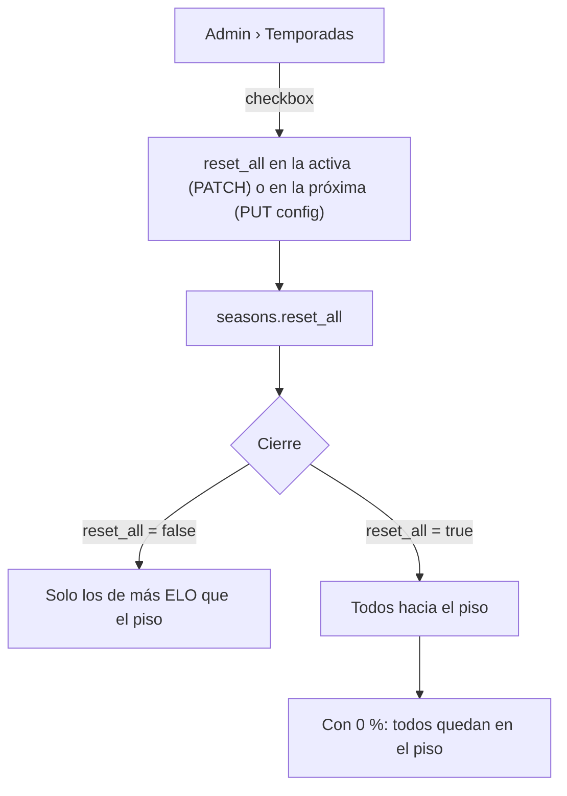

# Plan: reiniciar también a los que están debajo del piso (reinicio total del ELO)

> Planeación original. Estado: **aprobado** por Daniel el 2026-10-29 (pedido directo: "agrega lo que tengas que agregar al backend y diseña el ajuste pequeño en el frontend").

Hoy el cierre de una temporada solo reinicia a quien tiene más ELO que el piso (`reset_floor`): conserva `reset_pct` % de lo que tiene por encima. Quien está debajo del piso no cambia. Daniel quiere una opción "Reiniciar también a los jugadores por debajo del piso", para poder hacer un reinicio total (hard reset) del ELO.

## Decisiones tomadas

| Tema | Decisión | Por qué |
|---|---|---|
| Qué les pasa a los de debajo del piso | La **misma fórmula** que a los de arriba: `piso + round((elo − piso) × pct / 100)`. Suben hacia el piso y conservan el `pct` % de la distancia | Es simétrico y no suma otro número. Con `0 %` todos quedan en el piso: el reinicio total. Con `100 %` nadie cambia |
| Dónde se guarda | Columna `reset_all boolean not null default false` en `season_config` (próxima temporada) y en `seasons` (cada temporada la congela, como `reset_pct` y `reset_floor`) | Es un parámetro más del reinicio. Las temporadas cerradas quedan con `false` y su foto no cambia |
| Fórmula | Nueva `season_reset_elo(elo, pct, piso, todos)`. La de 3 parámetros queda igual (la usan las inversas y las pruebas viejas) | No rompe nada de lo anterior |
| Quién se "reinicia" (`reset`) en la vista previa y en el cierre | Con `reset_all`, todos los que tienen ELO distinto del piso. Sin él, como hoy (más que el piso) | El conteo de "N se reinician" sigue diciendo a cuántos les cambia |
| API | `reset_all` (booleano) en `Season`, `SeasonConfig`, `SeasonPatch` y en la consulta de la vista previa (opcional, `false` por defecto) | El frontend actual sigue funcionando sin mandarlo |
| Frontend | Un solo control nuevo en la tarjeta del reinicio: un checkbox debajo del piso. Cambian los textos que dependen de él. Nada más se mueve | Daniel pidió que siga casi igual |

## 1. El flujo completo

## 2. Base de datos: replanteo `37_reinicio_total.sql`

- `season_config.reset_all` y `seasons.reset_all` (`boolean not null default false`).
- `season_reset_elo(integer, integer, integer, boolean)`.
- Con `pg_temp.reemplazar` (como las anteriores), pasan a usar `reset_all`:
  - `elo_season_event` (24) y `elo_season_event_key` (34): el `update` del cierre.
  - `season_close_run`: el `elo_after` de la foto, el conteo de reiniciados y la copia de `reset_all` a la temporada siguiente.
  - `season_start`: copia `reset_all` de la configuración.
- Firma nueva (se borra la vieja) con `p_reset_all`:
  - `season_update` (`null` = no cambia), `set_season_config`, `season_preview` y `season_preview_summary` (`default false`).
- Vistas: `season_live_standings` (el `elo_after`) y `season_list` (suma `reset_all` al final).
- Inversa en `reversas/37_reinicio_total.sql` y prueba en `pruebas/37_reinicio_total.sql`, con `correr.sh`.

## 3. API (`web/backend`)

- `schemas/seasons.ts`: `reset_all` en `params` (y por lo tanto en `Season`, `SeasonConfig` y `SeasonPatch`) y en `PreviewQuery`.
- `routes/seasons.ts`: leerlo en `season_list` y `season_config`, y mandarlo a las funciones.
- `db/types.ts` (`pnpm db:types`), pruebas unitarias e integración de temporadas.

## 4. Frontend (`web/frontend`)

- `seasons.ts`: `reset_all` en `SeasonForm`, `resetElo(elo, pct, piso, todos)`, `resetTitle` ("Reinicio de todos" con el checkbox), `fromSeason`, `fromConfig`, `seasonPatch` y `toConfig`.
- `SeasonFormView.tsx` (`ResetCard`): checkbox "Reiniciar también a los que están debajo del piso", con la ayuda "Con 0 % todos quedan en el piso: reinicio total". El texto de arriba, la nota de la prueba y los ejemplos (suma uno debajo del piso) se adaptan.
- `PreviewTab.tsx` y el diálogo de "Terminar temporada": mandan `reset_all` y el texto "con más de N de ELO" pasa a "todos" cuando está marcado.
- `HistoryTab.tsx`: "reinicio 10 % sobre 2001" suma "(todos)".
- `schema.d.ts` con `pnpm gen:api`, y pruebas de `seasons.test.ts`.

## 5. Requisitos antes de empezar

- Supabase local en Docker con los replanteos hasta la `36` (ya está).

## 6. Orden de implementación

1. Replanteo `37`, su inversa y su prueba; `correr.sh` o, como mínimo, aplicar, probar, revertir y comparar la estructura en la base local.
2. API: esquemas, rutas, tipos y pruebas.
3. Frontend: `gen:api`, formulario, vista previa, historial y pruebas.
4. Contrato `docs/frontend/contrato/temporadas.md`, README del replanteo, `DOCUMENTACION.md`, `GUIA_IMPLEMENTACION.md`, fila en `docs/bitacora/README.md` y `docs/PENDIENTES.md` (la `37` va en el corte y en staging).
