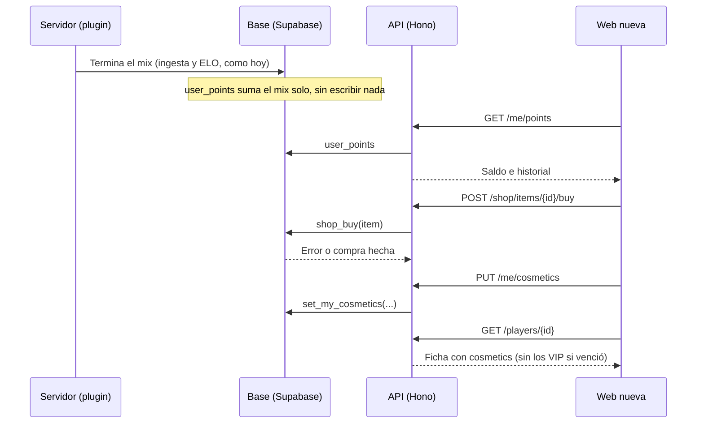

# Plan: tienda de cosméticos con puntos (backend)

> Planeación original. Estado: **propuesta**, pendiente de aprobación de Daniel o Kyan.

Kyan pidió el backend de la tienda para los cosméticos del perfil que ya están hechos en [`2026-10-28-cosmeticos-perfil`](../2026-10-28-cosmeticos-perfil/): ganar puntos jugando, comprar cosméticos, tenerlos en un inventario y equiparlos. Va sobre la rama `feat/backend-api-fase-1` (Hono + Supabase) y reutiliza lo que ya existe ahí:

- **VIP fase 0:** `vip_memberships`, `is_vip()` y el campo `vip` de la ficha. Los artículos `vip_only` dependen solo de eso.
- **Mixes y ELO:** `match_player_stats`, `elo_key()` (un solo ELO por ficha con varios SteamID), `mix_deletions` y `elo_recompute_all`.
- **Notificaciones** (replanteo 28): `notify()` y `notification_category()`.
- **Patrones de la API:** `createRoute` con OpenAPI, `requireUser` y `requireAdmin`, `Envelope` para las listas, errores `BUSINESS_RULE`, y reglas validadas en la base con funciones `security definer`.

Este plan se escribió en `kyan/pruebas`, que no tiene esa rama. No toca la web vieja (`index.html`) ni el plugin.

## Decisiones tomadas

| Tema | Decisión | Por qué |
|---|---|---|
| Puntos ganados | **Se calculan, no se anotan.** Una vista suma los mixes terminados que contaron para el ELO de cada cuenta | Si un mix se borra (`admin_delete_mix`) o se recalcula el ELO (`elo_recompute_all`), los puntos se corrigen solos, sin duplicados ni trabajos de reparación |
| Cuánto se gana | Propuesta: **10 por mix jugado y 5 más por mix ganado**, en `points_config` (una fila, como `ranking_config`) | Se ajusta sin migración. Los valores los decide Daniel o Kyan |
| Beneficio VIP | Propuesta: **puntos ×1,5 en los mixes jugados mientras era VIP** (`vip_multiplier` en `points_config`; 1 lo apaga) | Es un beneficio que se nota y no le quita nada a quien no paga. Se mira si el VIP estaba vigente **en la fecha del mix**, no hoy |
| Saldo | `ganados + regalos del admin − gastados`. Puede quedar negativo si se borra un mix después de una compra: **lo comprado se conserva**, pero no se puede comprar hasta volver a positivo | No quitarle cosas a nadie por una corrección del admin |
| Plata real | **No hay.** Los puntos no se compran ni se canjean por plata. Lo pago sigue siendo el VIP, que se cobra por fuera como hoy | Sin pasarela de pago ni problemas legales |
| Artículos `vip_only` | No se compran ni quedan en el inventario: **se pueden usar mientras la cuenta sea VIP**. Si el VIP vence, se dejan de mostrar al leer, sin ningún trabajo programado | Igual que el resto del VIP: "vence solo" |
| Catálogo | Tabla `shop_items` cargada con los 27 artículos de `catalogo.json` (mismo `id`). El admin cambia precio, nombre y si está a la venta. Los archivos siguen en el frontend | Los SVG son estáticos, y la base guarda solo los datos que cambian |
| Precio `null` | El artículo no está a la venta. Sirve para los que solo se regalan (eventos, premios de temporada) | Sin un flag aparte |
| Equipados | Una fila por cuenta en `user_cosmetics`: un artículo por tipo y hasta 3 stickers | Lo que muestra el perfil |
| De quién | De la **cuenta**, como el VIP. Una ficha sin cuenta no tiene puntos ni cosméticos | Los puntos se gastan desde la web, con sesión |
| Compras | Una función en la base con lock por cuenta (`pg_advisory_xact_lock`, como el VIP) | Dos clics rápidos no pueden gastar dos veces |
| Dónde | Replanteo `34_tienda.sql` (no va a producción hasta el corte) | Usa `elo_key`, `notify` y `match_player_stats` del replanteo. La web vieja no lo necesita |

## 1. El flujo completo

## 2. Base de datos (`supabase/replanteo/34_tienda.sql`)

### Tablas

| Tabla | Columnas | Notas |
|---|---|---|
| `points_config` | `per_mix`, `per_win`, `vip_multiplier` (numeric, de 1 a 3), `updated_at`, `updated_by` | Una sola fila. `set_points_config` (solo admin) |
| `shop_items` | `id` (text, el de `catalogo.json`), `kind` (`frame`, `background`, `mini`, `sticker`, `theme`, `name`), `name`, `description`, `file`, `css_class`, `vip_only`, `animated`, `price` (int, `null` = no se vende), `active`, `sort`, `created_at` | `file` o `css_class`, uno de los dos. Un `vip_only` siempre con `price null`. Lectura pública |
| `user_items` | `user_id`, `item_id`, `source` (`purchase` o `grant`), `price_paid`, `granted_by`, `note`, `acquired_at` | PK (`user_id`, `item_id`): no se compra dos veces. Cada uno lee los suyos y los admins todos |
| `point_grants` | `id`, `user_id`, `amount` (puede ser negativo), `reason`, `granted_by`, `created_at` | Regalos y correcciones del admin, con motivo obligatorio. No se borran |
| `user_cosmetics` | `user_id` (PK), `frame`, `background`, `mini`, `theme`, `name` (FK a `shop_items`), `stickers` (text[], hasta 3), `updated_at` | Lo que tiene equipado |

Todas con RLS. Se escribe solo con las funciones.

### Vistas

- **`user_mix_points`:** por cuenta y mix terminado que contó para el ELO (`m.kind = 'mix'`, `m.status = 'finished'`, `mps.elo_after is not null`), los puntos de ese mix: `per_mix`, más `per_win` si su bando ganó, por `vip_multiplier` si `is_vip` estaba vigente en `played_at`. Une cuenta y SteamID con `elo_key`, igual que el ELO.
- **`user_points`:** por cuenta, `earned`, `granted`, `spent` y `balance`. El dueño ve la suya y los admins todas.
- **`player_cosmetics_public`:** por ficha con cuenta, los equipados ya resueltos (`id`, `kind`, `file`, `css_class`), **sin los `vip_only` si la cuenta no es VIP hoy**. Pública.

La regla del VIP "en la fecha del mix" necesita una función `was_vip(p_user, p_at)` que mire `vip_memberships` en esa fecha (sin revocar, o revocado después). `is_vip()` ya existe y solo mira hoy.

### Funciones

| Función | Quién | Qué hace |
|---|---|---|
| `shop_buy(p_item)` | La cuenta | Con lock por cuenta: el artículo existe, está activo, tiene precio, no es `vip_only`, no lo tiene y le alcanza el saldo. Inserta en `user_items`. Devuelve el saldo nuevo |
| `set_my_cosmetics(p_data jsonb)` | La cuenta | Une los cambios como `set_my_preferences` (`null` quita uno). Cada artículo tiene que ser del tipo correcto y estar en su inventario, o ser `vip_only` con VIP vigente. Hasta 3 stickers, sin repetir |
| `admin_points_grant(p_user, p_amount, p_reason)` | Admin | Suma o resta puntos con motivo. Avisa a la cuenta |
| `admin_item_grant(p_user, p_item, p_note)` | Admin | Regala un artículo (también uno sin precio). Avisa a la cuenta |
| `admin_item_revoke(p_user, p_item, p_reason)` | Admin | Lo quita del inventario y de los equipados. No devuelve los puntos (si hace falta, `admin_points_grant`) |
| `admin_shop_item_update(p_item, ...)` | Admin | Cambia nombre, descripción, precio, `active` y `sort`. No cambia `kind` ni `vip_only` |
| `set_points_config(...)` | Admin | Cambia `per_mix`, `per_win` y `vip_multiplier` |

Un cambio de `points_config` **recalcula los puntos ganados de todos**, porque son una vista. Hay que mostrarlo en el admin antes de guardar ("Esto cambia el saldo de todos").

### Avisos

En la categoría `account` de `notification_category`: `points_granted` (con `amount` y `reason`), `item_granted` e `item_revoked`. Las compras no avisan, porque las hace el mismo usuario.

### Carga inicial

El mismo archivo inserta los 27 artículos de `catalogo.json` con los precios que se aprueben (sección 6).

## 3. API (`web/backend`)

Archivos nuevos: `routes/shop.ts`, `schemas/shop.ts` y `services/shop.ts`. Cambios: `routes/me.ts`, `routes/players.ts` y `schemas/players.ts`.

| Método y ruta | Quién | Qué devuelve |
|---|---|---|
| `GET /api/v1/shop/items` | Todos | Catálogo activo, filtros `kind` y `vip_only`. Con sesión suma `owned`, `equipped` y `can_buy` por artículo |
| `POST /api/v1/shop/items/{id}/buy` | Cuenta | El artículo comprado y el saldo nuevo. Sin saldo, ya lo tiene, `vip_only` o no se vende: `400 BUSINESS_RULE` con el mensaje |
| `GET /api/v1/me/points` | Cuenta | `balance`, `earned`, `granted` y `spent` |
| `GET /api/v1/me/points/history` | Cuenta | Lista paginada: mixes (con mapa, fecha, puntos y si tuvo el ×VIP), regalos y compras |
| `GET /api/v1/me/items` | Cuenta | Inventario: comprados, regalados y, si es VIP, los `vip_only` |
| `GET` y `PUT /api/v1/me/cosmetics` | Cuenta | Equipados. `PUT` con los cambios (`null` quita uno) |
| `GET /api/v1/admin/shop/items` y `PATCH /api/v1/admin/shop/items/{id}` | Admin | Todo el catálogo, también los inactivos, y la edición |
| `GET /api/v1/admin/users/{id}/points` | Admin | Saldo, historial e inventario de una cuenta |
| `POST /api/v1/admin/users/{id}/points` | Admin | Regalar o restar puntos (`amount`, `reason`) |
| `POST /api/v1/admin/users/{id}/items` y `.../items/{item}/revoke` | Admin | Regalar y quitar artículos |
| `GET` y `PUT /api/v1/admin/points/config` | Admin | `per_mix`, `per_win` y `vip_multiplier` |

**Ficha del jugador:** `PlayerSummary` y `PlayerDetail` suman `cosmetics` (`frame`, `background`, `mini`, `theme`, `name`, cada uno `{ id, file, css_class }` o `null`, y `stickers`), leído de `player_cosmetics_public`. En los listados (`GET /players`, el ranking) solo `frame` y `name`, para no cargar de más. Es un campo nuevo: no rompe a nadie.

El contrato del frontend (`docs/frontend/contrato/`) suma una sección "Tienda" y el campo nuevo en `jugadores.md`.

## 4. Frontend (solo lo que necesita del backend)

- Copiar `assets/perfil/` (sin `datos-falsos.json` ni `vista-previa.html`) a `web/frontend/public/cosmetics/` e importar `cosmeticos.css`. Las rutas `file` de la base son relativas a esa carpeta.
- Las pantallas (Tienda, Inventario, Mi perfil → Personalizar, Admin → Tienda y Puntos) van en el plan del frontend. La vista previa de `2026-10-28-cosmeticos-perfil` sirve de referencia.

## 5. Pruebas

- **Base** (`docs/bitacora/2026-10-14-replanteo-modelo-datos/pruebas/34_tienda.sql`, con su reversa en `reversas/`):
  - Puntos por mix: jugado, ganado y con ×VIP en la fecha del mix.
  - Un mix borrado los resta y un recálculo del ELO no los duplica.
  - Una ficha con dos SteamID suma una sola vez.
  - Compra sin saldo, repetida, `vip_only`, inactiva y sin precio.
  - Dos compras al mismo tiempo no dejan el saldo mal.
  - Equipar algo que no tiene, del tipo equivocado, 4 stickers o `vip_only` sin VIP.
  - Al vencer el VIP, `player_cosmetics_public` deja de mostrar lo VIP.
- **API:** unitarias de rutas e integración (`test/integration/shop.test.ts`) contra la Supabase local, como `vip.test.ts`. Cobertura mínima del 60 %, como el resto.

## 6. Requisitos antes de empezar

Decisiones de Daniel o Kyan:

1. **Puntos por mix** (propuesta: 10 por jugado y 5 más por ganado).
2. **Multiplicador VIP** (propuesta: ×1,5) o ninguno.
3. **Precios.** Propuesta, con 10 a 15 puntos por mix (unos 3 a 4 mixes por día):

   | Tipo | Precio | Equivale a |
   |---|---|---|
   | Sticker | 150 a 250 | 1 o 2 días |
   | Mini perfil | 500 | 4 o 5 días |
   | Marco, tema o efecto de nombre | 800 a 1500 | 1 a 2 semanas |
   | Fondo de perfil | 1500 a 2000 | 2 o 3 semanas |

4. **¿Cuentan los mixes viejos?** Propuesta: **sí**, desde el primer mix. Así nadie empieza en cero, y los que más jugaron tienen más puntos. La otra opción es contar desde el día del lanzamiento, con un campo `points_config.since`.
5. **¿Cuentan los PCW y los torneos?** Propuesta: **no** en esta etapa, solo mixes. El modelo deja sumarlos después cambiando la vista.

## 7. Orden de implementación

1. Replanteo `34_tienda.sql`, con su reversa y sus pruebas, sobre la base local (`pnpm db:reset`).
2. Tipos regenerados.
3. `schemas/shop.ts`, `services/shop.ts` y `routes/shop.ts`, con las rutas de la cuenta.
4. `cosmetics` en la ficha y en los listados.
5. Rutas del admin.
6. Pruebas unitarias y de integración, con cobertura.
7. Contrato del frontend, `DOCUMENTACION.md`, `GUIA_IMPLEMENTACION.md` y la fila en el índice.
8. Despliegue: con el corte, como el resto del replanteo. No toca el servidor, así que no hay nada que subir a nuestro servidor ni a RBK.
