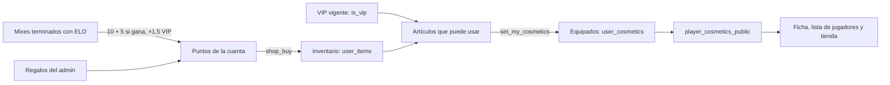

# Tienda de cosméticos en la web: documentación

## Qué hace

La web suma una **Tienda** donde cada jugador gasta los puntos que gana jugando mixes en los 308 cosméticos de `assets/perfil/`: marcos, stickers, temas y efectos de nombre. Lo que se pone se ve en su ficha y en la lista de jugadores. Cada uno puede subir una **portada** para su perfil. Los VIP usan los 154 artículos VIP sin gastar puntos y ganan ×1,5.

Va en la web actual (`index.html` + Supabase). El diseño, los nombres y las reglas son los del plan del backend ([`2026-10-29-tienda-puntos-backend`](../2026-10-29-tienda-puntos-backend/PLAN.md)), para que en el corte el replanteo y la API nueva los tomen tal cual.

## Puntos

- **No se anotan: se calculan.** `points_mixes_of(cuenta)` recorre los mixes de la ficha de la cuenta. Un mix cuenta si está terminado (`kind = 'mix'`, `status = 'finished'`), contó para el ELO (`elo_after` no nulo) y el jugador estuvo en el equipo 1 o 2 por su `player_id` o su `steam_id`. Es la misma regla que `widget_player` y `elo_apply_match`.
- Cada mix da `per_mix`, más `per_win` si su equipo ganó, por `vip_multiplier` si la cuenta era VIP **en la fecha del mix** (`was_vip`).
- **Saldo** = ganados + regalos del admin (`point_grants`, con motivo) − gastados (`user_items.price_paid`).
- **Correcciones automáticas:** si se borra un mix o se cambia `points_config`, el saldo se recalcula solo. Lo comprado se conserva aunque el saldo quede negativo, pero no se puede comprar hasta volver a positivo.
- **Sin ficha no hay puntos:** una cuenta sin ficha vinculada no suma, y la tienda le avisa que reclame su perfil.

| `points_config` | Valor inicial | Qué es |
|---|---|---|
| `per_mix` | 10 | Puntos por mix terminado |
| `per_win` | 5 | Extra si ganó |
| `vip_multiplier` | 1,5 | ×VIP (1 lo apaga) |
| `weekly_count` | 6 | Artículos en oferta por semana |
| `weekly_discount` | 25 | Descuento de las ofertas, en % |

## Tienda

- **Catálogo:** `shop_items` es el catálogo de `catalogo.json` (mismo `id`). Los SVG y el CSS siguen en `assets/perfil/`.
  - `price` en `null` significa que no se vende.
  - Los `vip_only` nunca tienen precio.
  - El admin cambia el precio y si el artículo está activo.
- **Precio de hoy:** `shop_catalog` lo calcula. Las **ofertas de la semana** (`shop_weekly`) son `weekly_count` artículos a la venta, mezclados con la semana ISO (hora de Bogotá) como semilla. Cambian solas cada lunes y no hace falta ningún trabajo programado.
- **Precios iniciales:**

  | Tipo | Counter-Strike | Otras colecciones |
  |---|---|---|
  | Sticker | 150 | 200 |
  | Nombre | 500 (600 si es animado) | 400 |
  | Tema | 700 | 600 |
  | Marco | 900 (1200 si es animado) | 1000 (países) o 900 (mapas) |

- **Comprar:** `shop_buy(item)` usa un lock por cuenta, así que dos clics no gastan dos veces. Rechaza con un mensaje claro si no estás logueado, si el artículo no existe o está inactivo, si es VIP, si no está a la venta, si ya lo tenés o si te faltan puntos.
- **Equipar:** `set_my_cosmetics(datos)` cambia `frame`, `theme`, `name` y `stickers` (hasta 3). Las claves que no vienen no se tocan. Cada artículo tiene que ser del tipo correcto y podés usarlo si lo tenés o si es VIP y sos VIP hoy (`can_use_item`).
- **Lo que se ve:** `player_cosmetics_public` muestra lo equipado de cada ficha con cuenta, **sin lo que ya no puede usar**, como lo VIP vencido o un artículo que el admin quitó. Es pública.

## La página Tienda (`#shop`)

- **Arriba, la vista previa:** tu avatar con marco, tu nombre con efecto, el tema y los stickers. Muestra lo que tenés puesto; "Probar" (o tocar una tarjeta) superpone el artículo sin comprarlo.
- **Al lado:** el saldo, ganados, regalos y gastados, cómo se ganan los puntos, el historial (`my_points_history`) y un acceso a Mi perfil.
- **Banner VIP:** a los VIP les confirma lo que tienen. A los demás les cuenta qué da el VIP y que se pide a un admin.
- **Ofertas de la semana:** con el precio tachado y la fecha de fin.
- **Catálogo:**
  - Pestañas por tipo y botones por colección, con cantidades.
  - Búsqueda.
  - "Mostrar": todo, puedo comprar, lo mío, solo VIP o para todos.
  - "Ordenar": destacados, más baratos, más caros o nombre.
- **Cada tarjeta:** vista previa, nombre, si es animado o VIP, colección, precio y "te faltan N puntos (≈ M mixes)". Los botones son Comprar (con confirmación), Equipar o Sacar, y Probar.
- **Sin sesión:** se ve todo, y para comprar pide ingresar.
- **Sin la migración aplicada:** muestra "La tienda todavía no está disponible" y no rompe el resto de la web.

## Perfil

- **Mi perfil → Portada y personalización:**
  - La portada se sube y se recorta a 1200 × 300 en JPG de menos de 1 MB.
  - Va a `avatars/<uid>/cover-*.jpg`, con las políticas que ya tenía el bucket, y se guarda en `profile_details.cover_url`.
  - Hay botones para quitarla, ir a la tienda y ver lo que tenés puesto.
- **Ficha del jugador:**
  - La portada arriba.
  - El avatar con el marco y el nombre con su efecto y la etiqueta VIP.
  - Los stickers junto a las redes.
  - El tema tiñe la cabecera y el cuerpo de la ficha: la clase `cos-tema` pasa `--primary`, `--card`, `--muted` y `--border` a los colores de la web vieja.
- **Lista de jugadores:** el marco, el efecto de nombre y la etiqueta VIP.

## Admin → Tienda (`#shadm`)

- **Puntos:** los cinco valores de `points_config`, con aviso de que cambian el saldo de todos.
- **Cuentas:** saldo, ganados, regalos, gastados, mixes, artículos, VIP y portada. Las acciones son:
  - ± Puntos (`admin_points_grant`, con motivo).
  - Regalar un artículo (`admin_item_grant`) o quitarlo (`admin_item_revoke`, con motivo; también se lo saca de lo equipado).
  - Quitar la portada (`admin_cover_clear`, con motivo).
  - Dar o quitar el VIP (`admin_vip_grant` y `admin_vip_revoke`, del backend).
- **Catálogo:** precio (vacío = no se vende) y activo, con búsqueda.

## VIP

Se reutiliza la migración del backend, `supabase/migrations/20261028120000_vip.sql`, copiada tal cual de `feat/backend-api-fase-1`. Fue escrita para la web vieja: solo usa `profiles`, `players` e `is_admin()`. La tienda usa `is_vip()`, `vip_memberships` (en `was_vip`) y `vip_public` (la etiqueta VIP de la lista y la ficha). Hasta ahora la web vieja no tenía forma de dar VIP; Admin → Tienda la suma.

## Para el corte al backend nuevo

- **Replanteo `34_tienda.sql`:** puede partir de esta migración. Hay que cambiar la regla de "mix del jugador" por `elo_key()`, excluir `mix_deletions` y sumar los avisos con `notify()` (`points_granted`, `item_granted` e `item_revoked`).
- **API:** las rutas del plan del backend (`/shop/items`, `/me/points`, `/me/cosmetics`…) leen estas mismas tablas y funciones.
- **Archivos:** `assets/perfil/` se copia a `web/frontend/public/cosmetics/`.
