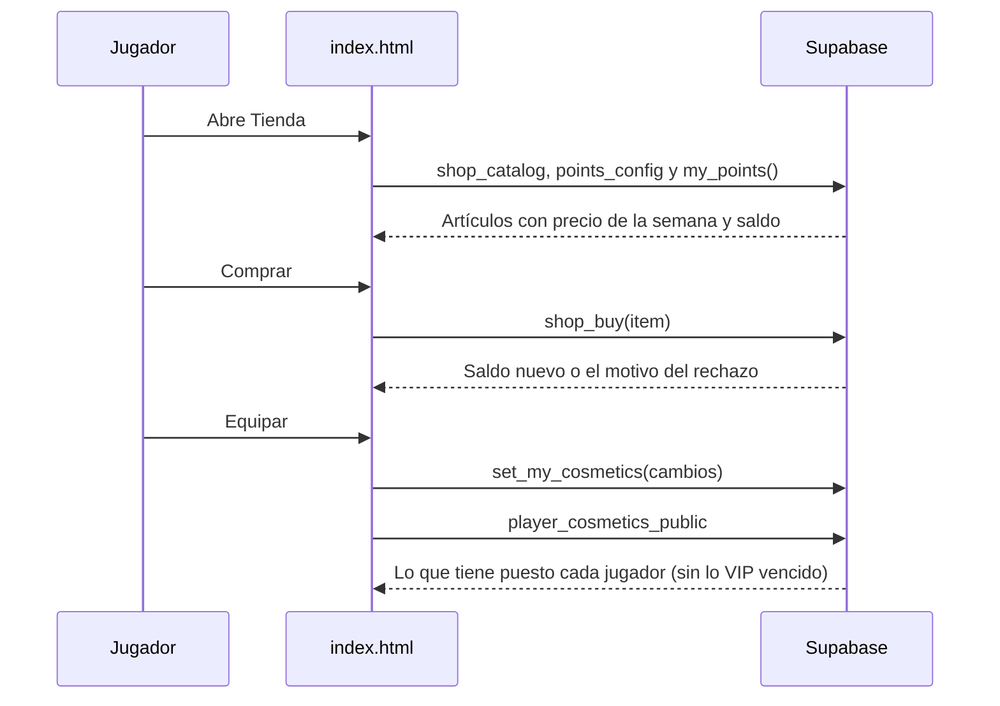

# Plan: tienda de cosméticos en la web

> Planeación original. Estado: **aprobado por Kyan** (2026-10-29: "hacelo todo… crea la sección de tienda y todo lo relacionado, lo más completo posible" y "hacelo teniendo en cuenta las cosas como están hechas en el backend y reutiliza todo lo de ahí").

Los 308 cosméticos de `assets/perfil/` tienen que llegar a los jugadores: ganar puntos jugando, comprar, tener un inventario, equiparse cosas y que se vean en el perfil, en la lista de jugadores y en la ficha. Esto va en la **web actual** (`index.html` + Supabase), porque el backend nuevo (`feat/backend-api-fase-1`) y el frontend nuevo todavía no están en producción.

El diseño sale del plan del backend, [`2026-10-29-tienda-puntos-backend`](../2026-10-29-tienda-puntos-backend/PLAN.md), con los mismos nombres de tablas y funciones. Así, en el corte, el replanteo `34_tienda.sql` y la API los toman sin rehacer nada.

## Qué se reutiliza del backend

| De `feat/backend-api-fase-1` | Cómo se usa acá |
|---|---|
| `supabase/migrations/20261028120000_vip.sql` (VIP fase 0) | Se trae **tal cual** a esta rama. Fue escrita para la web vieja: solo usa `profiles`, `players` e `is_admin()`. Da `vip_memberships`, `is_vip()`, `admin_vip_grant`, `admin_vip_revoke`, `vip_status` y `vip_public` |
| Diseño de la tienda (plan del backend) | `points_config`, `shop_items`, `user_items`, `point_grants`, `user_cosmetics`, `was_vip`, `shop_buy`, `set_my_cosmetics`, `admin_points_grant`, `admin_item_grant`, `admin_item_revoke`, `admin_shop_item_update` y `set_points_config`, con las mismas reglas |
| Patrones de la base | Funciones `security definer` con `is_admin()`, lock por cuenta con `pg_advisory_xact_lock`, RLS de "cada uno lee lo suyo y los admins todo", motivo obligatorio y nada se borra |
| Regla de "mix del jugador" | La de `widget_player` y `elo_apply_match`: su `player_id` o su `steam_id`, equipo 1 o 2, `matches.winner` |
| Bucket `avatars` | La portada va en `avatars/<uid>/`, con las políticas que ya existen |

**Lo que no se puede reutilizar todavía:**
- `elo_key()` y `mix_deletions` son del replanteo y no están en producción, así que se usa la regla del widget.
- `notify()` tampoco está, así que en esta etapa no hay avisos.

## Decisiones tomadas

Las preguntas abiertas del plan del backend se resuelven con sus propuestas. Todo queda en `points_config`, así que se cambia sin migración.

| Tema | Decisión |
|---|---|
| Puntos por mix | 10 por jugado y 5 más por ganado |
| VIP | ×1,5 en los mixes jugados mientras era VIP (en la fecha del mix) |
| Mixes viejos | Cuentan todos, desde el primero, para que nadie arranque en cero |
| PCW y torneos | No cuentan; solo los mixes terminados que contaron para el ELO (`elo_after` no nulo) |
| Artículos VIP | No se compran: se usan mientras la cuenta es VIP. Si vence, dejan de mostrarse solos |
| Precios | Por tipo y colección: stickers 150 a 200; nombres 400 a 600; temas 600 a 700; marcos 900 a 1200. Los VIP, sin precio |
| Ofertas de la semana | 6 artículos al azar por semana con 25 % de descuento, calculados en la base a partir de la semana (sin trabajos programados) |
| Portada | `profile_details.cover_url`, subida por el jugador (se recorta a 1200 × 300). El admin la puede quitar con motivo |
| Saldo negativo | Se conserva lo comprado y no se puede comprar hasta volver a positivo |
| Plata real | No hay. Lo pago sigue siendo el VIP |

## 1. El flujo completo

## 2. Base de datos

- `supabase/migrations/20261028120000_vip.sql`: copiado del backend.
- `supabase/migrations/20261029180000_tienda.sql`: tablas, vistas y funciones de arriba, más:
  - `shop_catalog` con el precio de la semana.
  - `player_cosmetics_public`.
  - `my_points()` y `my_points_history()`.
  - `admin_points_overview`, `admin_user_points(p_user)` y `admin_cover_clear`.
  - Carga de los 308 artículos con sus precios.

## 3. Web (`index.html`)

- **Tienda** (menú nuevo):
  - Saldo y cómo se ganan los puntos.
  - Ofertas de la semana.
  - Filtros por tipo y colección, búsqueda, "Puedo comprar" y "Lo mío".
  - Vista previa con tu avatar y tu nombre, y "te faltan N mixes".
  - Comprar con confirmación, y equipar o sacar.
  - Banner VIP con lo que da.
  - Historial de puntos.
- **Mi perfil:** subir y quitar la portada, y el acceso a la tienda.
- **Ficha del jugador:** portada, marco, efecto de nombre, tema y stickers.
- **Lista de jugadores:** marco y efecto de nombre.
- **Admin → Tienda:**
  - Puntos por mix, por victoria, ×VIP y ofertas.
  - Precios y artículos activos.
  - Cuentas: saldo, regalar o restar puntos, regalar o quitar artículos, quitar la portada, y dar o quitar VIP.
- `assets/perfil/cosmeticos.css` se carga desde `index.html`.

## 4. Requisitos antes de empezar

Ninguno para escribirlo. Para publicarlo: correr las dos migraciones en el SQL Editor y subir `index.html` con `assets/perfil/`.

## 5. Orden de implementación

1. Traer la migración VIP y escribir la de la tienda, con la carga del catálogo generada desde `catalogo.json`.
2. Probar la migración en un Postgres local, si hay; si no, revisarla a mano.
3. Tienda en `index.html`.
4. Cosméticos en el perfil, la ficha y la lista de jugadores.
5. Admin → Tienda.
6. Probar la web en local, con la Supabase real solo para leer (sin la migración aplicada la tienda tiene que avisar y no romper nada).
7. Documentación, guía y changelog.
