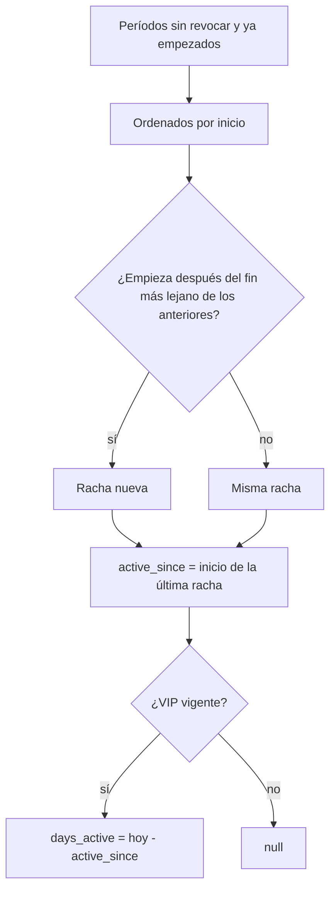

# Documentación: días que lleva cada usuario como VIP

## Qué hace

La vista `public.vip_status` (una fila por cuenta que fue VIP alguna vez) trae dos columnas nuevas al final:

| Columna | Tipo | Qué dice |
|---|---|---|
| `active_since` | `timestamptz` | Desde cuándo es VIP sin cortes (la racha actual). Null si hoy no es VIP |
| `days_active` | `int` | Días que lleva como VIP en esa racha, en fechas de Colombia. El día de la compra es 0: comprado el 25, el 29 lleva 4. Null si hoy no es VIP |

No hay nada guardado: se calcula al leer, así que suma un día sola a la medianoche de Colombia. Las dos webs leen la misma base: la vieja puede consultar la vista directo y la nueva la lee por la API.

## Cómo se arma la racha

| Caso | `days_active` |
|---|---|
| Lifetime comprado hace 4 días | 4 |
| Un mes hace 40 días, extendido donde terminaba | 40 (la extensión no reinicia) |
| Temporal hace 30 días y lifetime encima hace 5 | 30 (sigue la racha) |
| VIP vencido hace meses y vuelto a dar hace 7 días | 7 (`since` sigue siendo la primera vez) |
| Revocado o vencido | null |

Los períodos revocados no cuentan. Los permisos no cambian: el dueño ve su fila y los admins, todas.

## Archivos

- `supabase/migrations/20261029120000_vip_dias.sql`: la vista con las dos columnas. Necesita `20261028120000_vip.sql`.
- `pruebas/vip_dias.sql`: 7 pruebas con rollback.
