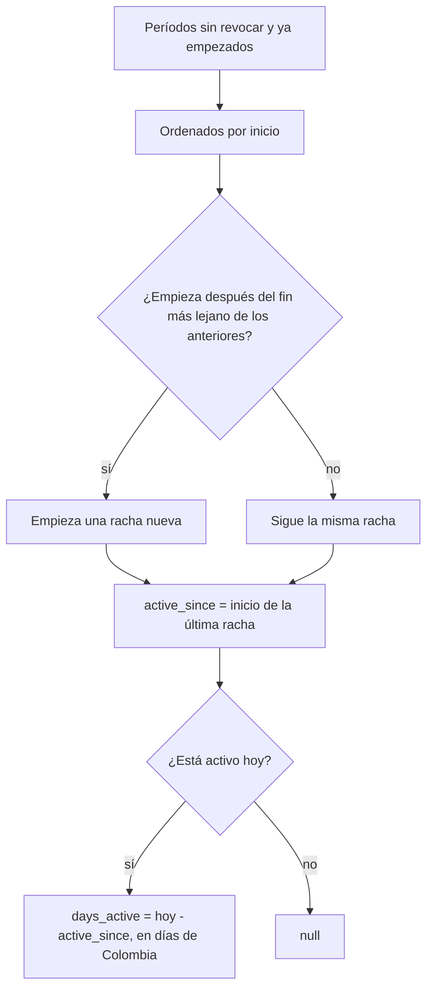

# Plan: días que lleva cada usuario como VIP

> Planeación original. Estado: **pedido por Daniel el 2026-10-29** e implementado en la misma sesión.

Daniel pidió una columna con los días que lleva cada usuario como VIP. Si compró lifetime, cuenta desde el día en que lo compró y suma 1 cada día: si lo compró el 25, el 29 lleva 4 días. Va como **migración** porque la base es la misma para la web vieja y la nueva.

## Decisiones tomadas

| Tema | Decisión | Por qué |
|---|---|---|
| Dónde va | Dos columnas nuevas al final de la vista `vip_status`: `active_since` y `days_active` | Es la vista que ya trae el estado VIP de cada cuenta (el dueño ve la suya; los admins, todas). Sin tabla ni columna guardada: se calcula al leer, así suma sola cada día |
| Desde cuándo cuenta | Desde el inicio de la **racha actual**: los períodos sin revocar, ya empezados, que se tocan o se pisan sin cortes, hasta el vigente | Una extensión empieza donde termina el anterior, así que pagar a tiempo no reinicia la cuenta. Si el VIP venció o se quitó y después se volvió a dar, cuenta desde la vuelta |
| Lifetime | Cuenta desde que empezó la racha. Si ya era VIP temporal y le dieron lifetime, sigue contando desde el temporal | Sigue siendo VIP sin cortes |
| Cómo se cuentan los días | Diferencia de fechas en hora de Colombia (`America/Bogota`): el día en que lo compró es 0 | Igual al ejemplo de Daniel (25 → 29 = 4) y a cómo se muestran las fechas en el resto del VIP |
| Sin VIP vigente | `active_since` y `days_active` en null | No lleva días como VIP hoy. `since` sigue diciendo cuándo empezó la primera vez |
| Períodos revocados | No cuentan | Quitar el VIP revoca todo lo vigente: la racha se corta ahí |
| API y frontend nuevo | Fuera de esta migración: se suma `days_active` a `GET /admin/vips` y `/me/profile` cuando Daniel lo pida | La vista ya lo deja listo para las dos webs |

## 1. El flujo completo

## 2. Base de datos

Migración `supabase/migrations/20261029120000_vip_dias.sql`: `create or replace view public.vip_status` igual a la de `20261028120000_vip.sql`, con las dos columnas al final. Los permisos de la vista no cambian. Re-ejecutable.

El replanteo no redefine `vip_status`, así que no hay que tocarlo.

## 3. Pruebas

`pruebas/vip_dias.sql`, sobre la Supabase local con rollback: lifetime comprado hace 4 días, temporal extendido sin cortes, lifetime dado sobre un temporal, VIP vencido y vuelto a dar, revocado y vencido.

## 4. Requisitos antes de empezar

Ninguno: la migración `20261028120000_vip.sql` ya está en producción.

## 5. Orden de implementación

1. Migración.
2. Pruebas en local.
3. Documentación y fila en `bitacora/README.md`.
4. Aplicar en producción (Supabase › SQL Editor), cuando Daniel lo diga.
