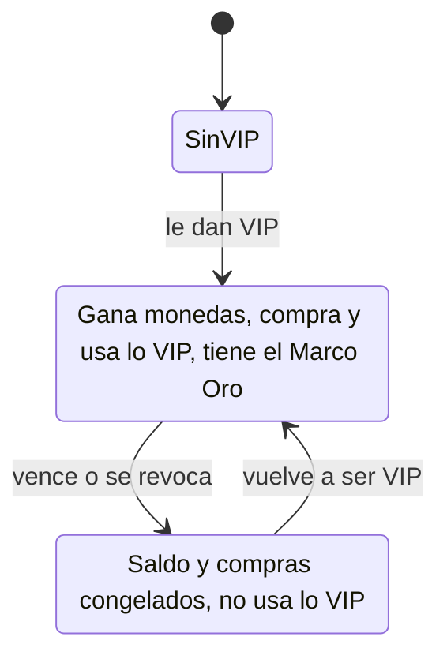

# Progresión VIP con moneda propia: documentación

## Cómo funciona

- **Al ser VIP:** se desbloquea solo el **Marco Oro VIP**.
- **El resto de lo VIP** (los 166 artículos de Series míticas, Arsenal, fondos y demás) se compra con **monedas VIP**.

| | Puntos | Monedas VIP |
|---|---|---|
| Quién las gana | Todos | Solo en mixes jugados siendo VIP |
| Cuánto (default) | 10 por mix + 5 por victoria | 10 por mix + 5 por victoria |
| Configurable en | `per_mix`, `per_win` | `vip_per_mix`, `vip_per_win` |
| Qué compran | Artículos para todos | Artículos VIP (`vip_price`) |
| ×VIP | Ya no: `vip_multiplier = 1`, aunque sigue configurable | No aplica |
| Regalos del admin | `admin_points_grant` | `admin_vip_coins_grant` |

Ninguna de las dos monedas se anota en una tabla de saldos. Se calculan a partir de los mixes terminados con ELO (`points_mixes_of`), los regalos (`point_grants`) y las compras (`user_items`). Por eso, si un admin cambia cuánto se gana, cambia el saldo de todos, también hacia atrás.

## Si se vence el VIP

- **Saldo:** no se pierde. No se puede gastar y no crece.
- **Artículos VIP comprados:** siguen en el inventario, pero `can_use_item` devuelve falso. Por eso `player_cosmetics_public` no los muestra y el perfil vuelve a verse sin ellos.
- **Al volver a ser VIP:** todo vuelve a funcionar, sin hacer nada.

## Base de datos (`20261029210000_vip_progresion.sql`)

| Objeto | Cambio |
|---|---|
| `points_config` | `vip_per_mix`, `vip_per_win`; `vip_multiplier` pasa a 1 |
| `shop_items` | `vip_price`, que solo pueden tener los artículos VIP, y `vip_reward`, que se usa sin comprarlo |
| `user_items`, `point_grants` | `currency`: `'points'` o `'vip'` |
| `points_of`, `my_points_history` | Cuentan solo `currency = 'points'` |
| `vip_coins_mixes_of`, `vip_coins_of` | Internas: mixes y saldo de monedas VIP |
| `my_vip_coins()`, `my_vip_coins_history()` | Saldo e historial de la propia cuenta, o de cualquiera si pide un admin |
| `can_use_item` | Premio VIP: siendo VIP. Lo demás: si lo tiene, y si es VIP, solo siendo VIP hoy |
| `shop_buy` | Lo VIP se compra con monedas VIP y siendo VIP, sin oferta semanal. Devuelve `currency` |
| `shop_catalog` | Suma `vip_price` y `vip_reward` al final |
| `admin_item_grant` | Ahora también regala artículos VIP. El Marco Oro VIP no se regala, viene con el VIP |
| `admin_shop_item_vip_price`, `set_vip_coins_config` | Precio VIP de un artículo y monedas por mix y por victoria |
| `admin_points_overview` | Suma `vip_earned`, `vip_granted`, `vip_spent` y `vip_balance`. Se borra y se recrea porque cambia lo que devuelve |

**Carga:**
- `marco-vip-oro`, de la colección `vip`.
- Los precios VIP, que solo se ponen donde todavía no hay: stickers 200, nombres 500, temas 600, marcos y fondos 1000.

## Frontend nuevo (demo `/demo/tienda`)

- **Cabecera:**
  - el saldo de monedas VIP, en dorado;
  - "Congeladas" si no sos VIP;
  - cuánto se gana de cada moneda.
- **Tarjetas VIP:**
  - el precio en monedas VIP;
  - Comprar, solo siendo VIP;
  - "Congelado: se usa siendo VIP" si lo tenés pero no sos VIP;
  - el Marco Oro VIP dice "Incluido con tu VIP" o "Viene con el VIP".
- **Historial:** puntos y monedas juntos; las monedas VIP salen en dorado.
- **Administración:**
  - monedas VIP por mix y por victoria;
  - columna de monedas VIP;
  - botón "+100 VIP";
  - el precio de los artículos VIP se edita en monedas VIP.
- **Barra del demo:** "Regalo de 300 VIP". Arranca con 40 mixes jugados siendo VIP y el VIP vencido, para ver las monedas congeladas. Con "Ser VIP" se descongelan.
