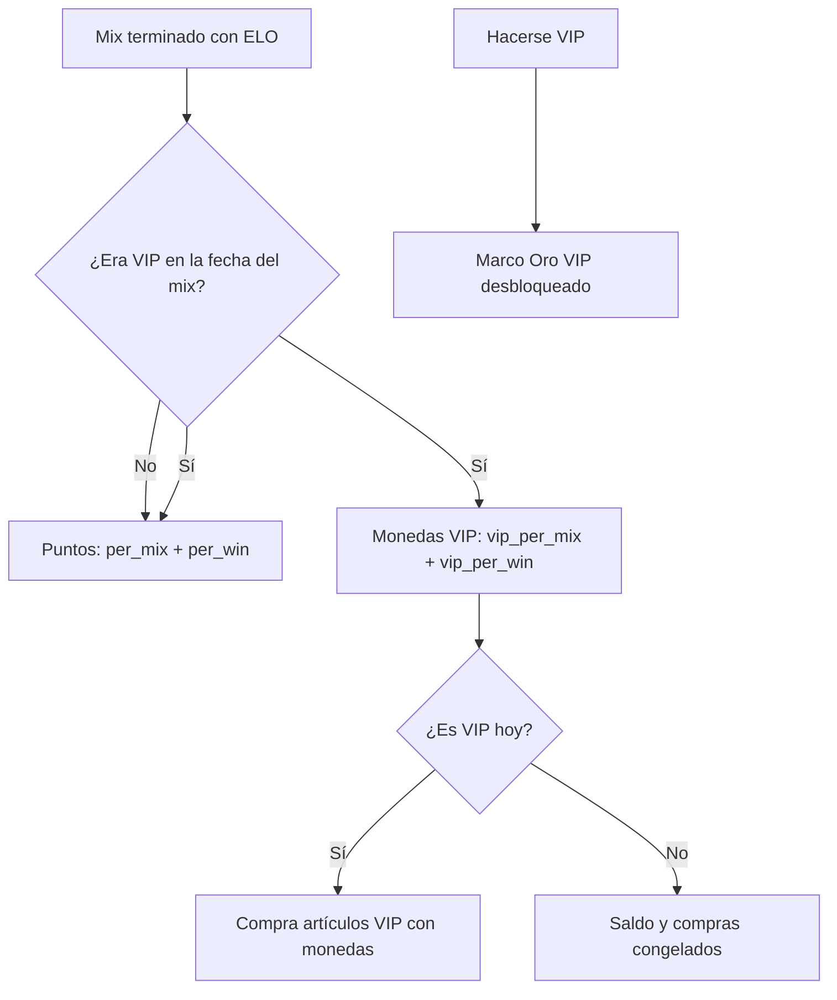

# Plan: progresión VIP con moneda propia

> Planeación original. Estado: **propuesta**, pedida por Kyan el 2026-10-29. Las decisiones las eligió Kyan.

Hasta ahora, ser VIP habilitaba todos los artículos VIP de una vez y multiplicaba los puntos ×1,5. Con este cambio el VIP también tiene que progresar:

- Al hacerse VIP se desbloquea **solo el Marco Oro VIP**.
- El resto de los artículos VIP se **compra con monedas VIP**. Se ganan igual que los puntos, por mix y por victoria, pero solo en los mixes jugados siendo VIP.
- Cuánto se gana es configurable, como los puntos.

## Decisiones tomadas

| Tema | Decisión | Por qué |
|---|---|---|
| Qué desbloquea el VIP | Solo el Marco Oro VIP (`marco-vip-oro`, `vip_reward = true`) | Lo pidió Kyan: el resto se gana jugando. |
| Artículos VIP | Se compran con monedas VIP, a precio `vip_price` | Opción elegida por Kyan, en lugar de desbloquear por nivel. |
| Cómo se gana | `vip_per_mix` (10) por mix terminado con ELO, y `vip_per_win` (5) extra por victoria, solo en los mixes en los que la cuenta era VIP (`was_vip` a la fecha del mix) | La misma regla que los puntos (`points_mixes_of`). |
| Configurable | `vip_per_mix` y `vip_per_win` en `points_config`. Se cambian con `set_vip_coins_config`. Los precios se cambian con `admin_shop_item_vip_price` | Igual que los puntos. Al cambiar la configuración cambia el saldo de todos, porque se calcula, no se anota. |
| VIP vencido | Se congela: no puede usar lo VIP comprado ni ganar monedas VIP. Al volver a ser VIP recupera lo comprado y el saldo | Opción elegida por Kyan. |
| Puntos normales | Los VIP ganan los puntos como todos, sin ×1,5 (`vip_multiplier = 1`) | Opción elegida por Kyan. La columna queda para poder volver a subirla. |
| Regalos y correcciones | `admin_vip_coins_grant`, con motivo, en `point_grants` con `currency = 'vip'` | Igual que `admin_points_grant`. |
| Base | Migración nueva, `20261029210000_vip_progresion.sql`, que redefine las funciones de la tienda | Las migraciones de la tienda todavía no están en producción, pero ya están commiteadas. |

## 1. El flujo completo

## 2. Base de datos (`20261029210000_vip_progresion.sql`)

- **`points_config`:**
  - columnas nuevas `vip_per_mix` (10) y `vip_per_win` (5);
  - `vip_multiplier` pasa a 1 (valor y default).
- **`shop_items`:**
  - `vip_price int`: el precio en monedas VIP. Solo pueden tenerlo los artículos `vip_only`.
  - `vip_reward boolean`: el artículo que se desbloquea solo por ser VIP.
- **`user_items` y `point_grants`:** `currency` (`'points'` o `'vip'`), con default `'points'`.
- **Funciones de puntos:**
  - `points_of` cuenta solo lo de `currency = 'points'`.
  - `vip_coins_mixes_of` y `vip_coins_of` son el equivalente con monedas VIP.
  - `my_vip_coins()` y `my_vip_coins_history()` son para la propia cuenta, o la que pida un admin.
- **`can_use_item`:** un artículo se puede usar si se cumple una de estas:
  - es `vip_reward` y la cuenta es VIP;
  - lo tiene y no es VIP;
  - lo tiene, es VIP y la cuenta es VIP hoy.
- **`shop_buy`:** los artículos VIP se pueden comprar siendo VIP, con monedas VIP y a `vip_price`. Los VIP no entran en las ofertas de la semana.
- **`shop_catalog`:** suma `vip_price` y `vip_reward` al final.
- **Admin:** `admin_vip_coins_grant`, `set_vip_coins_config` y `admin_shop_item_vip_price`.
- **Carga:**
  - el Marco Oro VIP;
  - `vip_price` en los artículos VIP: stickers 200, nombres 500, temas 600, marcos y fondos 1000.

## 3. Assets

- **Marco Oro VIP:** `pruebas/generar_vip.py` lo dibuja en `assets/perfil/marcos/vip-oro.svg`.
- **Catálogo:** el mismo script lo suma a `catalogo.json` (versión 8), con `vip_price` y `vip_reward`.
- **Frontend nuevo:** se copia a `public/cosmetics/`.

## 4. Frontend nuevo (demo de la tienda)

- **Tipos:**
  - `ShopItem` suma `vip_price` y `vip_reward`;
  - `PointsConfig` suma `vip_per_mix` y `vip_per_win`;
  - `Points` suma las monedas VIP.
- **Tienda:**
  - el saldo de monedas VIP aparece al lado del de puntos;
  - las tarjetas VIP muestran el precio en monedas VIP y el botón Comprar siendo VIP;
  - el Marco Oro VIP dice "Incluido con tu VIP";
  - el historial distingue puntos de monedas VIP.
- **Admin:**
  - monedas por mix y por victoria;
  - regalo de monedas VIP;
  - el precio VIP en el catálogo.
- **Barra del demo:** suma "Regalo de 300 monedas VIP".

## 5. Requisitos antes de empezar

Ninguno: todo se prueba con el demo.

## 6. Orden de implementación

1. Migración.
2. Marco Oro VIP y catálogo.
3. Tipos y demo.
4. Tienda y admin.
5. `tsc`, `eslint` y prueba en `/demo/tienda`.

La web vieja (`index.html`) no se toca en esta tanda. Su tienda sigue con la regla anterior hasta que se porte.
